# Kenapa Deploy Itu Menakutkan

::: info Prasyarat Modul
Modul ini lanjutan dari Docker. Kamu sudah bisa menulis Dockerfile, menjalankan Compose, dan memakai Git dasar. Kalau belum semuanya, tidak masalah: halaman ini dimulai dari cerita.
:::

---

## Dua Insiden, Satu Pola

Sebelum kita bahas teknik *deployment*, mari kita lihat dua kejadian nyata yang bikin satu industri belajar dengan cara paling mahal.

### 1. Knight Capital (1 Agustus 2012)

Dalam waktu sekitar **45 menit**, perusahaan *trading* ini rugi lebih dari **\$460 juta** (4 juta eksekusi di 154 saham, total lebih dari 397 juta saham). Penyebabnya? Bukan karena *bug* algoritma yang rumit, tapi urusan *deploy* manual:

* Sejak 27 Juli, kode baru dipasang bertahap ke delapan server.
* Menurut laporan [SEC](https://contracts.justia.com/companies/kcg-holdings-inc-18985/contract/555902), satu orang teknisi kelupaan menyalin kode baru ke salah satu server. Tidak ada teknisi kedua yang mengecek karena memang tidak ada prosedur tertulis yang mewajibkannya.
* Server yang ketinggalan itu masih menyimpan kode lama bernama **Power Peg**. Kode ini sudah mati sejak 2003, tapi tidak pernah dihapus.
* Apesnya, *flag* yang dulu dipakai untuk menyalakan Power Peg ternyata dipakai ulang oleh kode yang baru. Begitu sistem jalan, server yang tertinggal ini langsung mengeksekusi transaksi gila-gilaan.

### 2. CrowdStrike (19 Juli 2024)

Kalau kamu ingat layar biru massal (*Blue Screen of Death*) yang bikin bandara dan rumah sakit lumpuh di seluruh dunia, ini biang keroknya:

* Satu pembaruan konten (**Channel File 291**) dikirim membawa **21 *input field***, padahal sensor di lapangan cuma mengharapkan **20**.
* Akibatnya terjadi *out-of-bounds memory read* dan sistem langsung *crash* seketika.
* Dari laporan investigasi [(RCA) CrowdStrike](https://crowdstrike.com/wp-content/uploads/2024/08/Executive-Summary_Root-Cause-Analysis_Channel-File-291.pdf) sendiri, mereka akhirnya memperketat proses rilis lewat *deployment rings* (wajib lolos tahap kecil berurutan sebelum dilepas ke semua server) serta memberi kendali ke pelanggan untuk mengatur sendiri kapan pembaruan itu dipasang.

### Benang Merah

Dua kejadian di atas **bukan** cerita tentang kode yang jelek. Keduanya adalah cerita tentang **cara kode itu sampai ke produksi**:

1. Tidak ada yang memastikan kondisi semua server benar-benar sama.
2. Tidak ada tahap kecil untuk menguji dampak sebelum dilepas ke tahap besar.

> **Definisi ulang *deployment*:**
>
> *Deploy* bukan sekadar menyalin file kode ke server, tapi **mengganti versi aplikasi yang sedang melayani *traffic* tanpa ada user yang sadar.**

## CI, Continuous Delivery, dan Continuous Deployment
Tiga istilah ini sering dipakai bergantian, padahal menjawab pertanyaan yang berbeda.

| Istilah | Pertanyaan yang Dijawab | Siapa yang Menekan Tombol Produksi? |
| :--- | :--- | :--- |
| **Continuous Integration (CI)** | Apakah perubahan ini masih menyatu dengan kode lain dan lolos *test*? | Tidak ada (CI cuma urusan *build* dan *test*) |
| **Continuous Delivery** | Apakah setiap perubahan sudah siap dirilis kapan saja? | **Manusia** (butuh persetujuan/klik manual) |
| **Continuous Deployment** | Apakah setiap perubahan yang lolos otomatis langsung dirilis? | **Tidak ada manusia** (otomatis penuh) |

**Analogi pabrik roti:** 
* **CI** memastikan adonan tidak gagal mengembang. 
* **Continuous Delivery** berarti roti sudah matang dan siap di rak, tinggal kasir yang memutuskan kapan mau dijual. 
* **Continuous Deployment** berarti roti langsung masuk etalase detik itu juga begitu keluar dari oven.

---

## Kenapa Rilis Sering Justru Lebih Aman?

Intuisi kita biasanya bilang: *makin jarang rilis, makin aman*. Kenyataannya justru terbalik.

Bab *Release Engineering* di [**Google SRE Book**](https://sre.google/sre-book/release-engineering/) menjelaskan bahwa rilis yang sering menghasilkan perubahan (*diff*) yang jauh lebih kecil antar versi, sehingga proses *testing* dan *troubleshooting* jadi gampang. Bayangkan rilis sebulan sekali yang membawa seribu perubahan; begitu *error* di produksi, kamu seperti mencari jarum di tumpukan seribu jerami.

Untuk mengukur performa pengiriman kode ini, [**DORA**](https://dora.dev/guides/dora-metrics-four-keys) kini memakai **lima metrik** (banyak artikel lama masih menyebut empat):

| Kelompok | Metrik | Artinya |
| :--- | :--- | :--- |
| **Throughput** | *Change lead time* | Waktu dari *commit* kode sampai berjalan di produksi. |
| **Throughput** | *Deployment frequency* | Seberapa sering tim melakukan *deploy*. |
| **Throughput** | *Failed deployment recovery time* | Waktu pulih dari *deployment* gagal yang butuh penanganan segera. |
| **Instabilitas** | *Change fail rate* | Persentase *deployment* yang berujung masalah dan butuh penanganan segera (*rollback*, *hotfix*). |
| **Instabilitas** | *Deployment rework rate* | Persentase *deployment* tak terencana akibat insiden di produksi. |

*(Catatan: Metrik pemulihan yang dulu dikenal sebagai **MTTR** kini berganti nama menjadi **Failed Deployment Recovery Time**.)*

---

## Satu Artifact, Banyak Lingkungan
Prinsip pertama *pipeline* yang sehat adalah: **build sekali, deploy berkali-kali.**

Hasil *build* yang sudah diuji di CI harus **byte-per-byte sama** dengan yang berjalan di produksi. Kalau kamu melakukan *build* ulang untuk tiap lingkungan (*dev*, *staging*, *prod*), berarti barang yang kamu uji sebenarnya **bukan** barang yang kamu rilis.

**SRE Book** punya dua gagasan penting soal ini:
1. ***Hermetic build*:** Proses *build* hanya bergantung pada versi *tool* dan dependensi yang sudah dikunci, bukan pada isi mesin tempat dia di-*build*. Hasilnya, revisi kode yang sama akan selalu menghasilkan keluaran yang identik.
2. **Penamaan berbasis *hash*:** Paket rilis diberi versi *hash* yang unik. Label seperti `dev`, `canary`, atau `production` hanyalah penanda posisinya dalam alur rilis, bukan nama file yang berbeda.

Untuk *image* Docker, aturan mainnya sederhana: **tandai *image* dengan SHA *commit*, dan *deploy* memakai *digest* (`image@sha256:...`)** yang isinya mustahil diubah.

::: warning **💡 Tip: Tag itu penunjuk, digest itu isi**

 *Tag* seperti `:latest` itu cuma label tempelan yang bisa dipindahkan ke *image* lain kapan saja. Sebaliknya, *digest* dihitung langsung dari isi *image*-nya, jadi rujukan `@sha256:...` akan selalu menunjuk ke barang yang persis sama. Ingat catatan *"Pin versinya"* di lab RustFS? Alasannya persis sama.
:::
### Kebiasaan Lama vs. Praktik Sehat

| Kebiasaan | Kenapa Bermasalah? | Gantinya |
| :--- | :--- | :--- |
| **Deploy `:latest`** | Isinya bisa berubah diam-diam; tidak ada patokan "versi kemarin" untuk *rollback*. | *Tag* pakai SHA *commit*, *deploy* pakai *digest*. |
| **Build ulang per lingkungan** | Barang yang diuji di *staging* bukan barang yang dirilis ke produksi. | Satu *build*, banyak *deploy*. |
| **Config dibakar ke *image*** | *Image* tidak bisa dipakai di lingkungan lain, dan rahasia (URL DB, *secret key*) tertinggal di *layer* Docker. | Masukkan *config* dan *secret* saat *runtime* (lewat *environment variables*). |
| **Base image tanpa pin** | Hasil *build* hari ini bisa beda dengan *build* bulan depan karena *base image*-nya diam-diam update. | *Pin* ke *tag* versi spesifik, atau sekalian pakai *digest*. |

---

## Latihan

1. Pilih salah satu insiden di awal halaman (Knight Capital atau CrowdStrike). Sebutkan **dua kontrol** yang bisa mencegah kejadian itu, dan jelaskan di tahap *pipeline* mana kontrol tersebut seharusnya berada.
2. Jelaskan dengan bahasamu sendiri perbedaan antara **tag** dan **digest** pada Docker. Kenapa `:latest` tidak bisa dijadikan dasar untuk *rollback*?
3. Tim A rilis setiap hari, sementara Tim B rilis sebulan sekali. Siapa yang punya *diff* (selisih perubahan) lebih kecil per rilis, dan apa dampaknya saat terjadi *debugging* di produksi?

---

## Referensi

* [SEC Order terhadap Knight Capital Americas LLC (16 Oktober 2013)](https://contracts.justia.com/companies/kcg-holdings-inc-18985/contract/555902)
* [CrowdStrike: *Root Cause Analysis Channel File 291*, Ringkasan Eksekutif (PDF)](https://crowdstrike.com/wp-content/uploads/2024/08/Executive-Summary_Root-Cause-Analysis_Channel-File-291.pdf)
* [Google SRE Book, Bab 8: *Release Engineering*](https://sre.google/sre-book/release-engineering/)
* [DORA: *Software Delivery Performance Metrics*](https://dora.dev/guides/dora-metrics-four-keys)