# Strategi Deploy: Mengganti Mesin Saat Mesin Berjalan

::: info **Prasyarat Modul**
Kamu diasumsikan sudah paham konsep *image*, *tag*, dan *artifact* dari halaman sebelumnya, serta cara kerja *reverse proxy* secara garis besar. Halaman ini khusus membahas konsepnya dulu. Pipeline yang menayangkan versi baru kamu praktikkan di Halaman 5, dan cara mengamankannya dibahas di Halaman 4.
:::

Bayangkan kamu harus mengganti ban mobil. Ada beberapa cara yang bisa kamu pilih:

* **Recreate:** Menepi ke pinggir jalan, matikan mesin, lalu ganti ban.
* **Rolling:** Ganti satu ban demi satu ban sambil mobil tetap jalan pelan.
* **Blue-Green:** Siapkan mobil kembar yang bannya sudah baru, lalu kamu tinggal pindah duduk.
* **Canary:** Ajak satu penumpang mencoba mobil baru dulu sebelum semua penumpang ikut pindah.

Di dunia *backend*, cara kita mengganti versi aplikasi yang sedang melayani *traffic* punya pola yang persis sama.

## Peta Lima Strategi Deploy

Sebelum masuk ke detail tiap strategi, lihat dulu gambaran besarnya di tabel ini:

| Strategi | Cara Kerja Singkat | Downtime | Resource Ekstra | Cara Rollback | Risiko Utama |
| :--- | :--- | :--- | :--- | :--- | :--- |
| **Recreate** | Matikan versi lama, nyalakan versi baru | **Ada** | Tidak ada | *Deploy* ulang versi lama | User melihat *error* selama jeda pergantian |
| **Rolling** | Ganti instans satu per satu | **Tidak ada** | Sedikit | *Rolling* mundur (lambat) | Dua versi aplikasi hidup bersamaan |
| **Blue-Green** | Siapkan dua lingkungan kembar, alihkan *traffic* sekaligus | **Tidak ada** | Satu lingkungan penuh | Balikkan saklar *router* | Biaya ganda, dan *database* harus kompatibel |
| **Canary** | Versi baru terima persentase kecil dulu, lalu naik bertahap | **Tidak ada** | Sedikit | Tarik persentase balik ke `0%` | Salah baca sinyal metrik |
| **Shadow** | Salinan *traffic* dikirim ke versi baru, responsnya dibuang | **Tidak ada** | Satu lingkungan | Tidak perlu (user tidak terdampak) | Efek samping (tulis ke *database*, kirim email ganda) |

::: warning Catatan
Kolom **Downtime** dan **Resource Ekstra** di atas adalah rangkuman umum dari pemahamanku, bukan kutipan dari satu sumber baku. Untuk detail Blue-Green dan Canary, rujukannya ada di bagian masing-masing di bawah.
:::

## Recreate dan Rolling

### 1. Recreate
Ini cara paling polos dan sering kita pakai saat ngerjain tugas kuliah atau proyek kecil

```bash
docker compose down && docker compose up -d
```

Cocok untuk aplikasi internal yang masih dimaklumi kalau mati sebentar. Kelemahannya jelas: selama jeda container mati dan nyala lagi, tidak ada yang melayani *request* user.

<div align="center">



</div>

### 2. Rolling
Di strategi *rolling*, instans aplikasi diganti satu per satu. Karena selalu ada instans lama yang tetap menyala selama proses berlangsung, user tidak merasakan *downtime*.

Konsekuensinya: **selama proses *rolling* berjalan, dua versi aplikasi hidup bersamaan.** Kalau versi baru mengubah format respons API atau skema *database*, instans versi lama yang masih hidup bisa langsung *error*. Masalah inilah yang akan kita bedah cara penanganannya di Halaman 3.

<div align="center">



</div>

::: warning **Peringatan: Instans yang dimatikan harus menyelesaikan tugasnya dulu**
Saat instans lama mau dimatikan, ia wajib berhenti menerima koneksi baru, tapi **tetap menyelesaikan *request* yang sedang diproses** (*graceful shutdown* / *connection draining*).
Di aplikasi sungguhan, ini berarti aplikasimu harus menangani sinyal `SIGTERM`: berhenti menerima koneksi baru, menyelesaikan *request* yang masih berjalan, baru keluar. Tanpa mekanisme ini, strategi *rolling* yang katanya *zero-downtime* tetap bakal memutus *request* user di tengah jalan.
:::


## Blue-Green: Dua Panggung, Satu Pintu

Menurut [**Martin Fowler**](https://www.martinfowler.com/bliki/BlueGreenDeployment.html) (1 Maret 2010, diperbarui 5 Juni 2015), inti dari *blue-green deployment* adalah punya **dua lingkungan produksi yang kembar identik**:

1. Satu panggung aktif melayani pengguna (misalnya **Blue**).
2. Satu panggung lagi menganggur di bangku cadangan (misalnya **Green**).

Kode versi baru dipasang dan diuji dulu di lingkungan **Green** yang masih sepi. Begitu yakin aman, kamu tinggal memutar arah *router* supaya seluruh *traffic* pindah ke Green. Hasilnya: tanpa *downtime*, dan perpindahannya instan.

Kalau ternyata ada masalah di versi baru? **Rollback-nya cuma membalikkan saklar yang sama.** Selama lingkungan Blue belum dimatikan, balik ke versi lama cuma butuh satu kali ubah konfigurasi *router*. Itu daya tarik terbesarnya.

Meski terdengar mulus, ada **tiga hal yang sering luput** saat menerapkan Blue-Green:

1. **Sinkronisasi Database:** Fowler mencatat bahwa transaksi yang masuk saat Green aktif bisa tidak tercatat di Blue. Solusinya: skema *database* harus dibuat kompatibel dengan versi lama dan baru lebih dulu, baru aplikasi baru di-*deploy*. Dukungan untuk skema lama baru dihapus setelah versi baru benar-benar stabil (pola *expand/contract* di Halaman 3).
2. **Ongkos Infrastruktur:** Punya dua lingkungan kembar sekaligus mekanisme *routing* yang gampang dialihkan tentu butuh *resource* ekstra. (Artikel Fowler tidak membahas biaya secara eksplisit; poin ongkos ekstra ini catatan tambahanku sendiri).
3. **Saklar Harus Benar-Benar Satu:** Di server sungguhan, saklar pemindah *traffic* ini cukup berupa satu baris konfigurasi di `nginx`.

**Kenapa saklar di `nginx` aman diputar?**
Menurut [dokumentasi resmi `nginx`](https://nginx.org/en/docs/control.html), perintah `reload` akan mengecek sintaks konfigurasi baru terlebih dahulu. Kalau sintaksnya salah, `nginx` menolak perubahan dan tetap memakai konfigurasi lama tanpa gangguan. Kalau valid, proses *worker* lama akan berhenti menerima koneksi baru, menyelesaikan klien yang masih terhubung, baru kemudian berhenti.

<div align="center">



</div>

## Canary: Kenari di Tambang

[**Danilo Sato**](https://martinfowler.com/bliki/CanaryRelease.html) (*martinfowler.com*, 25 Juni 2014) menjelaskan asal namanya: penambang batu bara dulu membawa burung kenari ke terowongan sebagai peringatan dini kebocoran gas beracun.

*Canary release* memakai prinsip yang sama dengan Blue-Green, bedanya dengan Blue-Green, *traffic* dialirkan bertahap, bukan dipindah sekaligus 100%:

* Lepas versi baru ke **sebagian kecil pengguna** dulu (misalnya 5%–10%)—bisa acak, khusus tim internal, atau segmen tertentu.
* Naikkan porsinya bertahap seiring meningkatnya keyakinan tim.
* Jika bermasalah, *rollback* dengan mengembalikan semua *traffic* ke versi lama.

<div align="center">



</div>


### Tantangan Tersulit: Mengambil Keputusan

Menyalakan *canary* itu mudah; yang sulit adalah memutuskan lanjut atau *rollback*. [**Google SRE Workbook, Bab 16**](https://sre.google/workbook/canarying-releases/) merangkum panduannya:

| Pertanyaan | Jawaban SRE Workbook |
| --- | --- |
| **Apa itu?** | *Deployment* parsial berbatas waktu untuk evaluasi *rollout*. Penerima versi baru disebut **canary**, sisanya **control**. |
| **Kenapa perlu?** | *Bug* sering baru muncul saat kena *traffic* nyata; dampaknya terkunci di sebagian kecil pengguna. |
| **Metrik apa?** | Fokus ke pengalaman user (*error rate* & *latency*). Batasi jumlahnya, hindari metrik berisik seperti CPU umum. |
| **Bandingkan dengan apa?** | Bandingkan **canary vs control** secara bersamaan—**bukan** *before/after* rilis (trafik hari kerja dan akhir pekan berbeda). |
| **Berapa lama?** | Cukup lama untuk mewakili trafik normal, termasuk jam sibuk (jangan hanya tengah malam saat sepi). |
| **Berapa banyak?** | **Satu *canary* dalam satu waktu** agar sinyal metrik tidak bercampur. |

### Mengatur Persentase di `nginx`

`nginx` membagi *traffic* `upstream` memakai *weighted round-robin* (bobot bawaan `1`; misal rasio `5:1:1`). Untuk porsi *canary* sekitar 10%, pasang bobot `9` dan `1`:

```nginx
upstream app {
    server 127.0.0.1:8081 weight=9;   # stabil (90%)
    server 127.0.0.1:8082 weight=1;   # canary (10%)
}

```

Pembagian ini berlaku **per *request*** (bukan per pengguna), sehingga satu user bisa mendapat versi berbeda saat *refresh*.

## Shadow: Gladi Bersih Tanpa Penonton

Pada strategi **shadow** (*traffic mirroring*), salinan *request* dari pengguna asli diduplikasi lalu dikirim ke versi baru, **tapi respons dari versi baru langsung dibuang**. Pengguna tetap menerima respons dari versi lama.

Dengan cara ini, kamu bisa melihat bagaimana versi baru bereaksi terhadap beban dan pola *traffic* produksi yang asli tanpa membuat satu pun pengguna jadi kelinci percobaan.

Namun, **SRE Workbook** mengingatkan bahwa *traffic teeing* (istilah lain *mirroring*) bukanlah *canary* murni dan punya kelemahan pada sistem yang *stateful* (misalnya penggunaan *cache* bersama bisa mengacaukan metrik). Jebakan terbesarnya adalah **efek samping (*side effects*)**: bayangkan kalau *request* yang disalin ternyata memicu transaksi ke *database* atau mengirim email—kamu baru saja mengirim email dua kali ke user yang sama!

::: info **Tip: Shadow cocok untuk membaca, bukan menulis**
Gunakan strategi *shadow* hanya untuk *endpoint* yang bersifat *idempotent* (seperti `GET` atau pencarian), atau pastikan lingkungan versi bayangan terhubung ke *database* tiruan yang terpisah dari produksi.
:::
<div align="center">



</div>


## Panduan Memilih Strategi

Tidak ada satu strategi yang paling jago untuk semua situasi. Sesuaikan dengan kondisi aplikasi dan kesiapan timmu:

| Kondisi | Pilihan yang Masuk Akal |
| :--- | :--- |
| Aplikasi internal, tidak masalah mati 1–2 menit | **Recreate** |
| Punya beberapa instans, versi baru kompatibel dengan versi lama | **Rolling** |
| Butuh *rollback* instan dan mampu membiayai dua lingkungan kembar | **Blue-Green** |
| *Traffic* besar, butuh bukti nyata sebelum semua user terdampak | **Canary** |
| Ingin menguji performa di *traffic* asli tanpa risiko ke user | **Shadow** |

Satu hal lagi: strategi-strategi ini **tidak saling meniadakan**. Di dunia nyata, tim sering menggabungkannya—misalnya menjalankan fase *canary* dulu di atas infrastruktur *rolling*, atau menguji *canary* sebelum memutar saklar penuh pada *blue-green*.

## Latihan

1. Sebuah aplikasi absensi kampus dipakai oleh 200 mahasiswa dan boleh *down* selama 5 menit di tengah malam untuk pemeliharaan. Strategi *deploy* apa yang paling pas dipakai, dan kenapa *blue-green* justru berlebihan di sini?
2. **Hitung cepat:** Versi baru memiliki *error rate* `20%` dan menerima porsi `5%` dari total *traffic*. Berapa *error rate* gabungan yang muncul di *dashboard* utama? Apa yang harus kamu ubah pada tampilan *dashboard* agar masalah ini tidak tersembunyi?
3. Sebutkan **satu skenario** di mana strategi *shadow* sangat berbahaya dipakai, dan **satu skenario** di mana strategi ini aman digunakan.
4. **Tantangan:** Sebutkan **tiga metrik** yang akan kamu pilih untuk mengevaluasi rilis *canary* pada aplikasi *file manager*, serta **satu metrik** yang sengaja kamu hindari beserta alasannya.

## Referensi

* [Martin Fowler: *Blue Green Deployment*](https://www.martinfowler.com/bliki/BlueGreenDeployment.html)
* [Martin Fowler / Danilo Sato: *Canary Release*](https://martinfowler.com/bliki/CanaryRelease.html)
* [Google SRE Workbook, Bab 16: *Canarying Releases*](https://sre.google/workbook/canarying-releases/)
* [Dokumentasi `nginx`: *Controlling nginx*](https://nginx.org/en/docs/control.html)
* [Dokumentasi `nginx`: `ngx_http_upstream_module`](https://nginx.org/en/docs/http/ngx_http_upstream_module.html)