# Deploy Bukan Release: Kode Sudah di Produksi, Fiturnya Belum Nyala

::: info **Prasyarat Modul**
Kamu sudah kenal strategi *blue-green* dan *canary* dari halaman sebelumnya, serta pernah bikin tabel di SQLite atau database lain. Halaman ini membahas dua kunci agar strategi tadi benar-benar jalan di dunia nyata: **feature flag** dan **migrasi database**.
:::

Pernah merasa deg-degan setiap mau *merge* ke `main` karena takut *"kalau ini naik, semua orang langsung kena dampaknya"*?


Rasa panik itu muncul karena kita sering menyamakan dua hal yang sebenarnya terpisah:

* **Deploy:** Kode baru sudah terpasang dan berjalan di server produksi.
* **Release:** Fitur baru resmi dibuka, terlihat, dan mulai dipakai pengguna.

Begitu keduanya dipisah, urusan *deploy* bakal terasa membosankan—dan di dunia *engineering*, *deploy* yang membosankan itu kabar terbaik.

**Analogi sederhananya:** Kabel lampu sudah selesai dipasang di plafon rumah, tapi saklarnya masih dalam posisi *off*. Kamu bebas merapikan kabelnya kapan saja tanpa bikin seisi rumah kaget. Lampunya baru menyala tepat saat kamu menekan saklarnya.

## Feature Flag: Saklar di Dalam Kode

*Feature flag* (atau *feature toggle*) pada dasarnya hanyalah percabangan `if` di dalam kode yang nilainya bisa diubah tanpa perlu *deploy* ulang.

[**Pete Hodgson**](https://www.martinfowler.com/articles/feature-toggles.html) di *martinfowler.com* membagi *toggle* menjadi empat jenis berdasarkan tujuannya. Pembagian ini krusial karena masa hidup dan cara merawat tiap jenisnya berbeda:

| Jenis | Untuk apa | Umur wajar | Contoh di aplikasi *file manager* |
| :--- | :--- | :--- | :--- |
| **Release toggle** | Menyembunyikan fitur yang belum rampung atau belum siap diumumkan | Pendek (hari sampai minggu) | Tombol *"Bagikan folder"* disembunyikan dulu |
| **Experiment toggle** | *A/B test*: sebagian pengguna melihat versi A, sebagian lagi versi B | Pendek (cukup sampai data terkumpul) | Dua variasi tampilan daftar file |
| **Ops toggle** | Mengendalikan perilaku sistem saat operasional | Bisa pendek, bisa panjang | Matikan *preview* gambar otomatis saat server sesak |
| **Permission toggle** | Membuka fitur khusus untuk kelompok pengguna tertentu | Panjang | Fitur *beta* khusus akun tim internal |

### Kill Switch: Tombol Darurat

Dari keempat jenis tadi, varian *ops toggle* yang paling menyelamatkan nyawa adalah **kill switch**: satu saklar instan untuk mematikan fitur yang bermasalah tanpa harus *rollback* seluruh aplikasi.

Bayangkan *canary release* dari halaman 2 mulai memunculkan *error*. Kalau fitur barunya sudah dibungkus *flag*, kamu cukup mematikan saklarnya dalam hitungan detik. *Rollback* seluruh versi aplikasi mundur menjadi opsi cadangan, bukan langkah panik pertama.

### Contoh Paling Kecil

```javascript
// flags.js: sengaja dibuat sederhana
export const flags = {
  shareFolder: process.env.FLAG_SHARE_FOLDER === "on",
};

// di handler
if (flags.shareFolder) {
  // jalankan fitur baru
} else {
  // pertahankan perilaku lama
}
```

::: warning **Perhatian: Flag itu utang teknis**
Hodgson memandang *toggle* sebagai *inventory* yang punya biaya perawatan (*carrying cost*), sehingga tim wajib rajin membersihkannya (artikel aslinya tidak memakai istilah *"toggle debt"*).
:::
* **Beri batas umur:** *Release toggle* idealnya tidak hidup lebih dari satu atau dua minggu. Catat tugas penghapusannya di *backlog* sejak *flag* dibuat, beri tanggal kedaluwarsa, atau pasang *"time bomb"* yang membuat *automated test* gagal jika melewati batas waktu.
* **Cara menguji kombinasi:** Jumlah kombinasi *flag* memang bisa meledak, tapi kamu tidak perlu menguji semuanya. Cukup uji: (1) konfigurasi produksi saat ini, (2) konfigurasi dengan *flag* baru dinyalakan, dan (3) skenario *fallback* saat *flag* dimatikan.
*Flag* yang lupa dibersihkan pelan-pelan akan menumpuk menjadi labirin `if-else` yang tidak ada satu pun anggota tim berani menyentuhnya.

<div align="center">



</div>

## Masalah yang Sering Dilupakan: Database

Semua strategi *zero-downtime* di halaman 2 diam-diam menuntut satu syarat mutlak: **versi lama dan versi baru harus bisa hidup berdampingan di satu database yang sama.**


* Pada *rolling update*, dua versi berjalan berbarengan selama proses pergantian.
* Pada *blue-green* dan *canary*, kamu butuh skema lama tetap valid agar bisa mundur kapan saja.

Masalahnya, kode aplikasi bisa di-*rollback* dalam sekejap lewat saklar, tapi database tidak bisa sesantai itu—data yang sudah terlanjur ditulis tidak ikut mundur.

**Contoh bencana klasik:** Kamu ingin mengganti nama kolom `name` menjadi `filename`. Kamu langsung menjalankan `RENAME COLUMN`, lalu me-*deploy* aplikasi versi baru. Di sela-sela proses itu, instans versi lama masih melayani *traffic* dan mencoba mengakses kolom `name`. Hasil pengujian di SQLite langsung meledak:

```text
table files has no column named name
```
## Expand / Migrate / Contract
Solusi dari masalah ini dikenal sebagai **Parallel Change** atau pola **Expand / Migrate / Contract**. Prinsip utamanya sederhana: **jangan pernah menghapus atau mengubah struktur yang masih dipakai oleh versi lama.**

Perubahan skema dipecah menjadi tiga fase terpisah, dan masing-masing di-*deploy* secara bertahap:

| Fase | Yang dilakukan | Kenapa aman? |
| :--- | :--- | :--- |
| **1. Expand** | Tambah kolom baru `filename` (dibuat *nullable* / boleh kosong). Jangan sentuh kolom `name`. | Versi lama tidak tahu-menahu soal kolom baru, jadi tetap berjalan normal. |
| **2. Migrate** | *Deploy* versi baru yang menulis ke **kedua kolom**, membaca dari `filename` dulu (dengan *fallback* ke `name` jika kosong), lalu *backfill* baris data lama. | Versi lama dan versi baru sama-sama memegang data yang valid selama masa transisi. |
| **3. Contract** | Setelah dipastikan tidak ada instans lama yang hidup dan seluruh baris sudah terisi, baru hapus kolom `name`. | Sudah tidak ada lagi kode yang bergantung pada kolom lama. |

Ketiga fase ini **tidak harus selesai di hari yang sama**. Fase *contract* sangat wajar ditunda berhari-hari sampai tim benar-benar yakin tidak akan ada *rollback*.

::: danger **Hati Hati: Rollback kode bukan rollback data**
Jika kamu sudah terlanjur masuk ke fase **Contract** lalu menemukan *bug* fatal, versi lama sudah tidak bisa dipakai lagi karena kolom `name` telah lenyap.
**Aturan mainnya:** jangan pernah lakukan *contract* sebelum masa aman *rollback* lewat, dan selalu *backup* database sebelum mengeksekusi perintah yang menghapus kolom atau data.
:::

## Tabel Jebakan

| Gejala | Kemungkinan penyebab | Cek |
| :--- | :--- | :--- |
| Versi lama *error* setelah *deploy* skema | Skema diubah langsung tanpa fase *expand* | Apakah ada perintah `RENAME` atau `DROP` langsung? |
| Data baru hilang setelah *rollback* | Versi baru hanya menulis ke kolom baru yang tidak dibaca versi lama | Apakah versi baru sudah menulis ganda ke kolom lama? |
| Proses *backfill* bikin database melambat | Satu query `UPDATE` raksasa mengunci tabel | Pecah *update* per *batch* kecil dan jalankan di luar jam sibuk |
| Kode penuh `if (flag)` yang tidak ada yang berani hapus | *Flag* dibuat tanpa pemilik dan tanggal kedaluwarsa | Audit daftar *flag* yang sudah 100% aktif di produksi |
| Fitur sudah dimatikan tapi masih memakan *resource* | *Flag* hanya menyembunyikan tampilan UI, bukan menghentikan proses di belakangnya | Apakah *background job* / *worker* ikut mengecek *flag*? |

## Latihan

1. Jelaskan dengan bahasamu sendiri apa bedanya **deploy** dan **release**, lalu berikan satu contoh penerapannya pada aplikasi yang pernah kamu buat.
2. Kamu ingin memecah kolom `fullname` menjadi `first_name` dan `last_name`. Jabarkan langkah-langkah untuk ketiga fase **Expand / Migrate / Contract**-nya.
3. Jenis *toggle* mana (*release*, *experiment*, *ops*, atau *permission*) yang paling tepat untuk skenario berikut:
   * **(a)** Mematikan fitur *upload* sementara saat kapasitas *storage* hampir penuh.
   * **(b)** Menguji dua variasi warna tombol *checkout*.
   * **(c)** Menyembunyikan fitur baru yang kodenya belum selesai dikerjakan.
4. **Tantangan:** Pada fase mana dalam migrasi skema kamu masih bisa melakukan *rollback* dengan aman, dan pada titik mana *rollback* sudah tidak lagi dimungkinkan?

## Referensi

* [Pete Hodgson: *Feature Toggles* (*martinfowler.com*)](https://www.martinfowler.com/articles/feature-toggles.html)
* [Martin Fowler: *Parallel Change*](https://www.martinfowler.com/bliki/ParallelChange.html)
* [Martin Fowler: *Blue Green Deployment*](https://www.martinfowler.com/bliki/BlueGreenDeployment.html)