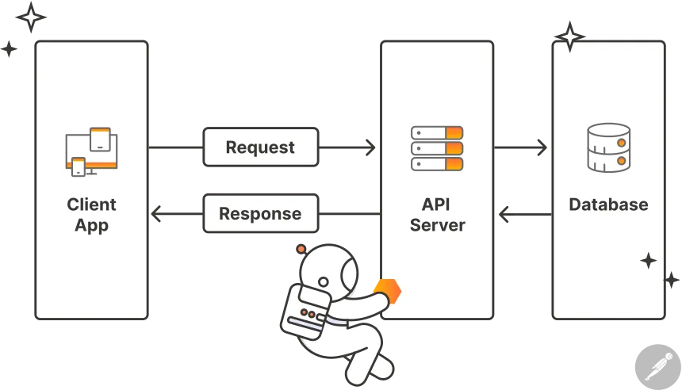

    # 🌐 Pengenalan REST API

Di era pengembangan aplikasi modern, backend jarang sekali bertugas merender tampilan HTML secara langsung. Backend modern bertindak sebagai **penyedia data dan layanan** melalui antarmuka yang disebut **REST API**.

---

## 📚 Apa itu REST API?

**REST API** (*Representational State Transfer - Application Programming Interface*) adalah standar arsitektur komunikasi data berbasis protokol HTTP. 

Melalui REST API, aplikasi client apa pun (Web React, Mobile Flutter/Android, Desktop, atau sesama server) dapat meminta dan mengirimkan data ke backend menggunakan format standar: **JSON** (*JavaScript Object Notation*).

<div align="center" style="margin: 24px 0;">



*Hubungan Client App, API Server, dan Database dalam ekosistem REST API.*

</div>

---

## 🔄 Alur Kerja Backend REST API (5-Step Lifecycle)

Klik setiap langkah di bawah untuk melihat apa yang terjadi di balik layar saat sebuah request diproses oleh backend:

<ApiLifecycle />

---

## 🧩 Komponen Utama REST API

### 1. HTTP Methods (Kata Kerja Aksi)

REST API memanfaatkan method bawaan protokol HTTP untuk menentukan tindakan apa yang ingin dilakukan terhadap data:

| Method | Aksi CRUD | Contoh Penggunaan | Deskripsi |
| :--- | :--- | :--- | :--- |
| `GET` | **Read** | `GET /api/absensi` | Mengambil satu atau banyak data |
| `POST` | **Create** | `POST /api/absensi` | Membuat/menambahkan data baru |
| `PUT` | **Update** | `PUT /api/absensi/{id}` | Memperbarui data yang sudah ada secara keseluruhan |
| `DELETE` | **Delete** | `DELETE /api/absensi/{id}` | Menghapus data berdasarkan ID |

### 2. Payload Body (JSON)

Saat membuat (`POST`) atau memperbarui (`PUT`) data, client menyertakan data dalam format raw JSON pada *body request*:

```json
{
  "nama": "Farhan Kurniawan",
  "nim": "244107020001",
  "status": "Hadir",
  "tanggal": "2026-11-08"
}
```

### 3. Apa itu Endpoint? (URL Khusus Backend)

Jika di frontend atau web biasa kita menyebutnya **URL / Alamat Website**, di dunia backend kita menyebutnya **Endpoint** (titik ujung / pintu gerbang).

#### 🌐 Perbedaan URL Website vs Endpoint API:
- **URL Website (Frontend):** Alamat untuk meminta **tampilan halaman** (HTML/CSS).  
  Contoh: `https://kampus.ac.id/profil-mahasiswa` → Muncul visual halaman web di browser.
- **Endpoint API (Backend):** Alamat untuk meminta atau mengirim **data mentah** (JSON).  
  Contoh: `https://api.kampus.ac.id/api/absensi/1` → Balasannya murni data JSON tanpa tampilan visual.

> **Kenapa dinamai *Endpoint*?**  
> Karena URL tersebut merupakan titik kontak terluar (*end point*) tempat server backend membuka pintunya bagi aplikasi lain untuk berinteraksi.

#### 🔍 Anatomi Sebuah Endpoint API:

```text
https://localhost:8080 /api/absensi /42
└────────┬──────────┘ └─────┬─────┘ └─┬─┘
     Base URL           Resource     Identifier (ID)
```

1. **Base URL:** Alamat domain utama server backend (`http://localhost:8000`).
2. **Resource (Path):** Nama kelompok data yang ingin diakses. Ditulis menggunakan kata benda (`/api/absensi`).
3. **Identifier / Parameter ID (Opsional):** Menunjuk spesifik ke satu data tertentu (`/42`).

#### ⚖️ Aturan Emas Penamaan Endpoint (RESTful Naming):

Di REST API, **URL hanya bertugas menunjukkan lokasi data (Kata Benda)**, sedangkan **tindakannya diserahkan sepenuhnya ke HTTP Method**.

| Jangan Lakukan (Gaya URL Jadul) | Gunakan Standar RESTful | Alasan |
| :--- | :--- | :--- |
| `POST /api/tambah_absensi` | `POST /api/absensi` | Kata kerja `tambah` sudah diwakili oleh method `POST`. |
| `GET /api/ambil_semua_absensi` | `GET /api/absensi` | Kata kerja `ambil` sudah diwakili oleh method `GET`. |
| `GET /api/detail_absensi?id=5` | `GET /api/absensi/5` | Parameter ID dijadikan bagian dari struktur path yang bersih. |
| `POST /api/hapus_absensi?id=5` | `DELETE /api/absensi/5` | Aksi hapus menggunakan method semantik `DELETE`. |

### 4. HTTP Status Code (Kode Status Respon)

Server wajib memberi tahu client apakah permintaan berhasil atau gagal menggunakan kode status HTTP:

| Kategori | Kode | Arti | Digunakan Saat |
| :--- | :--- | :--- | :--- |
| **2xx: Sukses** | `200 OK` | Berhasil | Data berhasil diambil (`GET`), diupdate (`PUT`), atau dihapus (`DELETE`). |
| | `201 Created` | Berhasil Dibuat | Data baru berhasil disimpan ke database (`POST`). |
| **4xx: Client Error** | `400 Bad Request` | Permintaan Salah | Format data yang dikirim client tidak sesuai. |
| | `404 Not Found` | Tidak Ditemukan | Endpoint salah atau data ID yang dicari tidak ada di database. |
| | `405 Method Not Allowed` | Method Ditolak | Memanggil method yang tidak didukung (misal `DELETE` pada rute yang cuma ada `GET`). |
| | `422 Unprocessable` | Validasi Gagal | Data lolos format tapi gagal aturan validasi (misal status bukan Hadir/Izin/Sakit/Alpa). |
| **5xx: Server Error** | `500 Server Error` | Gangguan Server | Terjadi error internal di server (misal database mati atau query error). |

### 5. Standar Format Respon JSON (Kontrak API)

Agar aplikasi Frontend atau Mobile mudah membaca respon dari backend, struktur data JSON yang dikembalikan sebaiknya selalu konsisten (*standard envelope*):

**Contoh Respon Berhasil (`200 OK` / `201 Created`):**
```json
{
  "status": "success",
  "message": "Data absensi berhasil disimpan.",
  "data": {
    "id": 1,
    "nama": "Farhan Kurniawan",
    "status": "Hadir"
  }
}
```

**Contoh Respon Gagal (`404 Not Found` / `422 Unprocessable`):**
```json
{
  "status": "error",
  "message": "Semua field (nama, nim, status, tanggal) wajib diisi!"
}
```

Dengan format yang seragam ini, developer klien cukup mengecek nilai `"status"` untuk mengetahui apakah operasinya berhasil atau gagal.
---

:::tip 💡 Mengapa Menggunakan JSON?
JSON adalah format teks terbuka yang ringan, mudah dibaca manusia, dan didukung secara native oleh hampir seluruh bahasa pemrograman modern di dunia.
:::

Di materi berikutnya, kita akan mempraktikkan konsep ini secara langsung pada studi kasus mini proyek absensi mahasiswa!
