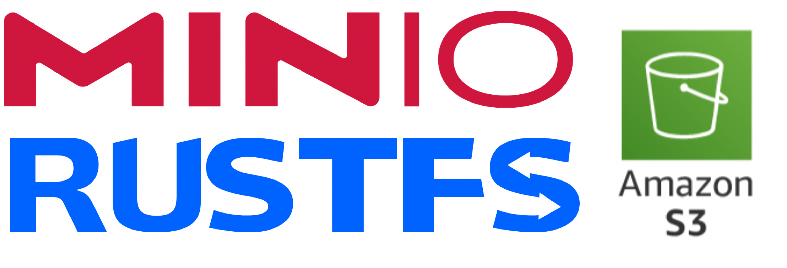

# Apa itu Object Storage

::: info Prasyarat Modul
Docker dan Compose sudah terpasang. Kalau belum, selesaikan modul Docker dulu, karena lab kita akan berjalan di dalam container.
:::

Modul ini membahas cara aplikasi backend menyimpan file dengan benar, termasuk protokol yang dipakai hampir semua layanan penyimpanan modern.

Protokol itu namanya **S3 API**. Kita akan mempelajarinya lewat server lokal bernama RustFS, tapi yang kamu bawa pulang adalah kemampuan yang berlaku di AWS S3, Cloudflare R2, Backblaze B2, dan sebagian besar object storage di dunia.

---

## Apa itu Object?

Sebelum bicara storage, kita samakan dulu definisi dari buzzword kita nanti.

**Object** adalah satu unit data yang terdiri dari tiga hal:

1. **Data itu sendiri** (byte mentah: isi foto, isi PDF, isi video).
2. **Metadata** (keterangan: tipe file, ukuran, tanggal upload, tag buatanmu).
3. **Key** (nama unik yang dipakai untuk mengambilnya lagi, misalnya `foto-profil/user-123.jpg`).

Tidak ada folder sungguhan. Key yang terlihat seperti path (`album/2026/foto.jpg`) sebenarnya hanya nama panjang dengan garis miring. Kamu tidak bisa `cd` ke dalamnya. Kamu hanya bisa meminta object lewat key-nya.

> Analogi sederhana: object itu seperti paket di gudang ekspedisi. Setiap paket punya nomor resi (key) dan label (metadata). Gudang tidak peduli isi paketmu foto atau sepatu. Yang penting resinya unik dan paketnya bisa diambil lagi.

---

## Apa itu Storage?

Kalau object adalah paketnya, storage adalah gudangnya. Tapi tidak semua gudang sama. Backend mengenal tiga jenis penyimpanan:

| Aspek | File Storage | Block Storage | Object Storage |
| :--- | :--- | :--- | :--- |
| Unit | File dalam folder | Block mentah | Object (data + metadata + key) |
| Struktur | Hierarki folder | Tidak ada, diatur OS | Flat, tanpa folder beneran |
| Akses | Path (`/var/www/uploads`) | Volume/disk (`/dev/sda`) | API lewat HTTP (S3) |
| Contoh | Folder `uploads`, NFS | Harddisk VPS, EBS | S3, RustFS, MinIO |
| Skala | Sulit, mentok di satu mesin | Sulit, terikat mesin | Mudah, dirancang untuk skala |

File storage itu folder `uploads` yang kamu kenal. Block storage itu harddisk mentah yang ditempel ke server. Object storage itu layanan yang menyimpan object dan melayaninya lewat API.

Untuk file user di aplikasi web modern, object storage hampir selalu jawaban yang benar. Alasannya ada di bagian berikut.

---

## Jadi Apa Masalahnya?

Mari kita bedah kenapa dua cara lama menyimpan file selalu berakhir menyakitkan.

### Masalah 1: Folder upload di server

Aplikasi menyimpan foto ke `/var/www/uploads`. Selama hanya satu server, aman. Lalu traffic naik dan kamu tambah server kedua (ingat Horizontal Scaling di modul System Design?).

Sekarang foto yang diupload lewat Server A tidak ada di Server B. User yang kebetulan diarahkan ke Server B melihat gambar rusak. Solusinya? Sinkronisasi folder antar server, atau NFS, atau migrasi total. Semua mahal dan rapuh.

Masalah tambahannya:

- **Backup**: siapa yang backup folder itu? Seberapa sering? Pernah dites restore-nya?
- **Serving**: setiap request gambar membebani aplikasi backend-mu, padahal itu file statis.
- **Hapus data**: user hapus akun, tapi file-nya tertinggal selamanya di disk.

### Masalah 2: Menyimpan isi file di kolom BLOB

Alternatif yang kadang muncul: simpan isi file sebagai BLOB di MySQL/PostgreSQL. Di MySQL, tipenya `TINYBLOB`, `BLOB`, `MEDIUMBLOB`, atau `LONGBLOB`. Di PostgreSQL, tipenya `bytea`. Isinya byte mentah dari file.

Ini terlihat rapi karena "semua data di satu tempat". Tapi:

- **Database membengkak.** Backup yang tadinya 500 MB jadi 50 GB karena isinya foto.
- **Query melambat.** Database dirancang untuk baris kecil yang dicari cepat, bukan untuk memuntahkan file 5 MB.
- **Biaya.** Storage database jauh lebih mahal per GB dibanding storage object.
- **Replikasi ikut berat.** Setiap file baru harus disalin ke replica, memperlambat replikasi.
- **Memori terpakai.** Driver database sering memuat seluruh BLOB ke memori sebelum dikirim.

::: warning Aturan Praktis
Database untuk data yang dicari dan difilter. Object storage untuk file yang disimpan dan diambil utuh. Jangan tukar perannya.
:::

Cara menyimpan referensi object di database, termasuk skema tabel `files` dan desain key, dibahas di pertemuan 2.

---

## Ringkasan

Dengan pola ini, alurnya berubah:

1. Aplikasi tidak menyimpan isi file. Dia menyimpan **key** dan metadata di tabel `files`.
2. File-nya tinggal di layanan object storage yang dirancang untuk itu: direplikasi, bisa di-backup, bisa disajikan langsung ke browser.
3. Server aplikasi boleh mati, diganti, atau digandakan. File user tetap aman di tempat lain.

Database-mu tetap ramping dan server-mu tetap stateless. Pola ini dipakai hampir semua aplikasi backend modern.

---

## Kenapa S3 API, Bukan Satu Produk Tertentu?

/Users/siputbiru/Projects/WRI-dev/wri-roadmap/miniclass/backend/assets/object-storage/minio-rustfs-s3-icons.png

Ada banyak produk object storage: AWS S3, Cloudflare R2, Backblaze B2, Google Cloud Storage, MinIO, Ceph, RustFS. Masing-masing punya konsol dan fitur sendiri.

Tapi hampir semuanya sepakat pada satu hal: **bicara lewat API yang kompatibel S3**.

Artinya, kalau kamu menguasai S3 API, kamu bisa pindah penyedia tanpa menulis ulang aplikasi. Cukup ganti endpoint dan kredensial. Ini alasan kenapa materi ini berfokus pada protokolnya, bukan pada satu merek.

Beberapa fakta yang membuat S3 API layak dipelajari serius:

- Versinya tetap `2006-03-01` sejak 2006. API yang stabil dua dekade.
- Berbasis HTTP biasa: method, header, status code, XML.
- Ekosistem alatnya besar: SDK resmi hampir semua bahasa, CLI, Terraform, backup tool, semuanya bicara S3.

> Analogi: S3 API itu seperti colokan USB. Kamu tidak perlu tahu merek lampunya, selama colokannya cocok.

---

## RustFS, MinIO, dan S3: Pilih yang Mana?

Di materi ini kita menjalankan **RustFS** di laptop sebagai server latihan. Bukan karena RustFS istimewa, tapi karena dia S3-compatible, ringan, dan berlisensi Apache 2.0.

Perbandingannya seperti ini:

| Aspek | RustFS | MinIO | AWS S3 |
| :--- | :--- | :--- | :--- |
| Lisensi | Apache 2.0 (bebas, ramah komersial) | AGPL v3 (ketat, berisiko jebakan lisensi) | Layanan berbayar milik Amazon |
| Bahasa | Rust | Go | Tertutup |
| API | Kompatibel S3 | S3 (yang asli mendefinisikannya) | S3 itu sendiri |
| Jalan lokal | Ya, satu container | Dulu ya, image resmi dihentikan Okt 2025 | Tidak, harus ke cloud |
| Biaya belajar | Gratis | Gratis | Bayar per request dan per GB |
| Cocok untuk | Lab kelas | Tidak disarankan lagi (baca di bawah) | Produksi sesungguhnya |

::: danger MinIO Community Edition Sudah Mati
MinIO edisi komunitas yang gratis itu sudah resmi berakhir:

| Kapan | Apa yang terjadi |
| :--- | :--- |
| Mei 2025 | Admin console dicabut dari edisi komunitas, tersisa object browser sederhana |
| Okt 2025 | Binary dan Docker image resmi dihentikan, tinggal source code |
| Des 2025 | Diumumkan maintenance mode: tidak ada fitur baru |
| Feb 2026 | Repo `minio/minio` diarsipkan dan dinyatakan tidak maintained |

Yang hidup hanya produk komersialnya (AIStor). Artinya puluhan juta instance MinIO lama yang masih jalan di luar sana tidak menerima patch keamanan lagi.

Alasan praktisnya, materi ini memakai RustFS dan bukan MinIO: kita tidak mau belajar memakai alat yang arsipnya sudah dikunci.
:::

::: info RustFS sebagai Alat Bantu
Semua operasi yang kita pelajari adalah **S3 core**. Kalau nanti RustFS berubah versi, berhenti dikembangkan, atau kamu pindah ke AWS S3, catatanmu tetap berlaku. Yang berubah hanya nilai `endpoint` dan kredensial.
:::

---

## Peta Modul Ini

Modul ini dibagi enam pertemuan:

1. **Konsep** (halaman ini): object, jenis storage, kenapa S3 API.
2. **Model data dan anatomi request S3**: bucket, key, verb HTTP, XML, error, gambaran SigV4, dan pola tabel `files` untuk menyimpan referensi object.
3. **Lab: RustFS sebagai S3 lokal**: menyiapkan server latihan.
4. **Operasi S3 lewat HTTP**: `curl`, status code, metadata, ETag, listing, range.
5. **CLI dan SDK**: `mc`, AWS CLI, aws-sdk, Laravel.
6. **Presigned URL dan multipart**: akses sementara, upload file besar, praktik aman.

Alasan object storage dibahas tepat setelah Docker: server latihannya berjalan sebagai container, jadi tidak ada instalasi baru.

---

## Latihan

1. Buka satu proyek backend-mu. Di mana file user disimpan sekarang? Folder lokal, BLOB database, atau layanan eksternal?
2. Kalau aplikasimu dijalankan di dua server sekaligus, apa yang rusak duluan dari cara penyimpananmu sekarang?
3. Jelaskan dengan bahasamu sendiri bedanya file storage, block storage, dan object storage.
4. Cari daftar penyedia yang mengaku kompatibel S3. Sebutkan tiga, lalu cek apakah mereka punya halaman kompatibilitas API.

---

## Referensi

- [Amazon S3 API Reference](https://docs.aws.amazon.com/AmazonS3/latest/API/Welcome.html)
- [Amazon S3 User Guide](https://docs.aws.amazon.com/AmazonS3/latest/userguide/Welcome.html)
- [RustFS Documentation](https://docs.rustfs.com/en)
