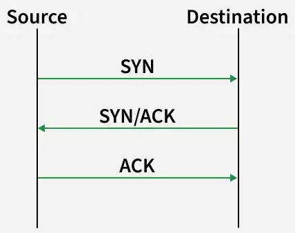
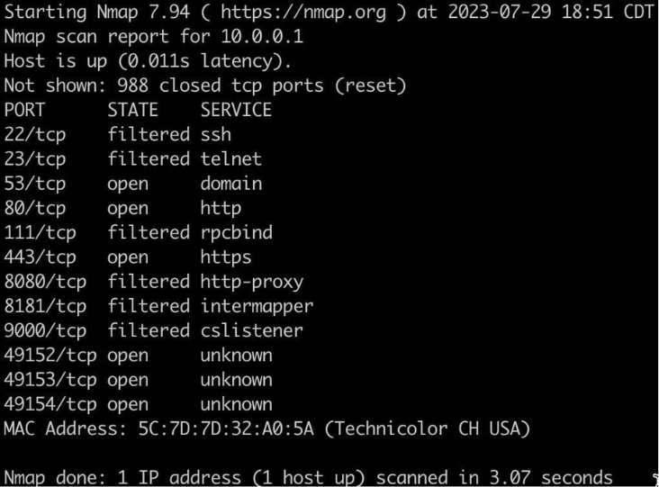
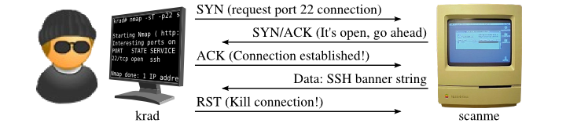
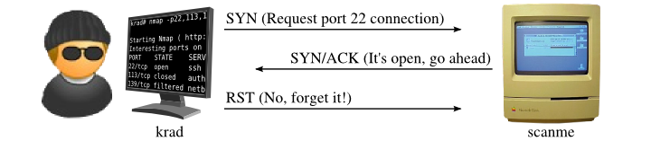

# Chapter 3: Active Reconnaissance & Network Scanning

Jika kemarin kita menggali informasi target secara tidak langsung, minggu ini kita mulai **"menyentuh"** target secara langsung. Fokus utama kita bukan sekadar menjalankan perintah scan sebanyak mungkin, melainkan memahami **mengapa** scan dilakukan, bagaimana **menginterpretasikan** output, dan bagaimana **memilih** service mana yang paling menjanjikan untuk diserang.

|           | Passive                                       | Active                                           |
| :-------- | :-------------------------------------------- | :----------------------------------------------- |
| Interaksi | Tidak ada interaksi langsung dengan target    | Paket dikirim langsung ke host target            |
| Jejak     | Relatif tidak meninggalkan log di sisi target | Meninggalkan jejak di log/IDS/firewall target    |
| Contoh    | OSINT, WHOIS, Google Dorking                  | Host discovery, port scanning, service detection |

## Glosarium

Berikut adalah 3 istilah utama yang wajib kamu pahami pada pertemuan minggu ini:

1. **Host Discovery**: Mencari tahu siapa saja yang "aktif" di dalam sebuah jaringan/subnet.
2. **Port Scanning**: Mengetuk setiap pintu di rumah target untuk melihat mana yang tidak terkunci.
3. **Service Detection**: Mengintip lewat lubang kunci untuk mengetahui apa yang ada di balik pintu tersebut (web server? database? file sharing?).

> [!TIP]
> Port terbuka tidak selalu berarti ada celah keamanan. Port terbuka hanyalah sebuah indikator keberadaan suatu layanan yang butuh investigasi lebih lanjut.

## Prequisite

### Host vs Port vs Service

Istilah ini akan muncul terus sepanjang materi, jadi pastikan pemahamannya tidak tertukar:

- **Host**: perangkat (server/PC) yang diidentifikasi lewat IP address — contoh: `192.168.16.3`.
- **Port**: "pintu" bernomor (0–65535) tempat komunikasi berlangsung pada sebuah host.
- **Service**: aplikasi yang berjalan dan menunggu koneksi di balik sebuah port.

```text
Host: 192.168.16.3
├── nginx   → port 80, 443
├── Postfix → port 25, 587, 465
└── MySQL   → port 3306, 33060
```

> [!TIP]
> Satu host bisa menjalankan banyak service sekaligus pada port yang berbeda. Tugas kita pada fase recon adalah memetakan ketiganya: host mana yang aktif, port mana yang terbuka, dan service apa yang berjalan di baliknya.

### IP Address, Subnet, dan DNS

- Setiap host di jaringan dikenali melalui **IP address**. Sebuah **subnet** dinyatakan dengan notasi CIDR, contoh: `10.200.6.0/24`.
- Hostname seperti `example.com` diterjemahkan ke IP address melalui **DNS resolution**: Browser/OS cache → Recursive Resolver → Root nameserver → TLD nameserver → Authoritative nameserver.

### Nmap 101

Nmap adalah tools open-source buatan Gordon Lyon (Fyodor) yang dirancang untuk menemukan host dan service di jaringan dengan mengirim paket lalu menganalisis responsnya. Struktur dasar perintahnya:

```bash
nmap [Scan Type] [Option(s)] [Target(s)]
```

`Target(s)` bisa berupa hostname, satu IP address, maupun seluruh subnet. Jika belum terpasang, unduh dari [nmap.org/download](https://nmap.org/download.html).

## Konsep Dasar

<center>



</center>

Sebelum mengetahui bagaimana cara melakukan _active scanning_ pada target, kita harus paham bagaimana cara data ditransmisikan pada suatu jaringan. Pada dasarnya, ada 2 jenis protokol: **TCP** dan **UDP**.

### 1. TCP

Hampir semua komunikasi di internet menggunakan protokol TCP. Sebelum data dikirim, terjadi proses yang disebut **Three-Way Handshake**:

```text
Client                          Server
   |                                 |
   |  ── SYN ──────────────────────► |   ① "Halo, port 80 buka?"
   |  ◄────────────────── SYN-ACK ── |   ② "Halo! Iya buka, ayo konek."
   |  ── ACK ──────────────────────► |   ③ "Oke, sip! Kita mulai ya."
   |                                 |
   |  [Koneksi Terbentuk]            |
```

Respons target berdasarkan status port:

- **Port Terbuka**: Target membalas dengan `SYN-ACK`.
- **Port Tertutup**: Target membalas dengan `RST` (Reset).
- **Port Difilter**: Tidak ada balasan (paket dibuang oleh firewall).

### 2. UDP

Berbeda dengan TCP, UDP adalah protokol "tembak dan lupakan" tanpa mekanisme handshake.

```text
Port UDP Terbuka  :  Paket ──► [Respons UDP]
Port UDP Tertutup :  Paket ──► ICMP "Port Unreachable"
Tidak Pasti       :  Paket ──► [Tidak ada respons] → Label: open|filtered
```

## Host Discovery

Host discovery adalah proses **identifikasi host** (IP address aktif) pada suatu jaringan/subnet. Host discovery selalu menjadi langkah pertama sebelum memindai port. Untuk melakukan host discovery, kita dapat menggunakan flag mode berikut:

### 1. List Host (`-sL`)

Menampilkan daftar semua IP address pada subnet **tanpa mengirim paket sama sekali**. Cocok untuk enumerasi alamat, tapi tidak bisa dipakai memastikan host benar-benar aktif:

```bash
nmap -sL 10.200.6.0/24
```

### 2. Ping Scan (`-sn`)

Mencari host yang benar-benar aktif dengan mematikan port scan (hanya discovery):

```bash
nmap -sn 10.200.6.0/24
```

#### Probe Spesifik

Secara default Nmap menggabungkan beberapa jenis probe sekaligus. Jika firewall target memblokirnya, tentukan sendiri protokol probe untuk menghindari log atau bypass firewall:

| Probe                           | Flag  | Keterangan                               |
| :------------------------------ | :---- | :--------------------------------------- |
| **ARP Ping**                    | `-PR` | Untuk host di subnet lokal, paling andal |
| **ICMP Echo**                   | `-PE` | Ping klasik                              |
| **ICMP Timestamp**              | `-PP` | Alternatif jika echo difilter            |
| **ICMP Type 17 (Address Mask)** | `-PM` | Varian ICMP lain yang jarang difilter    |
| **UDP Ping**                    | `-PU` | Mengirim paket UDP ke port-port umum     |

```bash
nmap -sn -PE 10.200.6.0/24
```

## Scanning Menggunakan Nmap



`nmap` mendukung **3 mode utama** yang dapat kamu gunakan saat melakukan proses scanning:

| Mode Scan       | Akses Root? |  Kecepatan   | Deteksi IDS | Kegunaan Utama                  |
| :-------------- | :---------: | :----------: | :---------: | :------------------------------ |
| **TCP Connect** |    Tidak    |    Sedang    |   Tinggi    | Digunakan jika tidak punya root |
| **SYN Scan**    |   **Ya**    | Sangat Cepat |   Sedang    | Default & Efisien (Stealth)     |
| **UDP Scan**    |   **Ya**    |    Lambat    |   Rendah    | Mencari DNS, SNMP, atau DHCP    |

### 1. TCP Connect Scan (`-sT`)



`nmap` meminta OS untuk menyelesaikan seluruh proses handshake. Ini lebih lambat dan "berisik" di log target, tapi tidak membutuhkan akses root untuk dijalankan (**unprivileged**).

### 2. SYN Scan / Stealth Scan (`-sS`)



Mode ini memerlukan user dengan hak akses khusus (**privileged users**). Cara kerja mode ini adalah `nmap` memulai handshake tapi segera mengirim `RST` (reset) setelah menerima `SYN-ACK`, sehingga koneksi tidak pernah benar-benar terbentuk.

> [!IMPORTANT]
> Karena koneksi tidak selesai, banyak sistem logging lama tidak mencatat aktivitas ini. Namun, firewall modern tetap bisa mendeteksinya.

### 3. UDP Scan (`-sU`)

Walaupun jarang ditemui, terkadang scan UDP penting untuk dilakukan, terutama pada port populer. Banyak celah keamanan fatal ditemukan di layanan UDP yang sering terlupakan (seperti DNS, SNMP, atau DHCP). Sama seperti *SYNC Scan*, mode ini memerlukan hak akses khusus (**privileged users**).


> [!NOTE]
> Ketiadaan handshake membuat scanning UDP jauh lebih lambat, karena `nmap` harus menunggu _timeout_ sebelum menyimpulkan status port.

### Port Scanning

Setelah host aktif diketahui, port scanning dilakukan untuk mengidentifikasi port yang terbuka. Nmap akan melaporkan salah satu dari tiga status berikut:

| Status     | Penjelasan                                                             |
| :--------- | :--------------------------------------------------------------------- |
| `open`     | Port menerima koneksi dan terdapat aplikasi yang menunggu koneksi.     |
| `closed`   | Port dapat dijangkau, tetapi tidak ada aplikasi yang menerima koneksi. |
| `filtered` | Nmap tidak dapat memastikan status karena adanya filtering jaringan.   |

Secara default, Nmap hanya memeriksa **1000 port paling populer**. Sesuaikan cakupan scan dengan kebutuhan:

```bash
nmap -p 22,80,443 192.168.56.101    # Port tertentu
nmap -p 1-1024 192.168.56.101       # Rentang port
nmap -p- 192.168.56.101             # Seluruh 65.535 port
nmap --top-ports 10 192.168.56.101  # 10 port paling populer
```

## OS & Service Detection

Mengetahui port yang terbuka saja belum cukup. Kita juga perlu mencari tahu **apa yang berjalan** di baliknya yang menjadi **inti** dari _active reconnaisance_ itu sendiri.

### 1. OS Detection (`-O`)

`nmap` mencoba menebak sistem operasi target dengan membaca sidik jari dari TCP/IP stack-nya (TTL, window size, dsb.). Mode ini berguna untuk mencari tahu versi kernel yang digunakan host aktif. Berikut adalah contoh perintahnya:

```bash
sudo nmap -O 192.168.56.101
```

> [!TIP]
> Hasil OS detection hanyalah prediksi. Jika port terbuka/tertutup yang terlihat sangat sedikit, Nmap sering hanya bisa menebak "range" OS-nya saja.

### 2. Service & Version Detection (`-sV`)

Port terbuka hanya memberi tahu bahwa ada aplikasi yang listening. Flag `-sV` memaksa Nmap berkomunikasi dengan service tersebut untuk menebak **nama aplikasi beserta versinya**, misal: `Apache httpd 2.4.41`. Berikut adalah contoh perintahnya:

```bash
sudo nmap -sV 192.168.56.101
```

### 3. Aggressive Scan (`-A`)

Gabungan dari `-sV`, `-sC`, `-O`, dan traceroute dalam satu perintah:

```bash
sudo nmap -A 192.168.56.101
```

> [!NOTE]
> `-A` menjalankan deteksi paling lengkap sekaligus paling berisik di sisi target — gunakan hanya jika memang diperlukan.

## Nmap Scripting Engine (NSE)

NSE adalah mesin script bawaan Nmap (ditulis dengan Lua, ratusan script tersimpan di `/usr/share/nmap/scripts`) yang memperluas kemampuan scanning: dari enumerasi informasi, pengecekan vulnerability, sampai brute force kredensial. Inilah yang membuat Nmap bisa "berinteraksi" jauh lebih dalam dengan service yang ditemukan.

Pilihan kategori script:

| Kategori    | Fokus                                                    |
| :---------- | :------------------------------------------------------- |
| `default`   | Script yang aman & umum dijalankan (setara `-sC`)        |
| `safe`      | Tidak agresif, tidak mengubah data di sisi target        |
| `discovery` | Menggali informasi tambahan dari target                  |
| `vuln`      | Mengecek kemungkinan celah keamanan yang sudah diketahui |
| `auth`      | Deteksi kredensial/autentikasi default pada service      |
| `brute`     | Brute force kredensial service (SSH, FTP, SMB, dll.)     |
| `exploit`   | Mencoba mengeksploitasi celah yang ditemukan             |
| `intrusive` | Berisiko mematikan service / tercatat sebagai aktivitas  |
| `version`   | Ekstensi deteksi versi service (dipakai saat `-sV`)      |
| `broadcast` | Mengumpulkan informasi host via broadcast jaringan lokal |

Contoh penggunaan:

```bash
# 1. Kategori default saja (setara --script=default)
sudo nmap -sC 192.168.56.101

# 2. Seluruh script kategori vuln pada web server
sudo nmap --script vuln -p 80,443 192.168.56.101

# 3. Script spesifik berdasarkan nama
sudo nmap -p 445 --script smb-os-discovery 192.168.56.101

# 4. Beberapa script sekaligus, atau wildcard per-protokol
sudo nmap --script http-title,http-headers -p 80 192.168.56.101
sudo nmap --script "http-*" -p 80 192.168.56.101

# 5. Script yang membutuhkan argumen (contoh: SNMP community string)
sudo nmap -sU -p 161 --script snmp-sysdescr --script-args snmpcommunity=public 192.168.56.101

# 6. Melihat dokumentasi & argumen yang tersedia pada sebuah script
nmap --script-help http-enum
```

Beberapa script yang berguna saat fase recon: `http-enum` (enumerasi path/aplikasi web umum), `smb-os-discovery` (info OS via port 445), serta `http-title`/`http-headers` (ringkasan cepat isi sebuah web).

> [!IMPORTANT]
> Kategori `intrusive`, `exploit`, dan `brute` dapat mematikan service target atau tercatat jelas di log. Di lab bebas digunakan; di jaringan nyata, pastikan ada izin eksplisit.

## Timing Template

Flag `-T<0-5>` mengatur seberapa agresif `nmap` mengirim probe seperti kecepatan antar probe, tingkat paralelisme, dan timeout. Semakin tinggi angkanya, semakin cepat scan selesai, tetapi semakin besar risiko hasil tidak akurat (port terlewat) dan semakin mudah terdeteksi IDS.

| Template | Nama       | Perilaku                                | Kegunaan                                |
| :------- | :--------- | :-------------------------------------- | :-------------------------------------- |
| `-T0`    | paranoid   | Serial, jeda ±5 menit antar probe       | Menghindari IDS/IPS (sangat lambat)     |
| `-T1`    | sneaky     | Serial, jeda ±15 detik antar probe      | Sama seperti T0, sedikit lebih cepat    |
| `-T2`    | polite     | Serial, jeda ±0.4 detik antar probe     | Meminimalkan beban pada jaringan/target |
| `-T3`    | normal     | Paralel dengan timing standar           | Default saat flag `-T` tidak ditentukan |
| `-T4`    | aggressive | Paralel agresif, timeout pendek         | Jaringan cepat/LAN — disarankan di lab  |
| `-T5`    | insane     | Paralel maksimal, timeout sangat pendek | Paling cepat, paling sering salah hasil |

Contoh penggunaan:

```bash
# Scan seluruh 65535 port dengan timing agresif (kombinasi paling umum di lab)
sudo nmap -T4 -p- 192.168.56.101

# UDP scan yang lambat dipercepat dengan T4
sudo nmap -sU -T4 --top-ports 20 192.168.56.101

# Scan lambat sengaja diperlambat lagi agar tidak mencurigakan
sudo nmap -T2 --scan-delay 1s 192.168.56.101
```

> [!IMPORTANT]
> Pada jaringan lambat atau target yang difilter firewall, `-T5` sering membuat Nmap salah menyimpulkan port `closed`/`filtered` padahal sebenarnya `open`, karena timeout-nya terlalu pendek. Jika hasil scan terasa janggal, ulangi dengan `-T4` atau `-T3`.

---

## Cheat Sheet

Gunakan perintah berikut sebagai urutan standar di lingkungan Lab:

```bash
# 1. Host Discovery (Cari target yang aktif di subnet)
nmap -sn 192.168.56.0/24

# 2. Scanning Dasar (Cek 1000 port paling umum - SYN Scan)
sudo nmap -sS 192.168.56.101

# 3. Scanning Detail (Versi Service & Default Script)
sudo nmap -sS -sV -sC 192.168.56.101

# 4. Scanning Seluruh Port (0-65535) - Penting!
sudo nmap -p- 192.168.56.101

# 5. UDP Scanning pada 20 port paling populer
sudo nmap -sU --top-ports 20 192.168.56.101
```

### Referensi Flag Nmap Lengkap

| Kategori           | Flag              | Deskripsi                                                                |
| :----------------- | :---------------- | :----------------------------------------------------------------------- |
| **Host Discovery** | `-sn`             | Ping Scan - Menonaktifkan port scan (hanya cari host aktif).             |
|                    | `-Pn`             | Lewati host discovery - Anggap semua host aktif (lewati blokir ping).    |
| **Teknik Scan**    | `-sS`             | TCP SYN Scan (Stealth) - Cepat, butuh akses root.                        |
|                    | `-sT`             | TCP Connect Scan - Default tanpa root, lebih lambat.                     |
|                    | `-sU`             | UDP Scan - Mencari layanan UDP aktif.                                    |
| **Opsi Port**      | `-p <n>`          | Scan port tertentu (contoh:`-p 22,80,443`).                              |
|                    | `-p-`             | Scan seluruh 65.535 port.                                                |
|                    | `--top-ports <n>` | Scan `<n>` jumlah port paling populer.                                   |
| **Deteksi**        | `-sV`             | Deteksi Versi - Mencoba menebak versi service aplikasi.                  |
|                    | `-sC`             | Script Scan - Menjalankan default scripts Nmap (NSE).                    |
|                    | `-O`              | OS Detection - Mencoba menebak Sistem Operasi target.                    |
|                    | `-A`              | Aggressive Scan - Gabungan dari `-sV`, `-sC`, `-O`, dan traceroute.      |
| **Performa**       | `-T<0-5>`         | Mengatur kecepatan (0: sangat lambat, 5: sangat agresif). T4 disarankan. |
| **Output**         | `-oN <file>`      | Simpan hasil dalam format teks normal.                                   |
|                    | `-oX <file>`      | Simpan hasil dalam format XML.                                           |
|                    | `-oG <file>`      | Simpan hasil dalam format yang mudah di-_grep_.                          |

## Kesalahan Umum

- **Scanning Tanpa Tujuan**: Menjalankan `-p-` tanpa melakukan _host discovery_ terlebih dahulu. Ini membuang waktu secara tidak efisien.
- **Lupa Scan UDP**: Terlalu fokus pada TCP dan melewati layanan rentan di UDP.
- **Mengabaikan Versi**: Melihat port terbuka tapi tidak mencatat versinya. Versi yang tepat memudahkan kamu mencari exploit di database seperti Exploit-DB.

## Referensi

1. Tryhackme: [Nmap: The Basics](https://tryhackme.com/room/nmap01)
2. Tryhackme: [Further Nmap](https://tryhackme.com/room/furthernmap)
3. [Nmap Script Engine Builtin References](https://nmap.org/nsedoc/scripts/)
4. https://medium.com/@rajbhatia21.21/the-complete-guide-to-nmap-network-scanning-mastery-1389eb227fab
