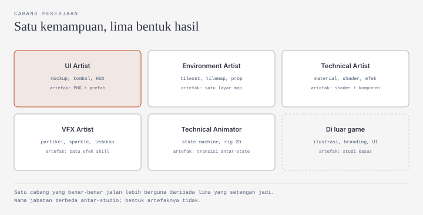

# Role Artist: Yang Dikerjakan, Cabangnya, dan Buktinya

Dokumen ini untuk kamu yang memilih kelas Artist, atau yang masih menimbang antara Artist dan dua kelas lain. Isinya tiga hal saja: apa yang sebenarnya dikerjakan artist, cabang pekerjaan yang bisa kamu tuju beserta buktinya, dan bentuk hasil yang bisa diperiksa orang lain.

Dua kelas lain — Programmer dan Design — punya dokumennya sendiri. Dokumen Programmer sudah ada di [Role Programmer](/miniclass/game/programmer/); dokumen Design menyusul. Di sini keduanya hanya muncul sebagai batas: bagian mana yang bukan pekerjaanmu.

Konteks programnya — gate minggu 4, jalur Observer, kontrak waktu, dan aturan AI secara umum — ada di [Materi Minggu 1](/miniclass/game/). Dokumen ini tidak mengulanginya.

Satu hal perlu jelas sejak awal. Artist bukan "orang yang menggambar apa saja yang diminta". Pekerjaan intinya adalah menetapkan satu bahasa visual, menjaganya tetap sama di seluruh aset, lalu menyerahkannya dalam bentuk yang bisa dipakai orang lain tanpa bertanya. Menggambar hanyalah cara mencapainya, dan biasanya bukan bagian yang paling sulit. Kalau ada yang bertanya apakah kamu perlu menyelam: tidak. Itu satu-satunya hal di dokumen ini yang tidak perlu dijelaskan lebih jauh.

---

## Yang sebenarnya dikerjakan artist

Ambil satu contoh kecil. Desainer menulis catatan: *"Tombol di menu harus terasa empuk dan tetap enak dilihat di layar HP maupun laptop."*

Kalimat itu belum bisa dikerjakan. Artist mengubahnya menjadi keputusan yang punya ukuran dan nama:

| Pertanyaan | Jawaban yang harus diputuskan artist |
|---|---|
| Sebesar dan sebentuk apa? | kotak 96×48 piksel, sudut membulat 4 px, sudutnya tidak ikut melar |
| Bagaimana perilakunya saat ditekan? | tiga state: `normal`, `hover`, `pressed` — dibedakan lewat kecerahan, bukan ukuran |
| Warna apa yang dipakai? | dua warna dari palet 8 warna yang sama dengan seluruh game |
| Bagaimana ia dipakai di layar lain? | border 9-slice disimpan di dalam file, bukan di-scale |
| Apa nama berkasnya? | `ui-button-primary-96x48.png`, lalu `-hover` dan `-pressed` |

Lima baris itu pekerjaan artist. Menggambarnya menyusul, dan biasanya lebih cepat daripada proses berpikir di atas.

Yang dilatih di kelas ini karena itu bukan bakat menggambar, melainkan tiga hal yang tetap berguna di luar game: menetapkan batas sebelum mulai (palet, ukuran, gaya), menjaga konsistensi antar-aset yang dibuat di hari berbeda, dan menamai berkas sehingga orang lain bisa menemukannya.

### Batas pekerjaannya

Sebagian besar kekecewaan peserta datang dari salah paham batas ini, bukan dari kemampuan menggambar yang kurang.

| Dikerjakan artist | Bukan pekerjaan artist | Sering disalahpahami |
|---|---|---|
| Menggambar aset yang terlihat: karakter, environment, UI, ikon, portrait | Menentukan mekanik dan angka keseimbangan | "Artist yang menentukan gamenya seru atau tidak" |
| Menyusun mockup UI di Figma sebelum digambar | Menulis logika gameplay | "Kalau art-nya bagus, gamenya otomatis bagus" |
| Menjaga style guide dan penamaan berkas | Menyusun jadwal dan prioritas tim | "Artist cuma tinggal menggambar, tidak ada mikirnya" |
| Menyiapkan aset sesuai batas mesin: ukuran, PPU, 9-slice, transparansi | Mengukur performa dan ukuran build | "Resolusi bebas, nanti dikecilkan" |
| Menyerahkan paket aset + README cara pakai | Memasarkan game | "Aset selesai berarti pekerjaan selesai" |
| Menulis satu halaman panduan gaya | Menulis dokumen teknis dan spesifikasi sistem | "Artist tidak perlu menulis apa pun" |

Dua baris terakhir yang paling sering diabaikan. Artist tetap menulis, tetapi yang ditulisnya satu halaman panduan gaya dan satu README — bukan dokumen teknis.

Satu batas lagi yang tidak tertulis: artist **boleh** membuka Unity, tetapi hanya untuk mengimpor, mengatur PPU, dan memeriksa hasilnya di layar. Begitu kamu mulai menulis C# untuk mengatur material atau state animasi, itu sudah wilayah technical artist, dan sisi seberangnya dibahas di [dokumen Programmer](/miniclass/game/programmer/).

Artist juga **boleh** menolak permintaan yang merusak konsistensi, asal menyebutkan alasannya. "Ini di luar palet" lebih berguna daripada diam lalu mengerjakannya.

---

## Satu kemampuan, lima bentuk hasil

Di lowongan kerja, "game artist" jarang berdiri sendiri. Ada UI artist, environment artist, technical artist, VFX artist, dan technical animator. Perbedaan mereka bukan alat yang dipakai — kebanyakan sama-sama menggambar — melainkan **jenis artefak yang diserahkan** dan **jenis masalah yang membuat mereka dipanggil**.

Hasil akhir dari semua cabang itu, kalau dirakit, terlihat seperti satu layar game yang utuh: karakter, latar, tombol, ikon, dan efek menyala di tempat yang sama.



Lima kotak cabang di atas bukan lima karier yang terpisah rapi. Kebanyakan orang mulai dari satu, lalu menambah dua atau tiga seiring proyek yang dikerjakan. Yang penting: setiap cabang punya hasil yang bisa dilihat orang lain.

| Cabang | Artefak yang diserahkan | Contoh nyata yang bisa dibuka sekarang | Bentuk postingan |
|---|---|---|---|
| **UI artist** | Mockup, tombol, HUD, dialog box, ikon | [Cozy Sage UI](https://nacila.itch.io/): paket UI bergaya kertas yang sudah disiapkan sebagai prefab Unity | Tangkapan Figma + GIF prefab yang dipakai |
| **Environment artist** | Tileset, tilemap, prop, latar parallax | [Kenney Assets](https://kenney.nl/assets): paket 2D dan UI gratis yang sering jadi titik mulai tim kecil | GIF map yang bisa dimainkan + lembar tileset |
| **Technical artist** | Material, shader, efek layar, alur impor aset | [KinoGlitch](https://github.com/keijiro/KinoGlitch): kumpulan file `.shader` + komponen C# untuk efek glitch | Rekaman sebelum–sesudah + nilai parameter yang diubah |
| **VFX artist** | Partikel, sparkle, ledakan, efek skill | [VFX Graph Samples](https://github.com/Unity-Technologies/VisualEffectGraph-Samples): kebakaran, portal, pita partikel | Rekaman 10 detik + angka yang diubah |
| **Technical animator** | State machine, blend tree, rig dan tulang 2D | [2D Animation Samples](https://github.com/Unity-Technologies/2d-animation-samples): sampel bone, IK, dan skinning sprite | GIF transisi antar-state + tangkapan jendela Animator |
| **Di luar game** | Ilustrasi, branding, UI produk digital | Kemampuan yang sama, konteks berbeda | Studi kasus satu halaman: masalah, keputusan, hasil |

Catatan sebelum kamu membuka tautan di tabel itu:

| Contoh | Yang perlu kamu tahu |
|---|---|
| Cozy Sage UI | Buatan perorangan, bukan studio. Syarat pemakaiannya diatur sendiri oleh pembuatnya — baca halaman paketnya sebelum dipakai di proyek komersial. |
| Kenney Assets | Banyak yang gratis dan CC0, tetapi gayanya seragam dan sudah sangat dikenal. Cocok untuk belajar dan prototipe, kurang cocok kalau kamu ingin gaya yang khas. |
| KinoGlitch | Memakai `OnRenderImage`, yang berjalan di Built-in Render Pipeline — bukan URP seperti template 2D di program ini. |
| VFX Graph Samples | Butuh HDRP. |
| 2D Animation Samples | README repo-nya sendiri menyebut fitur di dalamnya masih *preview* dan **tidak untuk produksi**. Target awalnya Unity 2018.1, jadi jangan berharap terbuka mulus di Unity 6.3. |

Polanya tetap berguna. Yang perlu kamu waspadai hanya satu: contoh yang bagus tidak otomatis cocok dengan proyekmu, dan lisensi adalah hal pertama yang diperiksa, bukan yang terakhir.

Satu catatan tentang daftar ini: ia tidak lengkap. **Concept artist** (merancang bentuk sebelum digambar) dan **character artist** (menggambar karakter sampai siap dianimasikan) juga jabatan yang umum di industri. Keduanya tidak masuk tabel karena di tim kecil biasanya digabung ke salah satu dari lima di atas. Nama jabatan juga berbeda antar-studio; yang tidak berbeda adalah bentuk artefaknya.

### Realita: satu orang, lima topi

Di studio besar, lima cabang di atas diisi lima orang berbeda. Di tim 3–5 orang — termasuk tim lomba dan proyek tugas akhir — biasanya diisi satu orang.

Berdasarkan pengalaman pendamping kelas ini selama sekitar satu tahun sebagai artist: hampir semua cabang dikerjakan sendiri, kecuali VFX.

| Cabang | Dalam praktiknya di tim kecil | Alasan |
|---|---|---|
| UI artist | Dikerjakan, sering jadi pekerjaan pertama | Paling cepat terlihat hasilnya dan langsung dipakai tim |
| Environment artist | Dikerjakan, biasanya paling banyak menyita waktu | Satu layar butuh banyak aset kecil yang harus konsisten |
| Technical artist | Dikerjakan seadanya: impor, PPU, aturan ekspor | Cukup sampai asetnya masuk dengan benar |
| Technical animator | Dikerjakan kalau gamenya memang butuh animasi karakter | Bisa ditunda sampai karakter benar-benar dipakai |
| VFX artist | Paling akhir dikuasai, kadang tidak dikerjakan sama sekali | Butuh alat lain, jarang jadi penghambat, dan mudah ditunda |

Ini bukan data survei, melainkan satu pengalaman. Anggap sebagai gambaran, bukan patokan.

Yang bisa kamu ambil: kelas Artist mengajarkan **batas** lebih dulu, bukan mengejar kelima cabang. Satu cabang yang benar-benar jalan, dengan aset yang konsisten dan bisa dipakai, lebih berguna daripada lima yang setengah jadi.

### Bukti seperti apa yang dihitung

Untuk pemula, "bukti" bukan jumlah gambar di media sosial dan bukan jumlah tutorial yang ditonton. Yang dihitung hanya hal yang bisa diperiksa orang lain tanpa bertanya kepadamu.

| Jenis bukti | Membuktikan apa | Kelemahannya |
|---|---|---|
| Paket aset dengan nama berkas konsisten | Kamu bisa bekerja dalam satu sistem, bukan hanya membuat satu gambar bagus | Satu tangkapan layar tetap bisa terlihat rapi meski foldernya berantakan |
| Link Figma mode lihat | Mockup-nya benar-benar ada dan bisa dipakai | Mockup bagus tidak membuktikan asetnya pernah dibuat |
| GIF sebelum–sesudah impor | Asetnya masuk ke engine dengan benar | GIF bisa dipotong; sebutkan versi Unity dan pengaturannya |
| README berisi lisensi dan batasan | Karyamu bisa dipakai orang lain | README yang hanya berisi judul tidak dihitung |
| Style guide satu halaman | Kamu bisa menjelaskan aturan, bukan hanya mengikuti rasa | Panduan tanpa aset jadi hanya janji |
| Rekaman in-game 15–30 detik | Asetnya berfungsi di dalam game | Rekaman bagus tidak menunjukkan siapa mengerjakan bagian mana |

Contoh yang paling mudah diperiksa adalah portofolio yang menyebutkan siapa pembuatnya dan apa isinya. [Portofolio Cila](https://nacila.itch.io/) menyusun karyanya seperti katalog: paket aset 16×16 dan 32×32, satu paket UI yang ditandai siap dikembangkan dan sudah berupa prefab Unity, serta beberapa game pendek yang bisa dimainkan langsung di peramban. Yang membuatnya berguna bukan jumlah gambarnya, melainkan bahwa setiap paket menyebutkan isi, gaya, dan cara pakainya.

### Contoh postingan

Format berikut dipakai di program ini. Isinya sengaja dibuat bisa diperiksa, bukan sekadar bercerita.

```text
Judul        : Paket tombol UI tiga state
Pembuat      : [nama]
Kelas        : Artist
Apa yang dibuat : 3 PNG (normal, hover, pressed) + prefab Button + README
Apa yang dipelajari : border 9-slice disimpan di sprite, bukan di-scale;
                      state dibedakan lewat kecerahan, bukan ukuran
Link hasil   : figma.com/[tautan] + github.com/[akun]/ui-kit
Status       : selesai, dites di Unity 6.3 pada 1080p dan 720p
Penggunaan AI: [tautan AI Usage Log]
Masukan yang diinginkan : apakah sudut tombol masih tajam di layar besar?
```

Contoh kedua, untuk cabang yang hasilnya bukan UI:

```text
Judul        : Tileset rumput–tanah 16×16
Apa yang dibuat : 24 tile + tilemap contoh satu layar
Apa yang dipelajari : PPU disamakan dengan aset lama; warna diambil dari
                      palet 8 warna yang sama
Link hasil   : rekaman 20 detik (sebelum dan sesudah dipasang)
Status       : masih eksperimen, tile air belum ada
Masukan yang diinginkan : sambungan antar-tile terlihat di layar besar?
```

Perhatikan bedanya dengan kalimat yang sering muncul di grup chat. Kolom kanan adalah **bentuk** kalimatnya, bukan angka yang harus kamu tiru.

| Kalimat yang tidak membuktikan apa-apa | Kalimat yang bisa diperiksa |
|---|---|
| "Bisa gambar" | "Paket 24 tile, PPU 16, nama berkas seragam" |
| "Bisa Figma" | "Mockup 3 layar, link mode lihat, komponen tombol bisa dipakai ulang" |
| "Sudah bikin UI" | "3 state tombol + prefab, dites di dua resolusi" |
| "Art-nya bagus" | "Palet 8 warna, tercatat di style guide satu halaman" |

---

## Kaitannya dengan delapan minggu

Materi ini adalah pengenalan role. Praktik kelasnya berjalan di minggu 5–8.

| Minggu | Yang dikerjakan | Hasil |
|:---:|---|---|
| 5 | Dasar bentuk dan warna lewat satu aset kecil | Satu aset jadi dan masuk ke engine |
| 6 | Menyusun style guide dan daftar aset sebelum produksi | Panduan gaya 1 halaman + daftar aset |
| 7 | Memproduksi paket aset dan mockup UI | Paket aset + mockup yang bisa dipakai |
| 8 | Merapikan, review silang, mengemas | Paket aset + README + rekaman 30 detik |

Hasil akhirnya selaras dengan yang dijanjikan di [Materi Minggu 1](/miniclass/game/): paket aset, UI, animasi, panduan gaya, dan README. Bukan game utuh.

---

## Batas bantuan AI untuk kelas ini

Program ini menetapkan batas **10%** untuk kelas Artist — paling kecil di antara tiga kelas, dan itu disengaja. Aset final harus dibuat sendiri.

Angkanya dihitung dari langkah kerja yang boleh dibantu, bukan dari jumlah gambar.

| Boleh | Tidak boleh |
|---|---|
| Mencari referensi dan menjelaskan istilah gaya | Membuat aset jadi: gambar, tekstur, model, animasi |
| Menjelaskan arti pengaturan impor di Unity | Menyerahkan paket aset hasil generate lalu mengaku selesai |
| Merapikan penamaan berkas dan susunan folder | Memakai hasil generate sebagai aset final meski sudah "diubah sedikit" |
| Menyusun daftar periksa konsistensi | Menyalin karya artist lain tanpa izin dan tanpa kredit |

Aturannya satu: **kalau kamu tidak bisa menjelaskan hasil AI, pekerjaan itu belum selesai.** Untuk kelas ini bentuknya lebih ketat — kalau gambar akhirnya bukan buatanmu, itu bukan pekerjaanmu.

Setiap artefak menyertakan catatan singkat: apakah AI digunakan, bagian apa yang dibantu, dan apa yang kamu kerjakan sendiri.

---

## Pertanyaan yang sering muncul

**Harus sudah bisa menggambar?** Tidak. Kelas dimulai dari batas bentuk dan warna, bukan dari bakat. Yang lebih menentukan adalah kesabaran mengulang satu aset sampai konsisten.

**Perlu tablet gambar?** Tidak untuk mulai. Mouse cukup untuk aset 16×16 dan UI. Tablet membantu saat menggambar ilustrasi atau karakter berukuran besar.

**Aseprite berbayar. Ada alternatif?** Ada: [LibreSprite](https://libresprite.github.io/) (gratis, GPL v2) atau Krita. [Aseprite](https://www.aseprite.org/) menyediakan versi percobaan. Pilih satu, jangan berpindah-pindah di tengah paket aset.

**Harus bisa Figma?** Perlu, tetapi hanya sebagian kecil: frame, komponen, dan auto layout. Mockup UI adalah artefak yang paling cepat dinilai orang lain.

**Artist harus bisa Unity?** Hanya sampai tahap impor: PPU, filter mode, kompresi, dan 9-slice. Menulis kode bukan bagiannya.

**Boleh pakai AI untuk gambar?** Lihat bagian di atas. Batasnya 10%, dan aset final tetap buatanmu.

**Laptop saya lemah untuk Unity?** Menggambar aset tidak butuh Unity. Pengecekan laptop dilakukan di minggu 2; sampaikan kondisimu ke pengurus.

**Apa bedanya dengan kelas Programmer?** Artist membuat asetnya, Programmer membuat aset itu berperilaku. Batasnya tipis di technical art — [dokumen Programmer](/miniclass/game/programmer/) membahas sisi seberangnya.

---

Artist game bukan orang yang bisa menggambar apa saja. Ia orang yang bisa menetapkan batas visual, menjaganya tetap sama di seluruh aset, lalu menyerahkan hasilnya dalam bentuk yang bisa dipakai orang lain tanpa bertanya.

Yang menentukan bukan satu gambar paling bagus di portofoliomu, melainkan apakah seluruh isinya terlihat dibuat oleh satu orang yang sama.