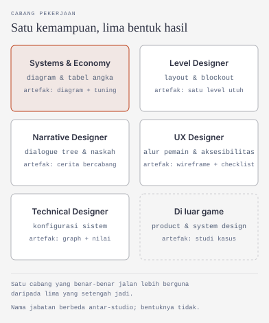

# Role Game Designer: Yang Dikerjakan, Cabangnya, dan Buktinya

Dokumen ini untuk kamu yang memilih kelas Design, atau yang masih menimbang antara Design dan dua kelas lain. Isinya tiga hal saja: apa yang sebenarnya dikerjakan game designer, cabang pekerjaan yang bisa kamu tuju beserta buktinya, dan bentuk hasil yang bisa diperiksa orang lain.

Dua kelas lain punya dokumennya sendiri: [Role Programmer](/miniclass/game/programmer/) dan [Role Artist](/miniclass/game/artist/). Di sini keduanya hanya muncul sebagai batas: bagian mana yang bukan pekerjaanmu.

Konteks programnya — gate minggu 4, jalur Observer, kontrak waktu, dan aturan AI secara umum — ada di [Materi Minggu 1](/miniclass/game/). Dokumen ini tidak mengulanginya.

Satu hal perlu jelas sejak awal. Game designer bukan "orang yang punya ide". Semua orang punya ide, dan itu bagian yang paling murah. Pekerjaan intinya adalah mengubah rasa yang kamu inginkan — tegang, lega, penasaran — menjadi aturan dan angka yang bisa dijalankan mesin, lalu membuktikan dengan pemain sungguhan bahwa rasanya memang begitu. Menulis dokumen hanyalah cara mencapainya.

---

## Yang sebenarnya dikerjakan game designer

Ambil satu contoh kecil. Sebuah catatan di rapat berbunyi: *"Pemain harus merasa tegang saat staminanya hampir habis."*

Kalimat itu belum bisa dikerjakan siapa pun. Designer mengubahnya menjadi keputusan yang punya angka dan urutan:

| Pertanyaan | Jawaban yang harus diputuskan designer |
|---|---|
| Berapa lama staminanya bertahan? | 3,5 detik berlari penuh; terisi penuh dalam 6 detik saat diam |
| Kapan pemain mulai merasa terancam? | di bawah 25%, bukan 50% — ambang yang terlalu awal membuat pemain berhenti berlari sepanjang game |
| Apa yang memberi tahu pemain? | tiga saluran: napas berat, tepi layar berdenyut, dan bar yang memerah. Satu saluran terlalu mudah terlewat |
| Apa yang terjadi kalau habis? | bukan mati: tidak bisa berlari selama 1,5 detik. Hukuman kecil yang terasa lebih baik daripada hukuman besar yang membuat pemain berhenti main |
| Bagaimana membuktikannya? | lima pemain mencoba; dicatat berapa kali mereka memperlambat langkah **sebelum** bar habis |

Lima baris itu pekerjaan designer. Angka di dalamnya bukan tebakan, tetapi juga bukan hasil hitungan rumit — semuanya bisa diubah di satu tempat, dan yang menentukan adalah hasil ujinya.

Yang dilatih di kelas ini karena itu bukan hafalan framework, melainkan tiga hal yang tetap berguna di luar game: mengubah kata sifat menjadi angka yang bisa diubah, menguji klaim dengan orang lain alih-alih dengan selera sendiri, dan menuliskan batas — termasuk apa yang **tidak** akan dikerjakan.

### Batas pekerjaannya

Sebagian besar kekecewaan peserta datang dari salah paham batas ini, bukan dari idenya yang kurang bagus.

| Dikerjakan designer | Bukan pekerjaan designer | Sering disalahpahami |
|---|---|---|
| Menentukan mekanik, angka, dan urutan tantangan | Menulis sistemnya di dalam engine | "Designer yang memutuskan semuanya" |
| Menulis dokumen desain dan batas lingkup | Menggambar aset final | "Ide bagus otomatis jadi game bagus" |
| Menyusun laporan playtest dan memutuskan revisi | Menyusun jadwal dan prioritas tim | "Designer cukup kasih ide lalu pulang" |
| Menyeimbangkan hadiah dan kesulitan berdasarkan hasil uji | Mengukur performa dan ukuran build | "Balancing cukup dikira-kira" |
| Menulis alur pemain dan daftar aksesibilitas | Memasarkan game | "Semua orang bisa jadi designer tanpa mencoba" |
| Menyiapkan pitch dan daftar hal yang tidak dikerjakan | Menjanjikan game selesai dalam delapan minggu | "Dokumen tebal berarti desainnya bagus" |

Dua baris terakhir yang paling sering diabaikan. Dokumen desain yang berguna justru yang pendek dan dipakai — lihat [materi one-page GDD](/miniclass/game/archive/2026/industri-game-dev-dan-one-page-gdd/M-1-industri-game-dev-dan-one-page-gdd) untuk bentuk satu halaman yang bisa dibaca tim.

Satu batas lagi yang tidak tertulis: designer **boleh** membuka Unity, tetapi untuk mengubah nilai di Inspector dan mencoba ulang, bukan untuk menulis sistemnya. Begitu kamu mulai menyusun class dan event, itu sudah wilayah [Programmer](/miniclass/game/programmer/).

Designer juga **boleh** memotong fitur, asal alasannya dicatat. Ide boleh datang dari siapa saja; keputusan akhir soal mekanik tetap di designer — dan itu berarti kamu yang harus bisa menjelaskan kenapa.

---

## Satu kemampuan, lima bentuk hasil

Di lowongan kerja, "game designer" jarang berdiri sendiri. Ada systems designer, level designer, narrative designer, UX designer, dan technical designer. Perbedaan mereka bukan alat yang dipakai — kebanyakan sama-sama menulis dokumen dan mengubah angka — melainkan **jenis artefak yang diserahkan** dan **jenis masalah yang membuat mereka dipanggil**.

Hasil akhir dari semua cabang itu, kalau dirakit, terlihat seperti satu game yang berjalan: aturan yang seimbang, level yang mengalir, cerita yang masuk akal, menu yang tidak membingungkan, dan sistem yang bisa diatur tanpa menyentuh kode.



Lima kotak cabang di atas bukan lima karier yang terpisah rapi. Kebanyakan orang mulai dari satu, lalu menambah dua atau tiga seiring proyek yang dikerjakan. Yang penting: setiap cabang punya hasil yang bisa dilihat orang lain.

| Cabang | Artefak yang diserahkan | Contoh nyata yang bisa dibuka sekarang | Bentuk postingan |
|---|---|---|---|
| **Systems / economy** | Diagram aliran sumber daya + tabel angka | [Machinations](https://machinations.io/): diagram ekonomi game yang bisa dijalankan dan diubah angkanya | Tangkapan diagram + tabel angka sebelum dan sesudah tuning |
| **Level designer** | Layout, blockout, urutan tantangan | [Game jam di itch.io](https://itch.io/jams): ribuan game jadi dalam 48–72 jam, banyak yang levelnya bisa dibedah | GIF 20 detik alur level + sketsa layout |
| **Narrative designer** | Dialogue tree, naskah bercabang | [Twine](https://twinery.org/): open source, tanpa koding, hasilnya langsung jadi HTML | Tangkapan peta cerita + tautan cerita yang bisa dimainkan |
| **UX designer (game)** | Alur pemain, wireframe menu, daftar aksesibilitas | [Xbox Accessibility Guidelines](https://learn.microsoft.com/en-us/gaming/accessibility/guidelines): 23 butir dari tampilan teks sampai pengaturan fotosensitif | Wireframe + checklist yang dicentang atau ditolak |
| **Technical designer** | Konfigurasi sistem, state machine, nilai di engine | [Unity Visual Scripting](https://docs.unity3d.com/Manual/com.unity.visualscripting.html): perilaku disusun dari graph, bukan baris C# | Tangkapan graph + penjelasan node mana memicu apa |
| **Di luar game** | Product design, system design, riset pengguna | Kemampuan yang sama, konteks berbeda | Studi kasus satu halaman: masalah, keputusan, hasil |

Catatan sebelum kamu membuka tautan di tabel itu:

| Contoh | Yang perlu kamu tahu |
|---|---|
| Machinations | Fiturnya berlapis dan sebagian berbayar. Versi gratis cukup untuk belajar, dan banyak diagram komunitas bisa dipelajari tanpa akun. |
| itch.io/jams | Isinya ribuan entri dengan kualitas campur. Yang berguna bukan memenangkan jam, tapi melihat bagaimana orang menyelesaikan lingkup kecil. |
| Twine | Versi 2.12.1 (Oktober 2026). Ceritanya diekspor jadi HTML, jadi tidak otomatis jadi game bergrafis. |
| Xbox Accessibility Guidelines | Dokumen v3.2 (Juni 2023), disusun untuk konsol dan PC. Berguna sebagai daftar periksa, bukan syarat sertifikasi. |
| Unity Visual Scripting | Dokumentasi yang tertaut mengikuti versi terbaru Unity, sedangkan program ini memakai **6.3 LTS**. Nomor versi paketnya bisa berbeda dari yang kamu lihat. |

Polanya tetap berguna. Yang perlu kamu waspadai hanya satu: contoh yang bagus tidak otomatis cocok dengan proyekmu, dan alat yang rumit tidak membuat desainnya otomatis bagus.

Kalau butuh kerangka untuk membedah game, [MDA](https://en.wikipedia.org/wiki/MDA_framework) — Mechanics, Dynamics, Aesthetics — adalah titik mulai yang paling sering dipakai: designer menyusun mekanik, pemain merasakan hasilnya. Kerangka ini juga punya kritik, terutama karena terlalu berat ke mekanik dan kurang cocok untuk game yang berorientasi pengalaman. Pakai sebagai alat, bukan sebagai jawaban.

Satu catatan tentang daftar ini: ia tidak lengkap. **Creative director** dan **game director** juga jabatan di industri, tetapi keduanya bukan posisi pemula — biasanya diisi orang yang sudah melewati beberapa cabang di atas. Nama jabatan juga berbeda antar-studio; di tim kecil, satu orang sering merangkap level dan narrative sekaligus.

### Realita: satu dokumen, banyak pembaca

Di studio besar, dokumen desain dibaca puluhan orang dan dipecah per bagian. Di tim 3–5 orang — termasuk tim lomba dan proyek tugas akhir — pembacanya tiga orang, dan kadang hanya dirimu sendiri tiga minggu kemudian.

Itu mengubah hal yang perlu kamu tulis. Bukan dokumen tebal, tetapi dokumen yang menjawab pertanyaan pembacanya:

| Pembaca | Yang dicari | Akibat kalau tidak ditulis |
|---|---|---|
| Programmer | aturan yang jelas dan urutan kejadian | mereka menebak, lalu dua orang menebak berbeda |
| Artist | daftar aset dan batasan gaya | aset dibuat dua kali, atau tidak dipakai sama sekali |
| Penguji | cara memicu sesuatu dan hasil yang benar | laporan bug masuk tanpa bukti |
| Dirimu, tiga minggu kemudian | alasan di balik sebuah angka | kamu mengubah angka tanpa tahu kenapa, lalu mengulanginya |

Ini bukan data survei, melainkan pengamatan yang berulang di tim kecil. Anggap sebagai gambaran, bukan patokan.

Yang bisa kamu ambil: kelas Design mengajarkan **batas** lebih dulu, bukan mengumpulkan ide. Satu mekanik yang sudah diuji dengan lima pemain lebih berguna daripada sepuluh ide di dokumen yang tidak pernah dibaca.

### Bukti seperti apa yang dihitung

Untuk pemula, "bukti" bukan panjang dokumen dan bukan jumlah ide yang ditulis. Yang dihitung hanya hal yang bisa diperiksa orang lain tanpa bertanya kepadamu.

| Jenis bukti | Membuktikan apa | Kelemahannya |
|---|---|---|
| Dokumen desain satu halaman | Kamu bisa memilih yang penting, bukan menulis semua | Rapi di atas kertas tidak berarti jalan saat dimainkan |
| Tabel angka dengan nilai awal dan hasil uji | Angkanya diubah karena alasan, bukan karena selera | Tanpa tanggal dan jumlah penguji, angkanya tidak bisa diulang |
| Laporan playtest berisi kutipan pemain | Kamu mendengar pemain, bukan menebak mereka | Lima pemain bukan sampel besar; sebutkan jumlahnya |
| Daftar hal yang **tidak** dikerjakan | Kamu bisa menjaga lingkup | Daftar panjang tanpa prioritas hanya memindahkan masalah |
| Rekaman 30 detik yang menunjukkan satu mekanik | Mekaniknya benar-benar berjalan | Rekaman bagus tidak menunjukkan berapa kali ia gagal sebelumnya |
| Diagram sistem atau level | Kamu berpikir dalam hubungan, bukan daftar fitur | Diagram bisa terlihat rapi meski angkanya belum diuji |

Dokumen yang paling mudah dinilai adalah yang menyebutkan **angka awal, jumlah penguji, dan keputusan akhir**. Itu sebabnya contoh di program ini selalu meminta tiga hal tersebut.

Cara paling murah memulai analisis ada di [Ayo Bermain Game](/miniclass/game/archive/2025/M-2): core loop, mechanics, dynamics, balancing, dan replayability. Materi itu mengajarkan membaca game orang lain sebelum menulis game sendiri.

### Contoh postingan

Format berikut dipakai di program ini. Isinya sengaja dibuat bisa diperiksa, bukan sekadar bercerita.

```text
Judul        : Stamina yang membuat pemain berhenti berlari
Pembuat      : [nama]
Kelas        : Design
Apa yang dibuat : tabel 5 angka + laporan playtest 5 pemain
Apa yang dipelajari : ambang 25% lebih terasa daripada 50%; tiga saluran
                      umpan balik lebih terbaca daripada satu
Link hasil   : github.com/[akun]/stamina-tuning
Status       : selesai, diuji 2 sesi
Penggunaan AI: [tautan AI Usage Log]
Masukan yang diinginkan : angka regen 6 detik terlalu longgar untuk level 3?
```

Contoh kedua, untuk cabang yang hasilnya bukan sistem:

```text
Judul        : Satu level pembuka yang mengajarkan lompat
Apa yang dibuat : blockout 1 level + sketsa layout + rekaman 30 detik
Apa yang dipelajari : satu mekanik per ruang; tidak ada teks instruksi
Link hasil   : rekaman 30 detik + foto sketsa
Status       : masih eksperimen, ruang ketiga belum selesai
Masukan yang diinginkan : pemain melewati ruang kedua tanpa sadar belajar?
```

Perhatikan bedanya dengan kalimat yang sering muncul di grup chat. Kolom kanan adalah **bentuk** kalimatnya, bukan angka yang harus kamu tiru.

| Kalimat yang tidak membuktikan apa-apa | Kalimat yang bisa diperiksa |
|---|---|
| "Punya ide game keren" | "Satu mekanik, 5 angka, diuji 5 pemain, revisi 2 kali" |
| "Sudah bikin GDD" | "GDD 1 halaman + daftar 4 hal yang tidak dikerjakan" |
| "Game-nya seru" | "Pemain kedua menyelesaikan level tanpa diminta" |
| "Sudah balancing" | "Waktu tempuh 4:10 → 3:20 setelah regen diubah dari 6 s ke 4 s" |

---

## Kaitannya dengan delapan minggu

Materi ini adalah pengenalan role. Praktik kelasnya berjalan di minggu 5–8.

| Minggu | Yang dikerjakan | Hasil |
|:---:|---|---|
| 5 | Mekanik dan core loop lewat satu analisis game yang sudah ada | Satu halaman analisis + satu mekanik yang bisa dicoba |
| 6 | Menyusun dokumen desain satu halaman dan batas lingkup | GDD 1 halaman + daftar hal yang tidak dikerjakan |
| 7 | Menguji angka dan alur ke pemain sungguhan | Tabel angka + catatan playtest minimal 3 orang |
| 8 | Merevisi, merapikan, dan mengemas | Dokumen + laporan playtest + pitch |

Hasil akhirnya selaras dengan yang dijanjikan di [Materi Minggu 1](/miniclass/game/): dokumen desain, daftar hal yang tidak dikerjakan, laporan playtest, dan pitch. Bukan game utuh.

---

## Batas bantuan AI untuk kelas ini

Program ini menetapkan batas **40%** untuk kelas Design. Angkanya dihitung dari langkah kerja yang boleh dibantu, bukan dari jumlah halaman dokumen.

| Boleh | Tidak boleh |
|---|---|
| Menyusun draf dokumen desain dari catatanmu | Menentukan angka keseimbangan tanpa playtest |
| Menawarkan pilihan mekanik untuk kamu pertimbangkan | Menyerahkan desain utuh lalu mengaku sudah diuji |
| Membuat rumus spreadsheet dari aturan yang **sudah** kamu putuskan | Mengarang hasil playtest atau kutipan pemain |
| Merangkum catatan playtest yang kamu tulis sendiri | Memakai keluaran AI sebagai bukti bahwa pemain menyukainya |

Aturannya satu: **kalau kamu tidak bisa menjelaskan hasil AI, pekerjaan itu belum selesai.** Untuk kelas ini bentuknya lebih ketat: AI boleh mengusulkan angka, tetapi angka yang dipakai harus berasal dari uji dengan pemain. Angka yang tidak pernah diuji bukan desain — itu tebakan yang ditulis rapi.

Setiap artefak menyertakan catatan singkat: apakah AI digunakan, bagian apa yang dibantu, dan apa yang kamu periksa atau ubah sendiri.

---

## Pertanyaan yang sering muncul

**Harus bisa ngoding?** Tidak. Kelas ini memakai angka, tabel, dan dokumen. Kalau nanti kamu ingin menyentuh engine, batasnya ada di technical designer, dan itu bukan syarat masuk kelas.

**Harus jago matematika?** Tidak. Perhitungannya hanya penjumlahan, perbandingan, dan persentase sederhana. Yang lebih menentukan adalah kesabaran menguji ulang.

**Apa bedanya "punya ide" dengan jadi designer?** Ide tidak bisa diuji. Desain bisa: ada aturan, ada angka, ada catatan siapa yang mencoba dan apa yang terjadi.

**Apa bedanya dengan kelas Programmer?** Designer memutuskan apa yang harus terjadi; Programmer membuatnya benar-benar terjadi. Batasnya bertemu di technical designer, dan [dokumen Programmer](/miniclass/game/programmer/) membahas sisi seberangnya.

**Apa bedanya dengan kelas Artist?** Designer menulis aturan dan alur; Artist menentukan bagaimana semuanya terlihat dan terasa saat dilihat. Lihat [dokumen Artist](/miniclass/game/artist/).

**Laptop saya lemah?** Kelas ini paling ringan dari ketiganya: dokumen, spreadsheet, dan game yang sudah ada. Unity baru relevan kalau kamu masuk ke technical designer. Pengecekan laptop tetap dilakukan di minggu 2.

**Harus banyak main game?** Membantu, tapi tidak harus banyak. Yang lebih berguna adalah bermain satu game dengan saksama sambil mencatat, seperti panduan di [Ayo Bermain Game](/miniclass/game/archive/2025/M-2).

**Bisa jadi bahan skripsi?** Bisa, dan justru paling dekat: game edukasi dan pengujian pengalaman pemain sering memakai MDA atau MDLC sebagai metode. Syarat dan pedomannya berbeda tiap jurusan — [Materi Minggu 1](/miniclass/game/) membahas bagian ini lebih lengkap.

---

Game designer bukan orang yang paling banyak punya ide. Ia orang yang bisa mengubah rasa yang diinginkan menjadi aturan dan angka, mengujinya ke pemain sungguhan, lalu berani membuang bagian yang tidak terbukti.

Yang menentukan bukan tebal dokumenmu, melainkan apakah keputusan di dalamnya bisa dijelaskan, diuji, dan diulang oleh orang lain.