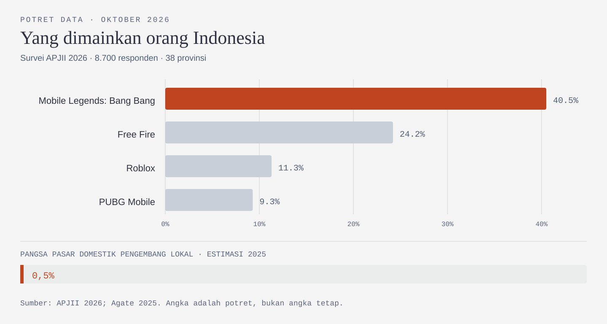
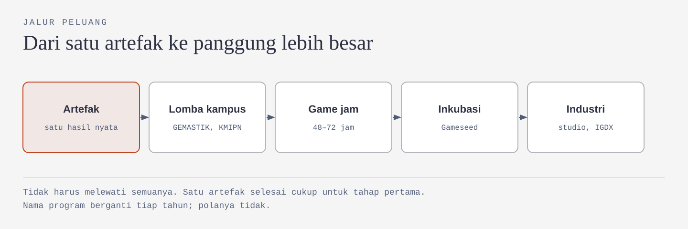
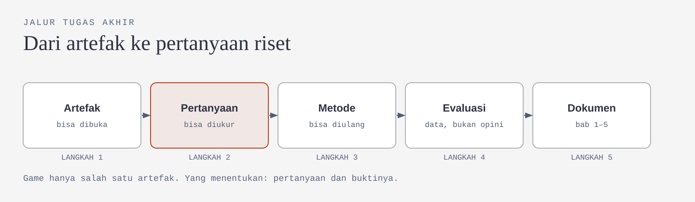
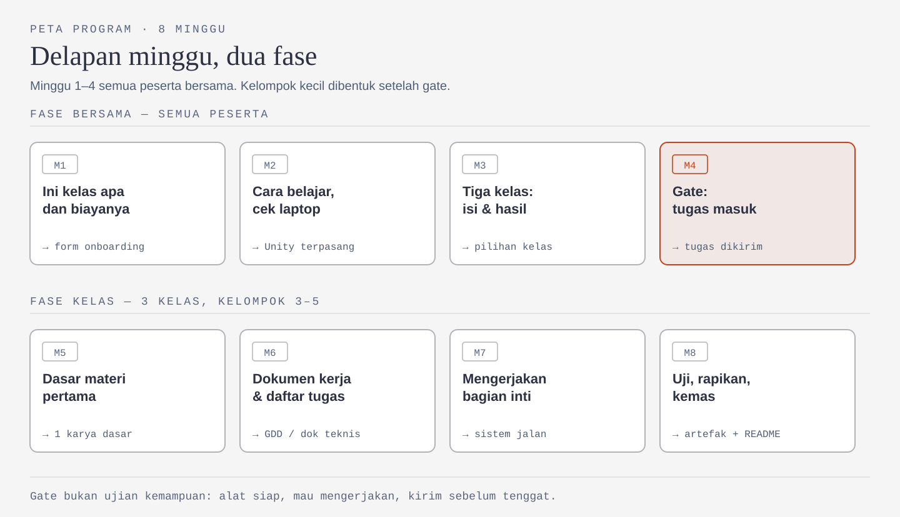

# Minggu 1: Kami Tidak Menjanjikan Kamu Jago Bikin Game

Kalau kamu ikut miniclass gamedev ini karena ingin coba-coba, penasaran, atau diajak teman, itu wajar. Hampir semua orang memulai dari alasan seperti itu. Yang sering tidak dijelaskan adalah apa yang sebenarnya akan kamu kerjakan—dan apa yang tidak akan kamu dapatkan.

Artikel ini menjelaskan semuanya. Kalau kamu tidak sempat datang pada minggu pertama, tidak masalah; kamu tetap bisa memahami tujuan program dan alurnya dari sini.

Satu hal yang perlu kamu tahu sejak awal: minggu pertama bukan pelajaran Unity. Kami belum menyentuh engine sama sekali. Materi teknis baru dimulai pada minggu kelima.

Alasannya sederhana. Banyak kelas gamedev pemula mulai dengan membuka Unity, lalu kehilangan peserta beberapa minggu kemudian. Bukan selalu karena materinya terlalu sulit, tetapi karena bayangan peserta tentang kelas ini berbeda dari kenyataannya.

Banyak orang membayangkan bahwa empat minggu lagi mereka sudah punya game. Kenyataannya, pada tahap itu mereka mungkin baru memahami kenapa script mereka tidak berjalan.

Karena itu, kami mulai dari hal yang lebih mendasar: menjelaskan terlebih dahulu apa yang akan dan tidak akan kamu dapatkan.

---

## Yang kami bangun bukan "jago", tapi lingkungan

Banyak kelas game menjual kalimat ini: *"dalam 8 minggu kamu bisa bikin game sendiri."* Kami tidak memakai kalimat itu, karena tidak jujur.

Yang kami bangun adalah tempat untuk terus belajar setelah delapan minggu selesai. Kalau kursus berhenti ketika pertemuan terakhir selesai, lingkungan belajar yang baik masih memberi kamu orang untuk bertanya, jadwal yang jelas, dan kesempatan untuk mencoba lagi.

Skill tetap berkembang. Namun, perkembangannya datang dari praktik, teman satu kelompok, dan hasil yang kamu kerjakan sendiri—bukan hanya dari mentor yang berbicara selama dua jam.

Masalahnya, "lingkungan yang mendukung" mudah menjadi kalimat kosong. Jadi, inilah bentuk dukungan yang bisa kamu harapkan.

| Yang dijanjikan         | Wujud nyatanya                                                                        | Yang bukan              |
| ----------------------- | ------------------------------------------------------------------------------------- | ----------------------- |
| Ada orang yang menjawab | Channel per kelompok setelah gate; pertanyaan dijawab maksimal 1×24 jam di hari kerja | Grup besar yang sepi    |
| Ada jadwal yang jelas   | Tiap minggu: satu materi pendek, satu praktik, satu hasil kecil                       | Materi menumpuk         |
| Ada ruang untuk gagal   | Hasil boleh kecil dan belum rapi, asal bisa dijelaskan                                | Ranking dan nilai angka |
| Ada umpan balik         | Review memakai checklist yang sama untuk semua                                        | Pujian kosong           |
| Ada jalan keluar        | Observer tanpa diumumkan dan tanpa dipermalukan                                       | Hilang tanpa kabar      |

Namun, dukungan bukan sesuatu yang berjalan satu arah. Lingkungan ini juga membutuhkan kontribusimu: bertanya ketika mengalami kendala, membantu teman yang masih bingung, dan menunjukkan hasil meskipun belum sempurna. Kalau semua orang hanya menunggu dilayani, diskusinya tidak akan berjalan.

Di sini mentor berperan sebagai pendamping, bukan pengajar yang terus-menerus berceramah. Materi dipelajari sebelum sesi; waktu tatap muka digunakan untuk praktik. Cara kerja ini membuat kamu lebih aktif dalam proses belajar.

---

## Pasar besar, pembuat lokal kecil

Menjelaskan kekurangan tanpa menjelaskan peluang itu tidak adil. Jadi ini dua sisi sekaligus.

Survei APJII 2026 menemukan sekitar **28,3% pengguna internet Indonesia bermain game daring**. Yang dimainkan:

| Game                      | Porsi pemain |
| ------------------------- | ------------: |
| Mobile Legends: Bang Bang | 40,5%        |
| Free Fire                 | 24,2%        |
| Roblox                    | 11,3%        |
| PUBG Mobile               | 9,3%         |

Keempat game tersebut bukan buatan Indonesia.

Sementara itu, laporan *The State of Indonesia's Game Industry* dari Agate (2025) memperkirakan pengembang lokal hanya meraih sekitar **0,5% pangsa pasar domestik**. Kementerian Komunikasi dan Digital menyebut sektor ini menyumbang sekitar **Rp71 triliun per tahun**, dengan lebih dari 2.000 pengembang dan penerbit.

Ada dua catatan penting. Sebagian data tersebut berasal dari pelaku industri sendiri, dan definisi "pengembang" dapat berbeda-beda. Namun, gambaran besarnya jelas: pasar game Indonesia besar, tetapi porsi yang dinikmati pengembang lokal masih kecil.

Kenapa bisa begitu? Ada tiga alasan yang sering muncul.

| Sebab       | Penjelasannya                                                                   | Contoh                                                                          |
| ----------- | ------------------------------------------------------------------------------- | ------------------------------------------------------------------------------- |
| Akses modal | Studio kecil sulit membiayai produksi 1–2 tahun tanpa pendapatan                | DreadOut menggalang dana lewat Indiegogo: target US$25.000, terkumpul US$29.067 |
| Talenta     | Orang yang siap bekerja di produksi game masih lebih sedikit daripada kebutuhan | Banyak tenaga berbakat memilih bekerja di luar negeri                           |
| Distribusi  | Menjangkau pasar global butuh pemasaran, lokalisasi, dan kualitas produksi      | Hal ini tidak selalu diajarkan di kampus                                        |

Namun, ada juga karya Indonesia yang berhasil. *A Space for the Unbound* (Mojiken Studio, 2023) memenangkan kategori Best Storytelling di SEA Game Awards dan masuk nominasi Games for Impact di The Game Awards 2023. Ceritanya berlatar kota kecil di Indonesia pada tahun 1990-an. *Coffee Talk* (Toge Productions, 2020) mencatat pendapatan kotor sekitar Rp7,6 miliar pada Februari 2020. *DreadOut* (Digital Happiness, 2014) menembus Steam dan kemudian diadaptasi menjadi film.

Ketiganya bukan produk studio raksasa. Dua di antaranya bahkan dikembangkan oleh tim yang jauh lebih kecil daripada yang mungkin kamu bayangkan.

Jadi, angka 0,5% bukan alasan untuk menyerah, dan besarnya pasar bukan alasan untuk merasa semuanya mudah. Peluangnya ada, tetapi bukan dengan meniru empat game teratas. Peluang itu bisa datang dari cerita lokal, kebutuhan pemain yang belum terpenuhi, dan kualitas produksi.

---

## Yang bisa kamu kerjakan setelah ini

Satu hal yang jarang dijelaskan kepada pemula: industri game bukan hanya soal programming dan art. Banyak peran tidak mengharuskan kamu membuat game utuh seorang diri. Jadi, kalau kamu merasa belum sanggup membuat game lengkap, kamu tetap bisa mulai dari satu bidang yang paling menarik bagimu.

Programmer mengerjakan sistem dan performa. Technical artist mengerjakan shader, VFX, dan alur kerja aset. Game designer menyusun mekanik, menyeimbangkan angka, dan merancang pengalaman pemain. Ada juga UI/UX game, producer yang mengatur lingkup dan jadwal proyek, QA yang mencari bug, serta audio.

| Peran            | Yang dikerjakan                                | Berguna juga untuk                              |
| ---------------- | ---------------------------------------------- | ----------------------------------------------- |
| Programmer       | Sistem, mekanik, performa                      | Arsitektur software, debugging, version control |
| Technical artist | Shader, VFX, alur kerja aset                   | Grafis, optimasi, pembuatan tool                |
| Game designer    | Mekanik, keseimbangan angka, pengalaman pemain | Berpikir produk, menulis spesifikasi            |
| UI/UX game       | Menu, HUD, alur awal pemain                    | UI/UX produk digital                            |
| Producer         | Lingkup proyek, jadwal, koordinasi             | Manajemen proyek                                |
| QA / playtester  | Mencari bug, menguji pengalaman                | Metode pengujian                                |
| Audio            | Efek suara, musik, implementasi                | Produksi audio                                  |

Skill tersebut juga berguna di luar game. Programmer belajar menyusun software dan mencari kesalahan. Designer belajar memahami produk dan menulis spesifikasi. Artist belajar grafis, optimasi, dan tooling.

Karena itu, kelas Design juga memberi porsi pada manajemen proyek. Di tim kecil maupun dalam lomba, game designer sering membantu menjaga arah proyek—bukan hanya membuat ide.

Kamu juga tidak harus mempelajari semuanya sekaligus. Memiliki kemampuan yang kuat di satu bidang sering lebih berguna daripada mengetahui sedikit tentang banyak hal. Itu sebabnya program ini memiliki tiga jalur yang jelas.

---

## Peluang yang bisa kamu ikuti

Aturan itu penting, tapi yang lebih menentukan apakah kamu berkembang adalah seberapa sering kamu keluar dan memamerkan hasil. Untungnya, jalur untuk itu di Indonesia sudah banyak — dan sebagian besar tidak menuntut kamu sudah jago.

| Jenis | Contoh | Bentuk tim | Yang kamu dapat |
|---|---|---|---|
| Kompetisi mahasiswa nasional | GEMASTIK divisi *Pengembangan Aplikasi Permainan*; KMIPN kategori Aplikasi Permainan | 3 orang, lewat kampus | Portofolio, pengalaman presentasi, pengakuan akademik |
| Inkubasi dan kompetisi industri | Gameseed, program Direktorat Gim | Tim, jalur student dan public, PC dan mobile | Mentoring, showcase publik, jaringan studio |
| Game jam | Global Game Jam, game jam kampus, game jam komunitas, dan game jam yang diadakan studio atau publisher | Bebas, biasanya 48–72 jam | Kebiasaan menyelesaikan, bukan hanya memulai |
| Program platform | Google Play Indie Games, Play Games Level Up, dan program kolaborasi platform yang berganti tiap tahun | Tim dengan build yang siap dirilis | Distribusi, kredit, akses program |
| Ajang industri | IGDX, diselenggarakan Kementerian Komunikasi dan Digital bersama AGI | Bebas | Jaringan, rekrutmen, pameran karya |

Nama program, syarat, dan jadwalnya berganti tiap tahun. Yang tidak berganti adalah polanya: selalu ada jalur yang terbuka untuk pemula, dan selalu ada yang tutup karena kamu tidak mendaftar.

### Kenapa lomba mempercepat

Tiga alasan yang paling terasa:

1. **Ada tenggat yang tidak bisa dinegosiasi.** Proyek pribadi selesai kapan saja; proyek lomba selesai tanggal sekian.
2. **Ada pembanding.** Kamu melihat karya orang lain dengan tingkat kesulitan yang sama, dan itu jauh lebih menenangkan daripada membandingkan diri dengan game komersial.
3. **Ada yang menilai.** Umpan balik dari juri berbeda dari umpan balik teman sendiri, karena mereka tidak berusaha menyenangkanmu.

### Kalau kamu di Polinema

Beberapa kampus memberi pengakuan akademik untuk prestasi ini. Di Polinema, yang umum berlaku:

| Prestasi | Pengakuan yang biasa diberikan | Yang perlu dicek |
|---|---|---|
| GEMASTIK juara 1, 2, atau 3 | Pengajuan bebas skripsi | Syarat administratif, kesesuaian bidang, dan apakah berlaku untuk angkatanmu |
| KMIPN | Konversi nilai A pada mata kuliah terkait | Mata kuliah mana yang bisa dikonversi, dan batas maksimalnya |
| Gameseed, game jam, IGDX | Umumnya belum masuk konversi resmi, tapi kuat untuk portofolio | Tanyakan ke jurusan apakah ada skema rekognisi |

Kebijakan seperti ini bisa berubah dan pelaksanaannya berbeda antar-jurusan. Konfirmasi ke jurusan atau koordinator tugas akhir sebelum kamu mengandalkannya — jangan mengandalkan artikel ini.

### Yang perlu disiapkan untuk ikut

Tidak banyak, dan sebagian sudah kamu kerjakan di program ini:

- **Satu artefak yang bisa dibuka.** Bukan ide, bukan slide. Build yang bisa dijalankan atau dokumen yang bisa dibaca.
- **Tiga orang yang bisa dihubungi.** Lomba tim jarang dimenangkan sendirian, dan yang paling dicari biasanya artist atau programmer yang bisa diandalkan.
- **Satu kalimat penjelasan.** Apa karyanya, untuk siapa, dan apa yang menarik darinya. Ini yang ditanya pertama kali oleh juri maupun perekrut.

Sisanya soal keberanian mendaftar. Banyak tim kalah bukan karena karyanya kurang, tapi karena tidak pernah mengirim.

---

## Game bisa jadi skripsi

Pertanyaan ini muncul hampir setiap angkatan. Jawabannya: bisa, tetapi ada syaratnya. Yang dinilai bukan sekadar game yang dibuat, melainkan penelitian di balik game tersebut.

Bedanya kira-kira seperti ini.

| Proyek hobi                          | Tugas akhir                                                                        |
| ------------------------------------ | ---------------------------------------------------------------------------------- |
| "Saya membuat game horor."           | "Saya menguji apakah suara latar meningkatkan kewaspadaan pemain pada game horor." |
| Selesai kalau gamenya bisa dimainkan | Selesai kalau pertanyaannya terjawab dengan data                                   |
| Tidak butuh pembanding               | Butuh pembanding, kelompok kontrol, atau versi alternatif                          |
| Dokumentasi seadanya                 | Metode, instrumen, dan analisis yang bisa diulang                                  |

Biasanya ada empat hal yang perlu disiapkan:

1. **Masalah yang jelas, bukan hanya ide.** "Saya ingin membuat game" belum menjadi masalah penelitian.
2. **Metode yang sesuai.** Misalnya MDLC, MDA framework, design science research, atau eksperimen kuasi.
3. **Evaluasi.** Tanpa pengukuran, kesimpulannya hanya klaim.
4. **Kontribusi.** Kontribusinya dapat berupa artefak, model, atau bukti empiris.

Game edukasi sudah sering menjadi tema tugas akhir di Indonesia. Jurnal seperti *Peripheral*, *SASAK*, dan *DeKaVe* juga memuat penelitian tentang perancangan game dan media interaktif berbasis game.

Namun, aturan setiap jurusan berbeda. Baca pedoman tugas akhir di jurusanmu sendiri dan tanyakan kepada dosen pembimbing apakah artefak game dapat menjadi bagian dari metode penelitian. Cek juga apakah laboratorium memiliki perangkat yang dibutuhkan untuk pengujian. Rencana evaluasi sebaiknya dibuat sejak proposal, bukan setelah game selesai.

Yang menentukan diterima atau tidak bukan gamenya, melainkan pertanyaan penelitian dan buktinya.

---

## Delapan minggu, dua fase

Pada minggu 1–4, semua peserta mengikuti sesi bersama. Kelompok kecil baru dibentuk setelah gate minggu 4.

| Minggu | Isi                                | Hasil                               |
| :------: | ---------------------------------- | ----------------------------------- |
| 1      | Mengenal program dan komitmennya   | Form onboarding + kontrak           |
| 2      | Cara belajar dan pengecekan laptop | Unity terpasang                     |
| 3      | Mengenal tiga kelas dan hasilnya   | Pilihan kelas                       |
| 4      | **Gate** — tugas masuk kelas       | Tugas dikirim                       |
| 5      | Dasar materi pertama               | 1 karya dasar                       |
| 6      | Menyusun dokumen kerja             | GDD / dokumen teknis / standar aset |
| 7      | Mengerjakan bagian inti            | Bagian inti berjalan                |
| 8      | Menguji, merapikan, dan mengemas   | Artefak + README                    |

Kenapa kelompok baru dibentuk setelah gate? Karena peserta yang mendaftar belum tentu bisa bertahan sampai akhir. Kalau kelompok dibentuk terlalu awal, pendamping bisa menghabiskan waktu untuk kelompok yang anggotanya banyak berkurang, sementara peserta yang tetap aktif mendapat lebih sedikit perhatian. Gate membantu kami membentuk kelompok berdasarkan kesiapan untuk mengerjakan, bukan hanya berdasarkan pendaftaran.

Jadwalnya seperti ini. Sebelum Kamis, kamu menonton satu video maksimal 20 menit, membaca satu cheat sheet, dan mengerjakan latihan kecil—total sekitar 60–90 menit. Pada hari Kamis, kamu mengikuti dua jam praktik. Total waktunya sekitar tiga jam per minggu. Setiap minggu ada satu hasil nyata: file, foto, atau commit.

Gate minggu 4 bukan ujian kemampuan. Yang dilihat hanya tiga hal: alat sudah siap, kamu mau mengerjakan, dan kamu bisa mengirim hasil sebelum tenggat. Kalau belum lolos, kamu tidak dikeluarkan. Ada jalur **Self-Paced Observer**: materi tetap bisa diakses, tetapi tanpa kewajiban mengikuti kelompok.

Kalau soal tiga jalurnya, hasil akhirnya kira-kira seperti ini.

| Jalur           | Mulai dari                    | Hasil akhir                                                                  |
| --------------- | ----------------------------- | ---------------------------------------------------------------------------- |
| **Programmer**  | Dasar OOP lewat tampilan menu | Satu modul yang bisa dipakai ulang + repo + demo 30 detik                    |
| **Game Design** | Mekanik dan core loop         | Dokumen desain + daftar hal yang tidak dikerjakan + laporan playtest + pitch |
| **Artist**      | Bentuk, warna, komposisi      | Paket aset + UI + animasi + panduan gaya + README                            |

Game utuh tidak wajib. Yang wajib adalah satu artefak nyata yang bisa dibuka, dijelaskan, dan digunakan sebagai bahan portofolio.

---

## Kontraknya dua arah

Kontrak ini berlaku dua arah. Keduanya punya kewajiban yang jelas.

| Yang kami minta dari kamu                                                  | Yang kami janjikan                                               | Yang **tidak** kami janjikan                         |
| -------------------------------------------------------------------------- | ---------------------------------------------------------------- | ---------------------------------------------------- |
| Dua jam Kamis + sekitar satu jam mandiri per minggu, selama delapan minggu | Materi mingguan ringkas: satu video ≤20 menit + satu cheat sheet | Kamu langsung jago membuat game dalam delapan minggu |
| Laptop sendiri; kami tidak menyediakan perangkat                           | Pendampingan kelompok kecil 3–5 orang setelah gate               | Kamu menghasilkan game utuh                          |
| Kabari kalau tidak bisa hadir                                              | Pertanyaan dijawab maksimal 1×24 jam di hari kerja               | Nilai atau ranking                                   |
| Kirim tugas gate minggu 4                                                  | Umpan balik dengan checklist yang sama untuk semua               | Mentor mengerjakan bagian sulit untukmu              |
| Bertanya kalau mengalami kendala                                           | Jalur Observer tanpa dipermalukan                                | Sertifikat kompetensi                                |

Kalau kamu mulai tidak aktif, begini cara kami menindaklanjutinya.

| Kondisi                     | Yang kami lakukan                                      |
| --------------------------- | ------------------------------------------------------ |
| Satu kali absen tanpa kabar | Menghubungi secara pribadi dalam 24 jam                |
| Dua kali berturut-turut     | Menanyakan kendala dan menawarkan cara mengejar materi |
| Tiga kali                   | Menghubungi lagi dan menawarkan jalur Observer         |

Observer bukan hukuman. Ini pilihan agar kamu bisa mengurangi komitmen tanpa harus menghilang atau merasa malu. Nama peserta yang tidak lolos juga tidak diumumkan kepada publik.

Satu kalimat yang perlu kamu ingat: **kami tidak menjanjikan kamu langsung jago. Kami menjanjikan kamu tidak sendirian saat belajar.** Dua hal itu berbeda, dan dukungan seperti ini biasanya membantu orang bertahan.

---

## AI: alat, bukan pengganti

Angka 40% / 40% / 10% yang sering disebut bukan nilai dan bukan pembagian porsi tugas. Angka itu menunjukkan seberapa jauh AI boleh membantu langkah kerja di setiap kelas.

Aturannya sederhana: **kalau kamu tidak bisa menjelaskan hasil AI, pekerjaan itu belum selesai.**

| Kelas       | Batas | Boleh dipakai untuk                                                                  | Tidak boleh                                        |
| ----------- | ----- | ------------------------------------------------------------------------------------ | -------------------------------------------------- |
| Programmer  | 40%   | Menjelaskan error, membuat kerangka kode, merapikan kode, menyusun langkah pengujian | Menyalin kode yang tidak dipahami                  |
| Game Design | 40%   | Draf dokumen desain, pilihan mekanik, rumus spreadsheet, merangkum catatan playtest  | Menentukan angka keseimbangan tanpa playtest       |
| Artist      | 10%   | Mencari referensi, menjelaskan pengaturan impor, merapikan penamaan file             | Membuat aset jadi: gambar, tekstur, model, animasi |

Angka 10% untuk Artist adalah batas atas, bukan target. Aset final harus dibuat sendiri.

Setiap artefak menyertakan catatan singkat: apakah AI digunakan, bagian apa yang dibantu, dan apa yang diperiksa atau diubah olehmu.

---

## Pertanyaan yang sering muncul

**Harus jago matematika?** Tidak. Logika dasar sudah cukup; kelas Design hanya menggunakan perhitungan sederhana.

**Laptop saya kurang kuat?** Spesifikasinya diperiksa pada minggu 2. Jangan membeli laptop baru sebelum mendapat informasi dari pengurus.

**Bisa ganti kelas?** Pilihan kelas dibuat pada minggu 3. Setelah gate, perubahan dibicarakan dengan pendamping kelas.

**Harus membuat game utuh?** Tidak. Hasilnya harus nyata dan bisa dijelaskan, tetapi bentuknya bebas.

**Tidak bisa hadir pada hari Kamis?** Materi dapat dipelajari mandiri, tetapi peserta di jalur aktif tetap perlu mengikuti praktik. Kabari pengurus jika berhalangan.

**Berarti saya tidak diajari?** Tetap diajari, tetapi bukan hanya melalui ceramah. Teori dipelajari lewat materi singkat; waktu Kamis digunakan untuk praktik bersama pendamping.

**Kalau bukan untuk menjadi jago, buat apa ikut?** Kamu akan pulang dengan satu artefak, cara kerja yang bisa diulang, dan orang yang masih bisa kamu tanyai setelah program selesai.

**Berarti peserta dibiarkan?** Tidak. Ada gate, kelompok, tenggat, dan checklist. Lingkungan yang mendukung bukan berarti programnya tanpa tuntutan.

**Apa bedanya dengan tutorial YouTube?** Tutorial memberi langkah-langkah. Program ini juga memberi tenggat, umpan balik, dan orang yang membantu memantau progresmu.

---

Delapan minggu tidak cukup untuk membuat seseorang langsung jago. Namun, delapan minggu cukup untuk menghasilkan satu karya nyata, memahami cara kerjanya, dan tahu kepada siapa harus bertanya setelahnya.

Itulah yang kami janjikan.

Kalau setelah membaca ini kamu berpikir, "Ternyata ini bukan kursus instan," berarti kamu sudah mendapat informasi penting sebelum memutuskan untuk ikut.