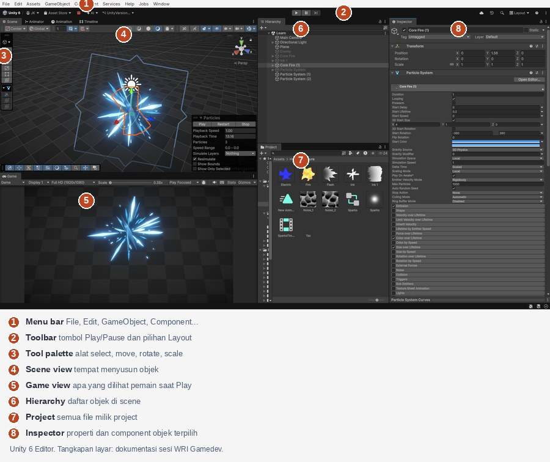
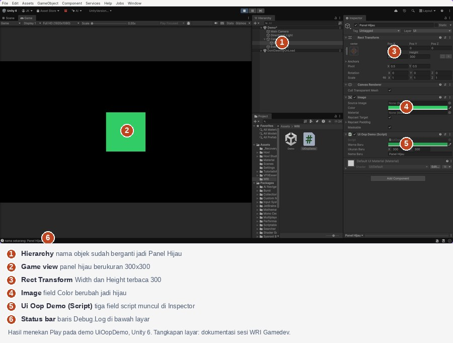

# Minggu 2: Kenalan sama Interface Unity dan Logika OOP Lewat UI

Minggu lalu kamu udah pasang Unity dan jalanin demo pertama ([Role Programmer](/miniclass/game/programmer/)). Minggu ini kita bedah layarnya: bagian ini namanya apa, gunanya buat apa, dan kapan kamu bakal membukanya. Setelah itu kita bikin satu script kecil yang ngubah nama, warna, dan ukuran objek UI — contoh pertama logika OOP di Unity.

Semua contoh di sini pakai **Unity 6.3 LTS**, versi yang dipakai program ini sampai selesai.

---

## Satu layar, delapan bagian



*Unity 6 Editor dengan layout gelap. Nomor 1–8 bakal dipakai terus di bagian ini. Tangkapan layar: dokumentasi sesi WRI Gamedev.*

| No | Nama | Isinya | Kapan kepakenya |
|:---:|---|---|---|
| 1 | Menu bar | File, Edit, GameObject, Component, dst. | Waktu bikin objek baru, nyimpan scene, atau buka pengaturan project |
| 2 | Toolbar | Tombol Play/Pause/Step di tengah, pilihan Layout di kanan | Waktu mau jalanin game atau nata ulang panel |
| 3 | Tool palette | Alat select, move, rotate, scale | Waktu mindahin atau muter objek di Scene |
| 4 | Scene view | Isi scene, bisa dilihat dari sudut mana aja | Waktu nyusun posisi objek |
| 5 | Game view | Tampilan yang dilihat pemain | Waktu tekan Play |
| 6 | Hierarchy | Daftar semua objek di scene yang lagi terbuka | Waktu milih, ganti nama, atau cek induk-anak objek |
| 7 | Project | Semua file punya project: script, gambar, audio, prefab | Waktu cari file atau bikin script baru |
| 8 | Inspector | Properti dan component objek yang lagi dipilih | Hampir selalu — panel ini yang paling sering berubah |

Tiga hal yang paling sering bikin pemula bingung:

- **Scene view itu bukan Game view.** Yang kamu susun di Scene belum tentu kelihatan di Game; yang nentuin apa yang masuk Game view itu kamera.
- **Hierarchy itu bukan Project.** Hierarchy isinya objek yang ada di scene sekarang; Project isinya file-file yang tersedia buat dipakai. Satu file prefab bisa dipakai jadi banyak objek di Hierarchy.
- **Inspector ngikutin pilihan kamu.** Klik objek di Hierarchy atau file di Project, isi Inspector ikut berubah. Kalau Inspector kelihatan "salah", biasanya kamu lagi milih objek yang salah.

---

## Layout: nata ulang panel

Semua panel bisa digeser: tarik tab judulnya (tulisan *Scene*, *Game*, *Hierarchy*, dst.) ke posisi baru, nanti Unity naruhnya sebagai tab atau panel terpisah. Kalau susunannya udah berantakan, nggak usah pasang ulang dari nol: menu **Window → Layouts** nyimpen beberapa susunan bawaan, dan balik ke layout default bakal balikin layar seperti semula.

Dua susunan yang layak dicoba minggu ini: **Default** (Scene dan Game numpuk di kiri) dan **Tall** (buat layar tegak). Pilih lewat dropdown **Layout** di kanan toolbar (nomor 2). Layout nggak ngubah isi project — cuma posisi panel di layarmu.

---

## Component: cara Unity nyusun perilaku

Di Unity, objek di scene namanya **GameObject**, dan GameObject itu pada dasarnya wadah kosong. Perilakunya datang dari **component**: potongan yang ditempel ke wadah itu. Semua yang kamu lihat di Inspector (nomor 8) itu component.

| Component | Yang dia tambahin |
|---|---|
| Transform | Posisi, rotasi, skala — selalu ada dan nggak bisa dihapus |
| Image / Sprite Renderer | Gambar yang kelihatan di layar |
| Collider | Batas tubuh buat tabrakan dan trigger |
| Rigidbody | Gerak yang diatur fisika |
| Script buatanmu | Aturan yang kamu tulis sendiri pakai C# |

Cara nempelin component: pilih objek, tekan **Add Component** di bawah Inspector, ketik namanya. Cara lepasin: klik ikon titik tiga di kanan judul component → **Remove Component**.

Di tangkapan layar tadi, objek `Core Fire (1)` punya dua component: **Transform** dan **Particle System**. Seluruh efek percikan biru itu diatur dari field-field Particle System di Inspector — tanpa nulis kode sama sekali. Itu poin pentingnya: banyak hal di Unity selesai cuma dengan nata component, dan kode baru ditulis kalau component bawaan nggak cukup.

---

## OOP versi Unity

OOP (pemrograman berorientasi objek) kedengarannya berat, padahal di Unity bentuknya kelihatan langsung di layar:

| Istilah OOP | Bentuknya di Unity |
|---|---|
| Class | File script `.cs` di panel Project |
| Object (instance) | Component dari script itu yang nempel di satu GameObject |
| Field / property | Baris nilai di Inspector |
| Method | Fungsi di dalam script yang bisa dipanggil |
| Encapsulation | Field ditulis `private`, tapi tetap muncul di Inspector lewat `[SerializeField]` |

Satu file script bisa ditempel ke sepuluh objek sekaligus; tiap objek pegang nilainya sendiri-sendiri. Itu maksudnya "satu class, banyak object" dalam bentuk yang bisa kamu klik.

---

## Demo: UI yang berubah lewat kode

Contoh minggu ini pakai **Canvas** — wadah semua elemen UI (tombol, teks, panel). Kita bikin satu panel gambar, terus satu script yang ngubah nama, warna, dan ukurannya waktu Play.

### Siapin scene

1. Project baru atau scene kosong. Kalau belum ada Canvas: menu **GameObject → UI → Canvas**. Unity sekalian bikin objek `EventSystem` di Hierarchy; biarin aja.
2. Klik kanan Canvas di Hierarchy → **UI → Image**. Ganti namanya jadi `Panel`.
3. Pastikan `Panel` lagi terpilih, terus lihat Inspector: ada component **Rect Transform** dan **Image**. Rect Transform itu Transform versi UI — dia yang nyimpan ukuran.

### Tulis script

1. Di panel **Project**, klik kanan → **Create → Scripting → MonoBehaviour**, kasih nama `UiOopDemo`.
2. Ganti isinya dengan kode berikut, terus simpan.

```csharp
using UnityEngine;
using UnityEngine.UI;

public class UiOopDemo : MonoBehaviour
{
    [SerializeField] private Color warnaBaru = new Color(0.2f, 0.8f, 0.4f);
    [SerializeField] private Vector2 ukuranBaru = new Vector2(300f, 300f);
    [SerializeField] private string namaBaru = "Panel Hijau";

    private Image gambar;
    private RectTransform rect;

    private void Awake()
    {
        gambar = GetComponent<Image>();
        rect = GetComponent<RectTransform>();
        Debug.Log($"nama awal: {gameObject.name}");
    }

    private void Start()
    {
        UbahNama(namaBaru);
        UbahWarna(warnaBaru);
        UbahUkuran(ukuranBaru);
    }

    private void Update()
    {
        if (Input.GetKeyDown(KeyCode.R))
        {
            JadikanMerah();
        }
    }

    public void UbahNama(string nama)
    {
        gameObject.name = nama;
        Debug.Log($"nama sekarang: {gameObject.name}");
    }

    public void UbahWarna(Color warna)
    {
        gambar.color = warna;
    }

    public void UbahUkuran(Vector2 ukuran)
    {
        rect.sizeDelta = ukuran;
    }

    public void JadikanMerah()
    {
        UbahWarna(Color.red);
    }
}
```

3. Seret `UiOopDemo` dari panel Project ke objek `Panel` di Hierarchy.
4. Perhatiin Inspector `Panel`: muncul tiga field baru — **Warna Baru**, **Ukuran Baru**, **Nama Baru** — lengkap sama nilai awalnya. Field `private` yang dikasih `[SerializeField]` memang muncul di Inspector; yang tanpa tanda itu nggak muncul.

### Jalanin dan amati

Tekan **Play**, terus klik area Game. Ini yang harus kelihatan:

| Yang berubah | Tempat melihatnya |
|---|---|
| Nama objek jadi `Panel Hijau` | Hierarchy — baris `Panel` ganti nama |
| Warna panel jadi hijau | Game view |
| Ukuran panel jadi 300×300 | Game view, sama field Rect Transform di Inspector |
| Baris `nama awal: Panel` terus `nama sekarang: Panel Hijau` | Window → General → Console |

Ini hasil jadinya — satu layar yang nunjukin semua perubahan di atas sekaligus:



*Hasil menekan Play pada demo di atas. Nomor 1–6 nunjukin tempat masing-masing perubahan kelihatan. Tangkapan layar: dokumentasi sesi WRI Gamedev.*

Waktu Play, tekan tombol **R**: panel berubah jadi merah tanpa script kedua. `JadikanMerah` itu method publik yang dipanggil sama event (tombol ditekan) — pola yang sama kayak tombol UI yang manggil method lewat `onClick` di minggu berikutnya.

Terus tekan **Stop**. Nama di Hierarchy balik jadi `Panel`, warna dan ukuran balik seperti semula. Perubahan waktu Play memang nggak disimpan — makanya kita nguji lewat kode, bukan edit manual waktu Play.

### Baca kode itu sebagai OOP

| Baris kode | Konsep |
|---|---|
| `public class UiOopDemo : MonoBehaviour` | Class baru yang mewarisi class Unity, biar bisa ditempel ke GameObject |
| `[SerializeField] private Color warnaBaru` | Encapsulation: data ketutup dari luar, tapi kebuka di Inspector |
| `GetComponent<Image>()` | Object ngambil component yang nempel di dirinya sendiri |
| `public void UbahWarna(Color warna)` | Method publik: pintu masuk yang boleh dipanggil pihak lain |
| `Awake` / `Start` / `Update` | Method khusus yang dipanggil Unity sendiri, di waktu yang udah ditentuin |

---

## Latihan kecil

| Tantangan | Yang perlu kamu ubah |
|---|---|
| Panel mulai biru, bukan hijau | Nilai `warnaBaru` di Inspector — tanpa buka kode |
| Panel jadi persegi panjang 400×100 | Nilai `ukuranBaru` |
| Tekan **R** bikin panel jadi kuning, bukan merah | Isi `JadikanMerah` (ganti `Color.red`, terus ganti juga nama methodnya biar jujur) |
| Nama nggak berubah lagi | Hapus panggilan `UbahNama(...)` di `Start`, terus jelasin kenapa baris itu yang bertanggung jawab |

---

## Kalau ada yang gagal

| Yang kelihatan | Penyebab paling sering | Perbaikan |
|---|---|---|
| `NullReferenceException` di baris `gambar.color` | Script nempel di objek yang nggak punya component Image | Tempelin script ke `Panel`, atau tambahin Image dulu |
| Panel nggak kelihatan di Game view | Posisi Panel di luar area kamera, atau Canvas Scaler ngecilinnya | Set posisi Rect Transform ke 0, 0 dan pastiin Game view nggak di-minimize |
| Field nggak muncul di Inspector | Field ditulis `private` tanpa `[SerializeField]` | Tambahin atributnya, atau tunggu kompilasi selesai |
| Perubahan hilang setelah Stop | Ngedit nilai waktu Play; Unity buang perubahan itu | Edit waktu nggak Play |
| Error waktu Play yang nyebut `UnityEngine.Input` | Project cuma ngaktifin backend Input System baru | **Edit → Project Settings → Player → Other Settings → Active Input Handling** → `Both`, terus Editor restart |
| Console merah nyebut tipe `Image` nggak ketemu | Paket Unity UI (ugui) belum kepasang | Template Universal 2D udah memakainya; kalau hilang, pasang paket **Unity UI (ugui)** lewat Package Manager |

---

## Kaitannya sama minggu berikutnya

Minggu ini kamu kenalan sama tempat semuanya berada: panel buat nyusun, Inspector buat nata component, Console buat baca bukti. Minggu 5 kita pakai tempat yang sama buat sistem yang lebih besar — pause menu yang dipakai ulang — dengan konsep OOP yang sama: class, field, method, event. Bedanya cuma ukuran.

Kalau cuma satu hal yang perlu kamu ingat dari materi ini: **di Unity, ngubah perilaku artinya ngubah component atau nambahin script — dan dua-duanya kelihatan di Inspector.** Kalau kamu bisa nunjuk bagian layar mana yang ngebuktiin kodemu kerja, kamu udah berpikir kayak programmer.
