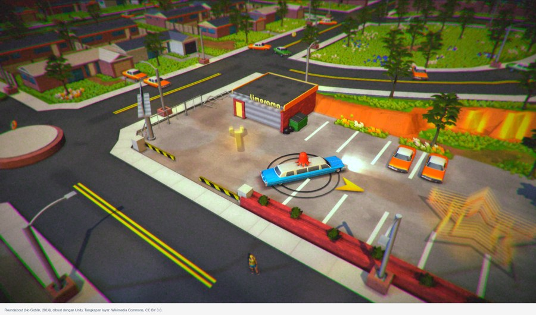
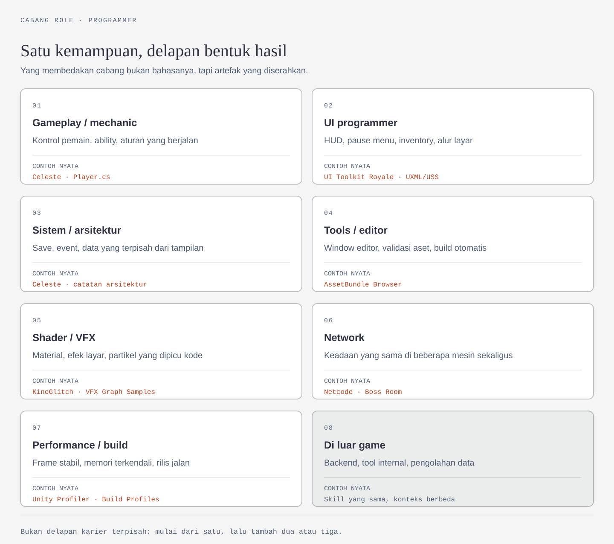
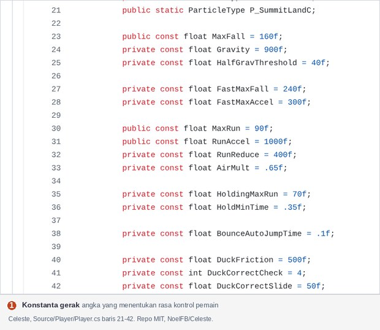
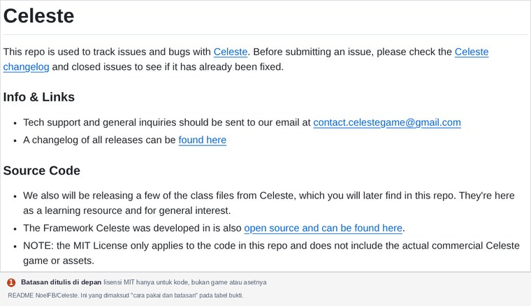
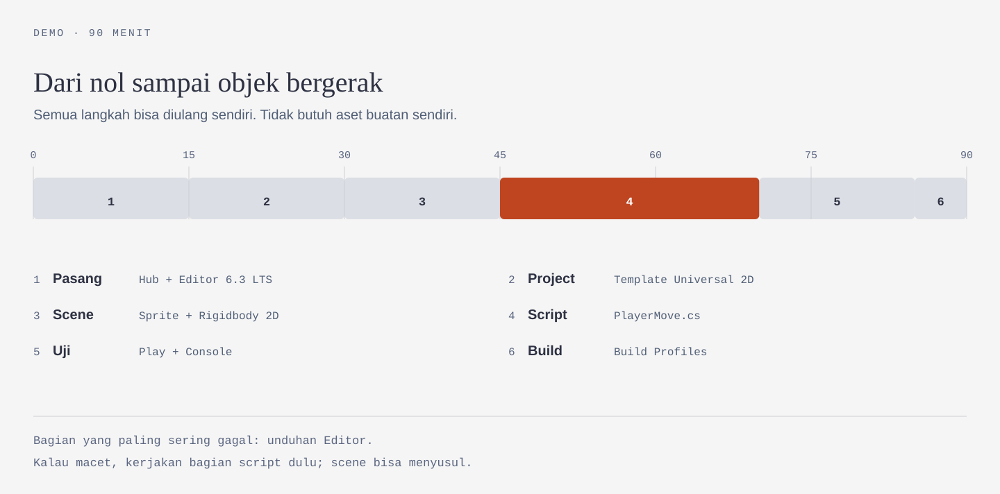
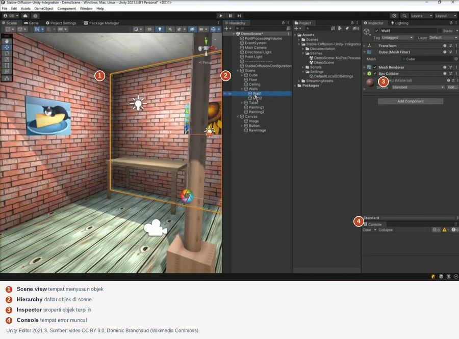
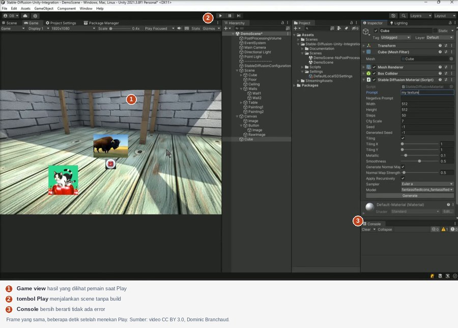

# Role Programmer: Yang Dikerjakan, Cabangnya, dan Demo Pertamanya

Dokumen ini untuk kamu yang memilih kelas Programmer, atau yang masih menimbang antara Programmer dan dua kelas lain. Isinya tiga hal saja: apa yang sebenarnya dikerjakan programmer, cabang pekerjaan yang bisa kamu tuju beserta buktinya, dan satu demo yang bisa kamu selesaikan sendiri dalam sekitar 90 menit.

Dua kelas lain — Design dan Artist — punya dokumennya sendiri. Di sini keduanya hanya muncul sebagai batas: bagian mana yang bukan pekerjaanmu.

Konteks programnya — gate minggu 4, jalur Observer, kontrak waktu, dan aturan AI secara umum — ada di [Materi Minggu 1](/miniclass/game/). Dokumen ini tidak mengulanginya.

Satu hal perlu jelas sejak awal. Programmer di tim game bukan "orang yang paling banyak mengetik kode". Pekerjaan intinya adalah menerjemahkan aturan menjadi keadaan (state) yang bisa dijalankan mesin, lalu membuktikan bahwa keadaan itu benar. Mengetik kode hanyalah cara mencapainya, dan bukan bagian yang paling sulit.

---

## Yang sebenarnya dikerjakan programmer

Ambil satu contoh kecil. Desainer menulis aturan: *"Pemain bisa membuka peti dan mendapat satu item acak. Peti yang sudah dibuka tidak bisa dibuka lagi."*

Kalimat itu belum bisa dijalankan mesin. Programmer mengubahnya menjadi keadaan yang punya nama dan urutan:

| Pertanyaan | Jawaban yang harus diputuskan programmer |
|---|---|
| Data apa yang disimpan? | status peti (`tertutup`, `terbuka`), isi peti, isi tas pemain |
| Kapan status berubah? | saat pemain menekan tombol **dan** berada dalam jarak |
| Apa yang terjadi lebih dulu? | cek jarak → cek status → ambil item → ubah status → tampilkan notifikasi |
| Apa yang bisa salah? | tas penuh, peti dibuka dua kali dalam satu frame, item yang sama ditambahkan berulang |
| Bagaimana membuktikannya? | lima langkah uji manual yang bisa diulang orang lain |

Lima baris itu pekerjaan programmer. Kodenya menyusul, dan biasanya lebih pendek daripada proses berpikir di atas.

Yang dilatih di kelas ini karena itu bukan hafalan C#, melainkan tiga hal yang tetap berguna di luar game: memecah masalah menjadi keadaan yang jelas, membaca error sampai ke penyebabnya, dan menulis kode yang bisa dipakai orang lain.

### Batas pekerjaannya

Sebagian besar kekecewaan peserta datang dari salah paham batas ini, bukan dari materi yang terlalu sulit.

| Dikerjakan programmer | Bukan pekerjaan programmer | Sering disalahpahami |
|---|---|---|
| Menerjemahkan aturan menjadi state, event, dan urutan kejadian | Menentukan mekanik inti dan angka keseimbangan | "Programmer yang menentukan gamenya seru atau tidak" |
| Menyambungkan input pemain ke aksi di dalam game | Membuat aset visual, animasi, atau audio | "Programmer juga yang menggambar kalau artist belum siap" |
| Menyimpan dan memuat data (inventory, save, progres) | Menulis cerita, dialog, dan dunia | "Programmer bebas mendesain ulang mekanik sesuka hati" |
| Mencari penyebab bug dan memperbaikinya | Menyusun jadwal dan prioritas tim | "Kalau build-nya jalan, pekerjaan programmer selesai" |
| Mengukur performa dan ukuran rilis | Memasarkan game | "Optimasi selalu jadi prioritas pertama" |
| Menulis cara pakai modul yang dibuatnya | Menjanjikan game selesai dalam delapan minggu | "Kode yang panjang berarti programmer yang rajin" |

Dua baris terakhir yang paling sering diabaikan. Satu batas lagi yang tidak tertulis: programmer **boleh** memberi masukan desain, terutama soal apa yang mahal dikerjakan. Keputusan akhir mekanik tetap di desainer; desainer tidak memutuskan class mana yang dipakai. Itu yang membuat tim kecil tetap jalan.

---

## Satu kemampuan, delapan bentuk hasil

Di lowongan kerja, "game programmer" jarang berdiri sendiri. Ada gameplay programmer, UI programmer, tools programmer, network programmer, dan seterusnya. Perbedaan mereka bukan bahasa pemrograman — semuanya C# di Unity — melainkan **jenis artefak yang diserahkan** dan **jenis masalah yang membuat mereka dipanggil**.

Hasil akhir dari semua cabang itu, kalau dirakit, terlihat seperti ini:



*Roundabout (No Goblin, 2014), dibuat dengan Unity. Satu layar ini adalah gabungan pekerjaan gameplay, UI, sistem, dan performance. Tangkapan layar: Wikimedia Commons, CC BY 3.0.*



Delapan kotak di atas bukan delapan karier yang terpisah rapi. Kebanyakan orang mulai dari satu, lalu menambah dua atau tiga seiring proyek yang dikerjakan. Yang penting: setiap cabang punya hasil yang bisa dilihat orang lain.

| Cabang | Artefak yang diserahkan | Contoh nyata yang bisa dibuka sekarang | Bentuk postingan |
|---|---|---|---|
| **Gameplay / mechanic** | Satu sistem yang bisa dimainkan: gerak, combat, ability | [Celeste — `Player.cs`](https://github.com/NoelFB/Celeste/blob/master/Source/Player/Player.cs): 5.471 baris, berisi konstanta gerak seperti `MaxRun = 90`, `RunAccel = 1000`, `JumpSpeed = -105` | Rekaman 15 detik gerak + tabel angka yang kamu ubah dan efeknya |
| **UI programmer** | Pause menu, HUD, inventory, alur layar | [UI Toolkit Unity Royale Runtime Demo](https://github.com/Unity-Technologies/UIToolkitUnityRoyaleRuntimeDemo): UI runtime disusun dari file UXML dan USS, bukan dari menata objek satu per satu | Tangkapan layar menu + penjelasan tombol mana memanggil method apa |
| **Sistem / arsitektur** | Save, event, pemisahan data dari tampilan | [Catatan arsitektur Celeste](https://github.com/NoelFB/Celeste/blob/master/Source/Player/Readme.md): penulisnya menjelaskan bagian mana yang mereka sesali dan mana yang mereka pertahankan | Diagram kecil: siapa memanggil siapa, data disimpan di mana |
| **Tools / editor** | Window editor, validasi aset, build otomatis | [AssetBundle Browser](https://github.com/Unity-Technologies/AssetBundles-Browser): alat untuk melihat isi bundel sebelum dan sesudah build | GIF alat yang dipakai, bukan tangkapan layar kode |
| **Shader / VFX** | Material, efek layar, partikel yang dipicu kode | [KinoGlitch](https://github.com/keijiro/KinoGlitch) (efek glitch, berisi file `.shader` dan komponen C#) dan [VFX Graph Samples](https://github.com/Unity-Technologies/VisualEffectGraph-Samples) (kebakaran, portal, pita partikel) | Rekaman efek sebelum–sesudah + nilai parameter yang diubah |
| **Network** | Keadaan yang sama di beberapa mesin | [Boss Room](https://github.com/Unity-Technologies/com.unity.multiplayer.samples.coop): game ko-op 8 pemain, server-authoritative, memakai Netcode for GameObjects | Rekaman dua jendela game berjalan bersamaan |
| **Performance / build** | Frame stabil, memori terkendali, build jalan di target | [Unity Profiler](https://docs.unity3d.com/Manual/Profiler.html) dan [Build Profiles](https://docs.unity3d.com/Manual/build-profiles.html) | Tangkapan layar grafik Profiler sebelum–sesudah, dengan angka |
| **Di luar game** | Backend, tool internal, pengolahan data | Kemampuan yang sama, konteks berbeda | Studi kasus satu halaman: masalah, keputusan, hasil |

Catatan sebelum kamu membuka tautan di tabel itu:

| Contoh | Yang perlu kamu tahu |
|---|---|
| Celeste | Bukan game Unity. Memakai framework Monocle di atas XNA/MonoGame, hanya sebagian file dibuka. Yang dipelajari: cara menamai konstanta dan mengurutkan logika. Timnya dua programmer. |
| UI Toolkit Royale | Dites di Unity 2020.1, bukan 6.3. |
| KinoGlitch | Memakai `OnRenderImage`, yang berjalan di Built-in Render Pipeline — bukan URP seperti template 2D di program ini. |
| VFX Graph Samples | Butuh HDRP. |
| AssetBundle Browser | Bukan alat resmi; halaman repo-nya sendiri menyarankan Addressables untuk proyek baru. |

Polanya tetap berguna. Yang perlu kamu waspadai hanya satu: jangan berharap project lama terbuka mulus di Unity 6 tanpa penyesuaian.

Kalau tabel di atas masih terasa abstrak, ini artefak nyata dari cabang pertama. Isinya bukan algoritma rumit, melainkan angka yang menentukan rasa kontrol pemain:



*Celeste, `Source/Player/Player.cs` baris 21–42. Repo [NoelFB/Celeste](https://github.com/NoelFB/Celeste) berlisensi MIT. Angka seperti `MaxRun = 90` dan `RunAccel = 1000` adalah hasil pengujian berulang, bukan nilai bawaan mesin.*

### Bukti seperti apa yang dihitung

Untuk pemula, "bukti" bukan sertifikat dan bukan jumlah tutorial yang ditonton. Yang dihitung hanya hal yang bisa diperiksa orang lain tanpa bertanya kepadamu.

| Jenis bukti | Membuktikan apa | Kelemahannya |
|---|---|---|
| Repo publik dengan riwayat commit | Kamu mengerjakan bertahap, bukan menyalin sekali jadi | Commit "update" tanpa pesan tidak membuktikan apa-apa |
| README berisi cara pasang dan batasan | Modulmu bisa dipakai orang lain | README yang hanya berisi judul tidak dihitung |
| Rekaman 15–30 detik | Hasilnya benar-benar berjalan | Video bisa dipotong; sebutkan versi Unity-nya |
| Tangkapan Console bersih saat demo | Tidak ada error yang disembunyikan | Console bersih bukan berarti tidak ada bug |
| Tangkapan Profiler | Kamu mengukur, bukan menebak | Angka di Editor berbeda dari angka di perangkat |
| Build yang bisa dijalankan | Proyeknya tidak hanya hidup di komputermu | Build tanpa keterangan platform sulit dinilai |

Baris kedua terlihat sepele, tetapi inilah bedanya repo yang bisa dipakai orang lain dan repo yang hanya bisa dipakai pembuatnya. Perhatikan bagaimana repo Celeste menuliskan batasannya sendiri:



*README [NoelFB/Celeste](https://github.com/NoelFB/Celeste). Kalimat terakhirnya justru yang paling berguna: ia memberi tahu apa yang **tidak** kamu dapat, sebelum kamu kecewa.*

### Contoh postingan

Format berikut dipakai di program ini. Isinya sengaja dibuat bisa diperiksa, bukan sekadar bercerita.

```text
Judul        : Pause Menu yang bisa dipakai ulang
Pembuat      : [nama]
Kelas        : Programmer
Apa yang dibuat : prefab Pause Menu + PauseMenu.cs (3 file)
Apa yang dipelajari : memisahkan status pause dari tampilan; menyambungkan
                      tombol lewat onClick, bukan lewat mencari objek
Link hasil   : github.com/[akun]/pause-menu
Status       : selesai, dites di Unity 6.3
Penggunaan AI: [tautan AI Usage Log]
Masukan yang diinginkan : apakah cara menyimpan status pause sudah benar?
```

Contoh kedua, untuk cabang yang hasilnya visual — perhatikan bahwa isinya tetap sama bentuknya, hanya buktinya berupa rekaman:

```text
Judul        : Efek glitch layar untuk transisi
Apa yang dibuat : satu material shader + komponen untuk menaikkan intensitas
                  glitch selama 0,4 detik saat scene berganti
Apa yang dipelajari : parameter shader bisa diatur dari C#; satu nilai
                      mengendalikan seluruh efek
Link hasil   : rekaman 12 detik (sebelum dan sesudah)
Status       : masih eksperimen
Masukan yang diinginkan : efeknya terlalu kuat untuk pemain baru?
```

Perhatikan bedanya dengan kalimat yang sering muncul di grup chat. Kolom kanan adalah **bentuk** kalimatnya, bukan angka yang harus kamu tiru.

| Kalimat yang tidak membuktikan apa-apa | Kalimat yang bisa diperiksa |
|---|---|
| "Belajar bikin game" | "Modul pause menu, 3 file, dites di dua scene" |
| "Bisa Unity" | "Repo berisi 4 commit; README menjelaskan cara pasang" |
| "Sudah paham C#" | "`PlayerMove.cs` sekitar 45 baris, tanpa `GameObject.Find`, angka penting ada di Inspector" |
| "Sudah optimasi" | "Dari 41 fps ke 58 fps di perangkat yang sama, grafik Profiler dilampirkan" |

---

## Demo: 90 menit dari nol sampai objek bergerak

Bentuk paling sederhana yang masih disebut "game programmer": satu objek, satu script, satu build. Tanpa aset buatan sendiri, jadi kamu tidak bisa tertahan karena belum bisa menggambar.



### Sebelum mulai

| Yang perlu | Keterangan |
|---|---|
| Laptop | Windows 10 versi 21H1 atau lebih baru, macOS Ventura 13 atau lebih baru, atau Ubuntu 22.04/24.04. RAM minimal 8 GB disarankan |
| Kartu grafis | Mendukung DirectX 10/11/12 atau Vulkan |
| Ruang kosong | Beberapa GB untuk Hub dan Editor; sisakan lebih jika ingin memasang modul build |
| Akun Unity | Gratis, dibutuhkan untuk lisensi Personal |
| Koneksi | Unduhan Editor adalah bagian yang paling sering gagal |

Sumber: [persyaratan sistem Unity](https://docs.unity3d.com/Manual/system-requirements.html). Versi yang dipakai program ini **Unity 6.3 LTS**, didukung sampai Desember 2027. Jangan mulai proyek baru di 6.0 LTS — dukungannya berakhir Oktober 2026.

### 0–15 menit: pasang editor

1. Unduh **Unity Hub** dari [unity.com/download](https://unity.com/download), lalu pasang seperti aplikasi biasa.
2. Buka Hub, pilih **Installs** di bilah kiri, lalu **Install Editor**.
3. Pada tab **Official releases**, pilih versi **6.3 LTS**.
4. Di jendela modul, centang platform yang kamu butuhkan. Untuk demo ini cukup platform komputermu sendiri (Windows/Mac/Linux Build Support). Modul Android atau WebGL bisa ditambahkan nanti lewat menu **Manage**.
5. Tekan **Install** dan tunggu. Progresnya terlihat di ikon **Downloads** pada bilah atas.

Kalau unduhan gagal, jangan mengulang dari nol berkali-kali: cek ruang disk, lalu coba lagi. Langkah ini yang paling sering menghabiskan waktu, dan bukan karena kesalahanmu.

### 15–30 menit: buat project

1. Di Hub, buka **Projects** → **New project**.
2. Pilih **Editor version** 6.3 LTS.
3. Pilih template **Universal 2D**. Template ini otomatis memasang paket 2D yang dibutuhkan: 2D Sprite, Tilemap, SpriteShape, dan lainnya.
4. Isi nama project, misalnya `demo-programmer`, pilih lokasi, lalu **Create project**.
5. Tunggu proses impor pertama. Untuk project baru, ini bisa beberapa menit.
6. Sebelum lanjut, buka **Edit** → **Project Settings** → **Player** → **Other Settings** → **Active Input Handling**. Kalau nilainya **Input System Package (New)**, ubah menjadi **Both**, lalu biarkan Editor restart.

Langkah 6 mencegah error membingungkan 30 menit kemudian: demo ini memakai Input Manager lama (`Input.GetAxisRaw`), dan project yang hanya mengaktifkan backend baru akan menolaknya saat Play.

### 30–45 menit: susun scene

1. Di panel **Hierarchy**, klik kanan → **2D Object** → **Sprites** → **Square**. Ini membuat objek kotak putih berukuran satu unit, tanpa perlu file gambar.
2. Ganti namanya menjadi `Player`.
3. Di panel **Inspector**, tekan **Add Component** → **Rigidbody 2D**. Biarkan **Body Type** di `Dynamic`, lalu ubah **Gravity Scale** menjadi `0`.
4. **Add Component** → **Box Collider 2D**.
5. Simpan scene dengan `Ctrl+S`, beri nama `Main`.

**Gravity Scale** harus `0` karena ini game dilihat dari atas: tidak ada "bawah" yang menarik pemain. Nilai `1` bukan tanpa akibat meski kode menuliskan kecepatan setiap langkah. [Dokumentasi `linearVelocity`](https://docs.unity3d.com/ScriptReference/Rigidbody2D-linearVelocity.html) menyebut kecepatan tetap terpengaruh gravitasi, dan [urutan eksekusi Unity](https://docs.unity3d.com/Manual/script-execution-order.html) menempatkan simulasi fisika tepat setelah `FixedUpdate` selesai. Artinya gravitasi menambah sedikit kecepatan ke bawah tepat setelah kodemu menimpanya, dan objek akan melorot pelan saat tombol dilepas. Kalau nanti kamu melihat gejala itu, periksa nilai ini dulu.

Pada tahap ini, menekan **Play** belum menggerakkan apa pun. Objek hanya diam di tempat — dan itu benar. Yang belum ada adalah aturan yang mengubah input menjadi gerak.

Kenali empat panel yang akan kamu pakai terus. Ini tampilan Unity Editor yang sebenarnya, bukan ilustrasi:



*Unity Editor. Nomor 1–4 menandai panel yang disebut di seluruh materi ini. Sumber: rekaman [Dominic Branchaud](https://commons.wikimedia.org/wiki/File:Video_game_creation_using_AI_%E2%80%93_Easy_Stable_Diffusion_Unity_Integration_package.webm) di Wikimedia Commons, lisensi CC BY 3.0.*

### 45–70 menit: tulis script

1. Di panel **Project**, klik kanan → **Create** → **Scripting** → **MonoBehaviour**. Beri nama `PlayerMove`.
2. Buka file itu (biasanya dengan editor bawaan atau IDE pilihanmu), lalu ganti isinya dengan kode berikut.

Kalau kamu belum pernah menulis C# sebelumnya, kamu belum perlu memahami setiap kata kunci di bawah ini sekarang — semuanya dibedah dari nol di minggu 5. Untuk demo ini, cukup tempel, jalankan, dan baca lima poin sesudahnya.

```csharp
using UnityEngine;

[RequireComponent(typeof(Rigidbody2D))]
public class PlayerMove : MonoBehaviour
{
    [SerializeField] private float speed = 5f;

    private Rigidbody2D body;
    private int collected;
    private float nextLogTime;

    public int Collected => collected;

    private void Awake()
    {
        body = GetComponent<Rigidbody2D>();
    }

    private void FixedUpdate()
    {
        Vector2 input = new Vector2(
            Input.GetAxisRaw("Horizontal"),
            Input.GetAxisRaw("Vertical"));

        if (input.sqrMagnitude > 1f)
        {
            input = input.normalized;
        }

        body.linearVelocity = input * speed;

        if (Time.time >= nextLogTime)
        {
            nextLogTime = Time.time + 1f;
            Debug.Log($"posisi {transform.position} | item {Collected}");
        }
    }

    public void Collect(int amount)
    {
        collected += amount;
        Debug.Log($"item terkumpul: {collected}");
    }
}
```

3. Simpan, lalu kembali ke Unity dan tunggu kompilasi selesai.
4. Seret `PlayerMove` dari panel Project ke objek `Player` di Hierarchy, atau lewat **Add Component**.
5. Pastikan field **Speed** muncul di Inspector dengan nilai `5`.

Lima keputusan di kode itu yang membuatnya disebut pekerjaan programmer, bukan salinan tutorial:

| Keputusan | Alasannya |
|---|---|
| `speed` di Inspector, bukan ditanam di kode | Angka yang sering diubah bisa diubah tanpa membuka editor kode |
| `RequireComponent` menuliskan syarat | Unity menambahkan Rigidbody 2D otomatis; syarat jadi bagian kode, bukan ingatan pemasangnya |
| Gravitasi hanya di Inspector | Kode tidak menimpanya di `Awake`; satu nilai, satu sumber kebenaran |
| `FixedUpdate`, bukan `Update` | Segerak dengan jadwal fisika dan tabrakan, tidak ikut naik-turunnya frame rate |
| Kecepatan ditulis ke `Rigidbody2D` | Fisika yang memindahkan objek, jadi tabrakan dan trigger tetap dihitung; mengubah `transform.position` bisa menembus dinding |

### 70–85 menit: jalankan dan uji

1. Tekan **Play**. Klik dulu area **Game** supaya jendela game menerima input.
2. Gerakkan dengan tombol panah atau `WASD`.
3. Buka **Window** → **General** → **Console** dan pastikan tidak ada tulisan merah.
4. Setiap detik akan muncul satu baris seperti `posisi (1.2, 0.0, 0.0) | item 0`. Itu bukti bahwa nilainya berubah, bukan hanya kelihatan berubah.

Tampilannya kira-kira seperti ini — perhatikan tombol Play yang menyala dan Console yang tetap kosong:



*Frame yang sama dengan gambar sebelumnya, beberapa detik setelah **Play** ditekan. Sumber: rekaman Dominic Branchaud, CC BY 3.0.*

Uji juga apa yang **tidak** boleh terjadi — ini yang membedakan demo dari sekadar "jalan":

| Yang diuji | Hasil yang benar |
|---|---|
| Menekan dua tombol arah sekaligus | Kecepatan tidak bertambah menjadi lebih cepat dari `speed` |
| Mengubah `Speed` ke `0` saat Play | Objek berhenti tanpa mengubah kode |
| Menekan `Play` lalu langsung `Stop` | Tidak ada error di Console |
| Membuka Inspector saat Play | `Speed` bisa diubah dan langsung terasa; `Collected` tidak bisa diedit karena ia property baca-saja, bukan field |

### 85–90 menit: build

1. **File** → **Build Profiles**.
2. Pilih platform komputermu, tekan **Build**.
3. Simpan hasilnya di luar folder project, jalankan, dan pastikan gerakannya sama.

Build membuktikan satu hal yang tidak dibuktikan Play mode: proyeknya tidak hanya hidup di dalam Editor.

### Kalau ada yang gagal

| Yang terlihat | Penyebab paling sering | Perbaikan |
|---|---|---|
| `'Rigidbody2D' does not contain a definition for 'velocity'` | Kode dari tutorial lama memakai nama field yang sudah diganti di Unity 6 | Pakai `linearVelocity` |
| Error saat Play yang menyebut `UnityEngine.Input` | Project hanya mengaktifkan backend Input System, sedangkan kode memakai Input Manager lama | **Edit** → **Project Settings** → **Player** → **Other Settings** → **Active Input Handling** → `Both`, lalu Editor restart |
| Perubahan kode tidak berpengaruh saat Play | File belum disimpan di editor kode, atau Unity masih mengompilasi | Simpan file, tunggu ikon putar di pojok kanan bawah berhenti, lalu coba lagi |
| `CS0246` atau `CS0103` saat kompilasi | Kode tersalin tidak lengkap — baris `using UnityEngine;` hilang, atau ada kurung kurawal yang tertinggal | Bandingkan dengan daftar di atas; Console menyebut nomor barisnya |
| Objek diam, Console bersih | Fokus keyboard ada di Editor, bukan di jendela Game; atau `Speed` bernilai 0 | Klik area Game, cek nilai `Speed` |
| Play tidak mau jalan | Masih ada error kompilasi | Baca pesan pertama di Console, bukan yang terakhir |

Kebiasaan yang layak dipelihara: baca pesan error **dari baris pertama**, cari nama file dan nomor barisnya, lalu buka baris itu. Sebagian besar error pemula selesai di sini.

### Kalau berhasil, apa artinya

Itu siklus kerja programmer dalam bentuk terkecil: membaca aturan, memutuskan keadaan yang disimpan, menuliskannya, menjalankannya, menguji batasnya, mengemasnya jadi build. Sistem di minggu 5–8 adalah versi lebih panjang dari siklus yang sama.

---

## Tambahan: satu objek yang bisa diambil

Kalau masih ada waktu, tambahkan satu aturan lagi. Perhatikan bahwa yang bertambah hanya satu keadaan baru, bukan satu sistem baru.

1. Buat **2D Object** → **Sprites** → **Circle**, beri nama `Coin`.
2. **Add Component** → **Circle Collider 2D**, lalu centang **Is Trigger**.
3. Buat script `Pickup`:

```csharp
using UnityEngine;

[RequireComponent(typeof(CircleCollider2D))]
public class Pickup : MonoBehaviour
{
    [SerializeField] private int value = 1;

    private void OnTriggerEnter2D(Collider2D other)
    {
        PlayerMove player = other.GetComponent<PlayerMove>();
        if (player == null)
        {
            return;
        }

        player.Collect(value);
        Destroy(gameObject);
    }
}
```

4. Tempel ke `Coin`, duplikat beberapa kali, lalu jalankan.

Kalau kamu menempel script ini ke objek yang belum punya collider, Unity menambahkan Circle Collider 2D dengan **Is Trigger** mati. Centang sendiri. Tanpa trigger, koin akan menabrak pemain, bukan terambil.

Sekarang Console akan menampilkan `item terkumpul: 1`, lalu `2`, `3` setiap kali kamu menyentuh koin berikutnya. Perhatikan juga bahwa `PlayerMove` tidak tahu apa-apa tentang koin: ia hanya menyediakan method `Collect`. Itu contoh pemisahan tanggung jawab yang akan kamu pakai terus di minggu 5–8, ketika modulmu dipakai orang lain di tim.

Satu detail yang mudah terlewat: `Pickup` mencari `PlayerMove`, bukan `Player`. Dengan begitu, script itu tetap bekerja kalau nanti nama objek pemain diganti, dan tetap gagal dengan jelas kalau yang menyentuh koin bukan pemain.

---

## Batas bantuan AI untuk kelas ini

Program ini menetapkan batas 40% untuk kelas Programmer, dihitung dari langkah kerja yang boleh dibantu — bukan dari jumlah baris kode.

| Boleh | Tidak boleh |
|---|---|
| Minta AI menjelaskan arti sebuah error dan di baris mana | Menempel kode lalu menjalankannya tanpa membacanya |
| Minta kerangka class, lalu isi sendiri logikanya | Menyerahkan satu fitur utuh lalu mengaku selesai |
| Minta AI merapikan kode yang **sudah** kamu tulis | Memakai kode yang tidak bisa kamu jelaskan |
| Minta daftar langkah pengujian manual | Menghapus kode yang tidak dipahami karena "katanya tidak perlu" |

Aturannya satu: **kalau kamu tidak bisa menjelaskan hasil AI, pekerjaan itu belum selesai.** Untuk demo di atas, itu berarti kamu harus bisa menjawab kenapa memakai `FixedUpdate` dan bukan `Update`, dan kenapa kecepatan disimpan di Rigidbody, bukan dihitung sendiri setiap frame.

---

## Kaitannya dengan delapan minggu

Materi ini adalah pengenalan role. Praktik kelasnya berjalan di minggu 5–8.

| Minggu | Yang dikerjakan | Hasil |
|:---:|---|---|
| 5 | Dasar OOP lewat satu tampilan: class, field, method, event | Prefab Pause Menu yang berjalan |
| 6 | Menyusun dokumen teknis sebelum menulis kode | Dokumen 2–3 halaman + daftar tugas berurutan |
| 7 | Mengerjakan bagian inti, memakai AI untuk bagian berulang | Satu sistem jalan + catatan hasil tes manual |
| 8 | Merapikan, review silang, mengemas | Repo publik + README + demo 30 detik |

Hasil akhirnya bukan game utuh, melainkan satu modul yang bisa dipakai ulang dengan cara pakai yang jelas — bentuk artefak yang sama dengan delapan cabang di atas, hanya diperkecil skalanya.

---

## Pertanyaan yang sering muncul

**Harus jago matematika?** Tidak. Yang dipakai hanya penjumlahan, perbandingan, dan sesekali normalisasi vektor seperti di demo. Yang lebih menentukan adalah kesabaran membaca error.

**Harus sudah pernah coding?** Tidak. Kelas dimulai dari nol di minggu 5, memakai tampilan menu sebagai contoh pertama karena hasilnya langsung terlihat di layar.

**Laptop saya 4 GB RAM. Bisa ikut?** Bisa mengikuti materi, tetapi praktik langsung kemungkinan tersendat. Sampaikan saat pengecekan laptop di minggu 2; jalur Observer tersedia tanpa perlu menghilang.

**Kenapa Unity, bukan Godot?** Seluruh materi dan catatan error di program ini disusun untuk satu versi Unity. Mengganti engine berarti contoh error di kelas tidak lagi cocok.

**Harus bisa semua delapan cabang?** Tidak, dan sebaiknya tidak. Satu cabang yang benar-benar jalan lebih berguna daripada delapan yang setengah jadi. Cabang kedua datang sendiri saat proyek berikutnya menuntutnya.

**Saya lebih suka bagian visual. Salah masuk Programmer?** Tidak. Cabang UI, shader, dan VFX ada di kelas ini justru karena batasnya tipis. Bedanya: Artist membuat asetnya, Programmer membuat aset itu berperilaku.

**Apa bedanya modul saya dengan tutorial YouTube yang saya ikuti?** Tutorial berhenti saat kodenya jalan. Modul berhenti saat orang lain bisa memasangnya, memakainya, dan tahu batasannya tanpa bertanya kepadamu.

---

Programmer game bukan orang yang menghafal C#. Ia orang yang bisa mengambil aturan yang masih berupa kalimat, mengubahnya menjadi keadaan yang jelas, membuktikan bahwa keadaan itu benar, lalu menyerahkannya dalam bentuk yang bisa dipakai orang lain.

Demo 90 menit di atas adalah versi terkecil dari pekerjaan itu. Delapan minggu berikutnya hanya menambah ukuran dan jumlah orang yang memakainya.
