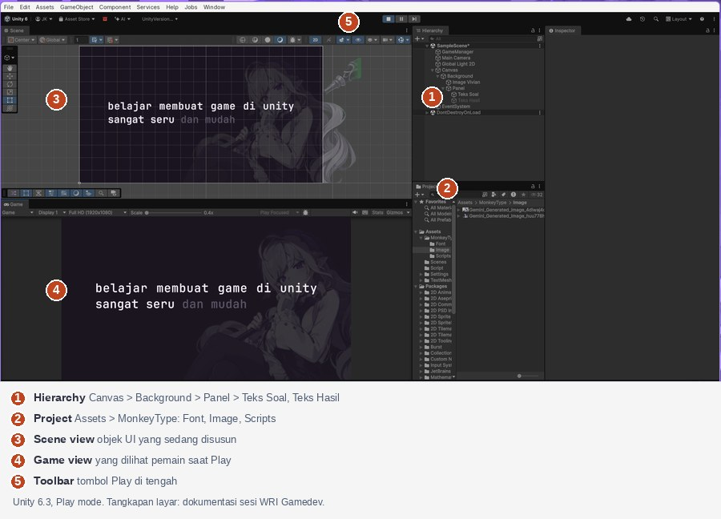
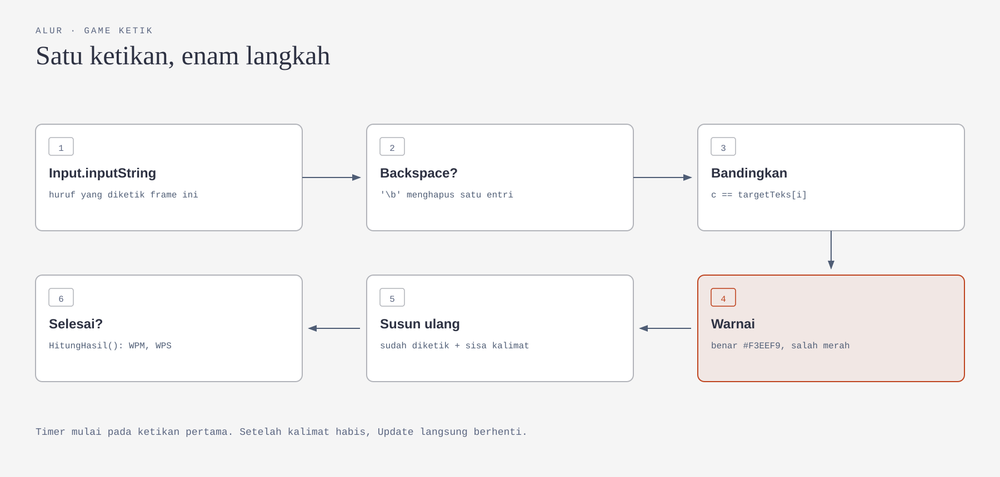
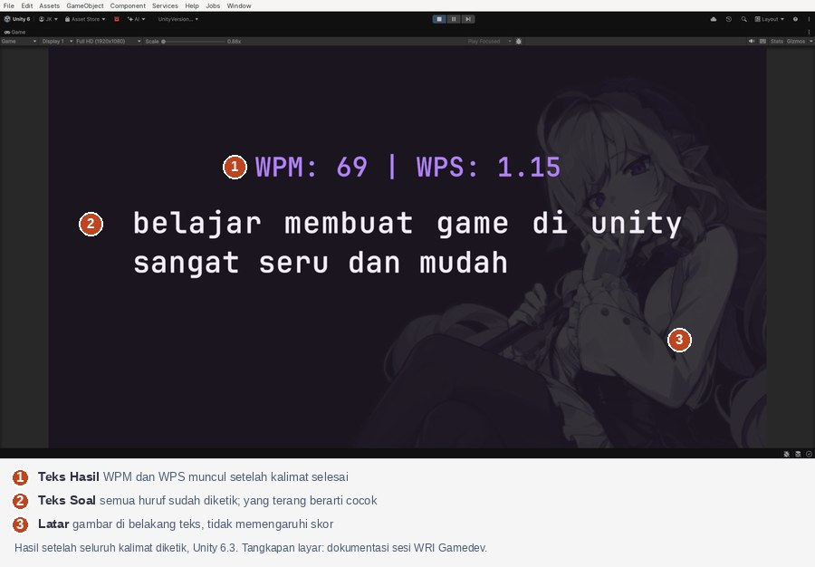

# Game Ketik di Unity: Bikin Sendiri Versi MonkeyType

Game ini punya satu kalimat di layar. Kamu ketik huruf per huruf, dan tiap huruf langsung berubah warna: terang kalau cocok, merah kalau salah. Setelah huruf terakhir, skor WPM dan WPS muncul di atas kalimat.

Versi ini tidak punya kalimat acak, hitungan akurasi, tombol ulang, atau papan skor. Kodenya sengaja sesingkat itu: satu class, 86 baris.

Semua contoh pakai Unity 6.3 LTS.

---

## Yang kamu bangun hari ini

Ada enam objek yang kita buat, yaitu Canvas, Background, Panel, Teks Soal, Teks Hasil, dan GameManager. Latarnya satu gambar diam dan tidak ada animasi. Semua yang berubah di layar berasal dari satu string yang disusun ulang setiap kali kamu menekan tombol.



*Unity 6.3 saat Play dengan kalimat setengah diketik. Nomor 1-5 menunjuk objek yang dibahas di artikel ini. Tangkapan layar: dokumentasi sesi WRI Gamedev.*

| Objek | Component | Gunanya |
|---|---|---|
| Canvas | Canvas, Canvas Scaler, Graphic Raycaster | wadah semua elemen UI |
| Background | Image | gambar latar; boleh dikosongkan |
| Panel | Image (transparan) | wadah teks supaya posisinya mudah diatur |
| Teks Soal | TextMeshPro - Text (UI) | kalimat target dan warna hasil ketikan |
| Teks Hasil | TextMeshPro - Text (UI) | baris WPM/WPS, disembunyikan script saat mulai |
| GameManager | TypingGame (Script) | membaca input, menyusun teks, menghitung skor |

Dua objek teks hanya menampilkan. Semua logika ada di skrip yang menempel pada GameManager, jadi setiap perubahan warna huruf berasal dari file itu.

---

## Aturan mainnya

Lima kejadian ini yang harus ditangani kode:

| Kejadian | Yang dikerjakan kode | Yang kamu lihat |
|---|---|---|
| Huruf yang ditekan cocok | huruf target dibungkus `<color=#F3EEF9>` | huruf berubah terang |
| Huruf yang ditekan salah | huruf target dibungkus `<color=red>` | huruf berubah merah |
| Backspace ditekan | satu entri terakhir dibuang dari daftar | satu huruf kembali redup |
| Ketikan pertama | `waktuMulai = Time.time` | tidak terlihat; timer mulai |
| Kalimat habis | `HitungHasil()` dipanggil | baris WPM dan WPS muncul |

TextMeshPro bisa membaca tag mirip HTML, jadi mewarnai huruf dilakukan dengan menyisipkan tag `<color=...>` ke dalam string. Properti warna komponen tidak diubah. Akibatnya teks di layar adalah string panjang yang berisi tag.

---

## Alur satu ketikan

Unity memanggil `Update()` setiap frame. Di dalamnya ada enam langkah:



*Alur di dalam `Update()`. Gambar: WRI Gamedev.*

1. Unity menyerahkan huruf yang diketik sejak frame sebelumnya lewat `Input.inputString`.
2. Kalau hurufnya `\b`, yaitu Backspace, satu entri dibuang dan langkah lain dilewati.
3. Huruf lain dibandingkan dengan huruf target pada posisi sekarang.
4. Hasil perbandingan menentukan warna: terang atau merah.
5. Kalimat disusun ulang dari dua potongan, lalu ditulis ke layar.
6. Begitu jumlahnya sama dengan panjang kalimat, skor dihitung dan input berhenti dibaca.

`Update` dipanggil puluhan kali per detik. Satu frame bisa membawa dua atau tiga huruf kalau kamu mengetik cepat, dan itulah sebabnya langkah 3 sampai 5 ada di dalam `foreach`.

---

## Kode lengkapnya

Satu file, `TypingGame.cs`. Di project contoh letaknya di `Assets/MonkeyType/Scripts`; nama foldernya bebas.

```csharp
using UnityEngine;
using TMPro;
using System.Collections.Generic;

public class TypingGame : MonoBehaviour
{
    public TextMeshProUGUI teksSoal;
    public TextMeshProUGUI teksSelesai;
    public string targetTeks = "belajar membuat game di unity sangat seru";

    private List<string> hasilKetikan = new List<string>();
    private float waktuMulai = 0f;
    private bool sudahMulai = false;

    void Start()
    {
        teksSelesai.gameObject.SetActive(false);
        teksSoal.text = targetTeks;
    }

    void Update()
    {
        if (hasilKetikan.Count >= targetTeks.Length) return;

        foreach (char c in Input.inputString)
        {
            if (c == '\n' || c == '\r') continue;

            if (c == '\b')
            {
                if (hasilKetikan.Count > 0)
                {
                    hasilKetikan.RemoveAt(hasilKetikan.Count - 1);
                    teksSoal.text = string.Join("", hasilKetikan) + targetTeks.Substring(hasilKetikan.Count);
                }
                continue;
            }

            if (!sudahMulai)
            {
                sudahMulai = true;
                waktuMulai = Time.time;
            }

            char hurufTarget = targetTeks[hasilKetikan.Count];

            if (c == hurufTarget)
            {
                hasilKetikan.Add("<color=#F3EEF9>" + hurufTarget + "</color>");
            }
            else
            {
                hasilKetikan.Add("<color=red>" + hurufTarget + "</color>");
            }

            teksSoal.text = string.Join("", hasilKetikan) + targetTeks.Substring(hasilKetikan.Count);

            if (hasilKetikan.Count >= targetTeks.Length)
            {
                HitungHasil();
                return;
            }
        }
    }

    void HitungHasil()
    {
        float detik = Time.time - waktuMulai;
        if (detik < 0.1f) detik = 0.1f;

        int jumlahBenar = 0;
        foreach (string huruf in hasilKetikan)
        {
            if (huruf.Contains("#F3EEF9"))
            {
                jumlahBenar++;
            }
        }

        float menit = detik / 60f;
        float wpm = (jumlahBenar / 5f) / menit;
        float wps = wpm / 60f;

        teksSelesai.gameObject.SetActive(true);
        teksSelesai.text = "WPM: " + Mathf.RoundToInt(wpm) + " | WPS: " + wps.ToString("F2");
    }
}
```

| Bagian | Jenis | Tugasnya |
|---|---|---|
| `teksSoal` | field `public` | tempat kalimat ditampilkan |
| `teksSelesai` | field `public` | tempat skor muncul |
| `targetTeks` | field `public` | kalimat yang harus diketik; bisa diubah di Inspector |
| `hasilKetikan` | field `private` | daftar potongan teks yang sudah diketik, sudah berisi tag warna |
| `waktuMulai` | field `private` | `Time.time` saat ketikan pertama |
| `sudahMulai` | field `private` | penanda timer sudah jalan |
| `Start()` | method | menyembunyikan Teks Hasil, menuliskan kalimat |
| `Update()` | method | membaca `Input.inputString` tiap frame |
| `HitungHasil()` | method | menghitung WPM/WPS lalu menampilkan Teks Hasil |

Tiga field `public` muncul di Inspector dan bisa diisi tanpa membuka kode. Tiga field `private` menyimpan keadaan permainan: apa yang sudah diketik, kapan mulai, dan apakah timer sudah jalan.

---

## Membaca kodenya baris per baris

### Menyimpan keadaan

```csharp
private List<string> hasilKetikan = new List<string>();
private float waktuMulai = 0f;
private bool sudahMulai = false;
```

Ketiganya tidak muncul di Inspector dan menyimpan keadaan permainan. Keadaan itu tidak bisa dibaca ulang dari layar karena teks di sana sudah penuh tag warna.

Game ini hanya menyimpan dua hal: daftar ketikan dan satu angka waktu. Semua baris lain menampilkannya.

### Start: kalimat tampil, hasil disembunyikan

```csharp
teksSelesai.gameObject.SetActive(false);
teksSoal.text = targetTeks;
```

`Start` jalan sekali, sebelum frame pertama. Baris skor dimatikan supaya tidak muncul sebagai "WPM: 0" sejak awal, dan kalimat target langsung ditulis ke Teks Soal dengan warna aslinya.

`SetActive(false)` mematikan objeknya. Teks Hasil tidak ada di layar sampai `HitungHasil` menyalakannya.

### Update: hanya selama kalimat belum habis

```csharp
if (hasilKetikan.Count >= targetTeks.Length) return;
```

Baris pertama `Update`. Selama jumlah huruf yang diketik masih kurang dari panjang kalimat, eksekusi lanjut. Begitu jumlahnya sama, `Update` langsung keluar. Karena itu skor tidak berubah setelah permainan selesai, walaupun Unity tetap mengirim input.

### Backspace

```csharp
if (c == '\b')
{
    if (hasilKetikan.Count > 0)
    {
        hasilKetikan.RemoveAt(hasilKetikan.Count - 1);
        teksSoal.text = string.Join("", hasilKetikan) + targetTeks.Substring(hasilKetikan.Count);
    }
    continue;
}
```

`'\b'` adalah karakter Backspace. Karena Backspace tidak menambah huruf, ia ditangani lebih dulu lalu `continue`. Tanpa itu, Backspace ikut dibandingkan dengan huruf target dan dihitung sebagai salah.

`RemoveAt` membuang entri terakhir, lalu kalimat disusun ulang. Bagian yang dihapus kembali ke warna asli. `if (hasilKetikan.Count > 0)` membuat Backspace di awal kalimat tidak melakukan apa pun.

Dua baris sebelumnya, `'\n'` dan `'\r'`, juga dilewati dengan `continue`. Keduanya karakter Enter, dan tanpa penyaringan itu Enter akan dihitung sebagai ketikan salah.

### Cocok atau tidak

```csharp
char hurufTarget = targetTeks[hasilKetikan.Count];

if (c == hurufTarget)
{
    hasilKetikan.Add("<color=#F3EEF9>" + hurufTarget + "</color>");
}
else
{
    hasilKetikan.Add("<color=red>" + hurufTarget + "</color>");
}
```

`hasilKetikan.Count` sekaligus menjadi posisi huruf yang ditunggu. Kalau sudah ada 7 entri, huruf berikutnya adalah `targetTeks[7]`. Tidak perlu penghitung terpisah.

Yang disimpan ke daftar adalah `hurufTarget`, bukan `c`. Kalau kamu menekan `x` padahal yang ditunggu `b`, layar tetap menampilkan `b` dengan warna merah. Jadi yang terlihat adalah posisi salahmu.

### Menyusun ulang kalimat

```csharp
teksSoal.text = string.Join("", hasilKetikan) + targetTeks.Substring(hasilKetikan.Count);
```

`string.Join` menggabungkan semua entri yang sudah diketik, dan tiap entri sudah terbungkus tag warna. `targetTeks.Substring(hasilKetikan.Count)` mengambil sisa kalimat yang belum disentuh, masih warna asli. Hasilnya kalimat utuh dengan bagian depan berwarna.

Baris ini muncul dua kali: di cabang Backspace dan setelah menambah entri. Keduanya berakhir di keadaan yang sama, yaitu layar menampilkan daftar ketikan ditambah sisa kalimat.

### Menghitung WPM dan WPS

```csharp
float detik = Time.time - waktuMulai;
if (detik < 0.1f) detik = 0.1f;

int jumlahBenar = 0;
foreach (string huruf in hasilKetikan)
{
    if (huruf.Contains("#F3EEF9")) jumlahBenar++;
}

float menit = detik / 60f;
float wpm = (jumlahBenar / 5f) / menit;
float wps = wpm / 60f;
```

`Time.time` adalah detik sejak Play ditekan. Selisihnya dengan `waktuMulai` jadi durasi mengetik. `if (detik < 0.1f)` mencegah pembagian dengan nol kalau kalimat selesai hampir seketika.

Huruf benar dihitung dengan mencari tag `#F3EEF9` di tiap entri, karena tag warna itulah penanda benar dan salah. Satu kata dihitung 5 huruf. Angka itu konvensi tes mengetik, bukan jumlah kata sebenarnya di kalimat.

| Langkah | Rumus di kode | Contoh tangkapan layar |
|---|---|---|
| Huruf benar | `jumlahBenar` | 51 |
| "Kata" | `jumlahBenar / 5` | 10,2 |
| Menit | `detik / 60` | 0,1478 menit (≈ 8,9 detik) |
| WPM | `"kata" / menit` | 69 |
| WPS | `WPM / 60` | 1,15 |

Kolom kanan diambil dari tangkapan layar di bagian akhir: 51 huruf benar, selesai dalam 8,9 detik, hasilnya 69 WPM. Timer mulai dari ketikan pertama, jadi waktu yang kamu habiskan untuk membaca tidak ikut dihitung.

---

## Yang perlu kamu tahu soal versi ini

| Yang terjadi | Sebabnya di kode |
|---|---|
| Huruf benar dihitung dari warna teks | `HitungHasil` mencari `"#F3EEF9"` di dalam string |
| Huruf salah yang tampil adalah huruf target | yang disimpan `hurufTarget`, bukan huruf yang ditekan |
| Tidak ada akurasi | hanya yang benar dihitung; yang salah tidak disimpan |
| Tidak bisa diulang tanpa keluar Play | setelah selesai `Update` langsung `return` |
| Skor hanya muncul di akhir | `HitungHasil` dipanggil sekali |

Kolom kanan menunjuk baris yang perlu dibuka kalau kamu ingin mengubah perilaku itu. Beberapa di antaranya jadi latihan.

---

## Cara memasangnya di project baru

Urutan membangunnya dari nol, kira-kira 30 menit:

1. Unity Hub → **New project** → template **Universal 2D** (Unity 6.3).
2. Kalau diminta, **Window → TextMeshPro → Import TMP Essential Resources**.
3. Buat UI: **GameObject → UI → Canvas** (EventSystem ikut terbuat).
4. Opsional: Canvas → **UI → Image** untuk latar, regangkan ke seluruh layar.
5. Canvas → **UI → Image** → ganti nama `Panel`; atur lebarnya ± 1470.
6. Di dalam Panel: **UI → Text - TextMeshPro** → nama `Teks Soal`; font size auto (min 18, max 80), rata tengah, Rich Text tetap dicentang.
7. Ulangi → nama `Teks Hasil` di bawah Teks Soal; warnai ungu.
8. **Create Empty** → nama `GameManager` → **Add Component → TypingGame**. Seret `Teks Soal` dan `Teks Hasil` ke dua field, lalu isi field **Target Teks** (di tangkapan layar: `belajar membuat game di unity sangat seru dan mudah`).
9. **Edit → Project Settings → Player → Other Settings → Active Input Handling** → `Both`, lalu restart Editor. Project contoh memakai nilai ini; tanpa itu `Input.inputString` tidak menerima huruf.

Tekan **Play**, klik area Game view supaya jendelanya fokus, lalu ketik kalimatnya. Tanpa fokus, ketikanmu masuk ke Editor.

Nilai default `targetTeks` di kode adalah `belajar membuat game di unity sangat seru` (41 karakter). Tangkapan layar memakai `... sangat seru dan mudah` (51 karakter), diisi lewat field Target Teks di Inspector. Nilai di Inspector yang dipakai saat Play. Kalau kalimat di layarmu lebih pendek dari yang kamu harapkan, cek field itu dulu.

---

## Hasilnya



*Semua huruf sudah diketik; baris skor muncul di atas kalimat. Tangkapan layar: dokumentasi sesi WRI Gamedev.*

Semua huruf sudah terang dan baris skor muncul di atasnya. `WPM 69` dan `WPS 1,15` pada 51 huruf benar berarti sekitar 8,9 detik. Hitungannya: 51 dibagi 5 jadi 10,2 kata, dibagi 0,1478 menit jadi 69. WPS tidak dihitung dari waktu. Nilainya WPM dibagi 60.

Huruf yang terlewat tetap harus diketik. Salah ketik tidak menghentikan permainan, tapi huruf itu tidak dihitung benar.

---

## Kalau ada yang gagal

| Yang kelihatan | Penyebab paling sering | Perbaikan |
|---|---|---|
| `NullReferenceException` di baris `teksSelesai.gameObject.SetActive` | field `Teks Selesai` kosong di Inspector | seret objek `Teks Hasil` ke field itu |
| Menekan tombol tidak mengubah apa pun | Game view tidak sedang fokus | klik area Game view, lalu ketik lagi |
| Error merah di Console yang menyebut `UnityEngine.Input` | Active Input Handling = Input System Package (New) | ubah ke `Both`, restart Editor |
| Teks tampil apa adanya: `<color=#F3EEF9>b</color>` | Rich Text dimatikan di komponen TMP | centang **Rich Text** di Inspector |
| Huruf yang salah tidak terlihat merah | yang ditekan bukan huruf target di posisi itu | cek posisi: kode mewarnai huruf target, bukan huruf yang ditekan |
| Kalimat tidak pernah selesai | `Target Teks` di Inspector beda dengan kalimat di layar | samakan isi field dengan yang kamu baca di layar |
| WPM tiba-tiba ratusan | timer mulai dari ketikan pertama, bukan dari awal baca | ukur ulang dengan kalimat utuh |
| Skor `WPM: 0` | semua huruf salah | ulangi, atau kecilkan kalimat target dulu |

---

## Latihan kecil

| Tantangan | Yang perlu kamu ubah |
|---|---|
| Kalimatnya kalimatmu sendiri | field **Target Teks** di Inspector, tanpa buka kode |
| Huruf benar jadi hijau | `#F3EEF9` di dua tempat (`Update` dan pengecekan `HitungHasil`) |
| Tampilkan jumlah huruf salah | hitung entri yang mengandung `"red"` di `HitungHasil` |
| Skor diperbarui tiap detik | panggil `HitungHasil` dari dalam `Update` selama kalimat belum habis |
| Satu kata dihitung 5 huruf | angka `5f` di rumus WPM |

Latihan pertama tidak perlu menyentuh kode sama sekali. Latihan terakhir mengubah arti skor, karena 5 huruf per kata itu konvensi.

---

## Kaitannya sama materi lain

Di [materi interface Unity](/miniclass/game/programmer/minggu-2/) kamu belajar bahwa component adalah tempat perilaku menempel dan Inspector adalah tempat nilainya terlihat. Di sini `TypingGame` adalah component, `teksSoal` dan `targetTeks` diisi lewat Inspector, dan seluruh logika permainan ada di tiga method.

Di [Role Programmer](/miniclass/game/programmer/minggu-1/) kamu mengubah nama, warna, dan ukuran. Di sini yang diubah adalah benar atau salahnya huruf, posisinya, dan waktu. Polanya sama: tentukan keadaan yang perlu disimpan, lalu tulis method yang mengubahnya.

Kalau kamu bisa menunjukkan baris kode mana yang membuat satu perubahan di layar, kamu sudah berpikir seperti programmer.
